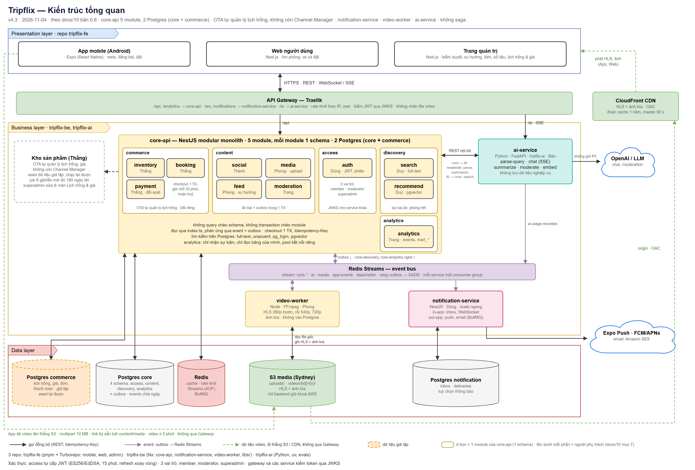

# Tripflix architecture guide — AI service

AI agents: read this file and [RULES.md](RULES.md) before changing code.

## Canonical system architecture

> The PNG preview above is still v4.5 (it shows a separate `commerce` database). The editable `.drawio` file is v4.7 (2026-11-05, replaces v4.6) and is canonical: `commerce` is a schema in the `core` database. Re-export the PNG from the `.drawio` file.

The editable diagram is the canonical system view (v4.7, 2026-11-05). `tripflix-ai` is a stateless FastAPI service behind Traefik, not a direct Front Office or Back Office client. `core-api` calls it over the internal REST interface for parsing, moderation, and summarization; the AI service calls back only through the Core API contract for search. It emits usage events to Redis Streams and does not store business data. The diagram says no PII is sent to the external LLM provider.

The [editable diagram](docs/architecture/06-kien-truc-tong-quan.drawio) is the source for the preview. Supporting decisions and repo structure are in [architecture doc 10](docs/architecture/10-de-xuat-kien-truc-va-repo.md) and [architecture doc 11](docs/architecture/11-de-xuat-cau-truc-repo.md). If a supporting document conflicts with the v4.7 diagram, flag the conflict and follow the diagram until the architecture is reconciled.

## AI service boundaries

- Keep this service stateless; read and write business data only through Core API contracts.
- Version prompts instead of replacing prompts already in use.
- Read credentials from environment settings. Record usage costs through the agreed event contract.
- Treat `contracts/` as generated output; update its source and regenerate it.
- Follow `RULES.md` for ownership, evaluations, checks, and branch workflow.
