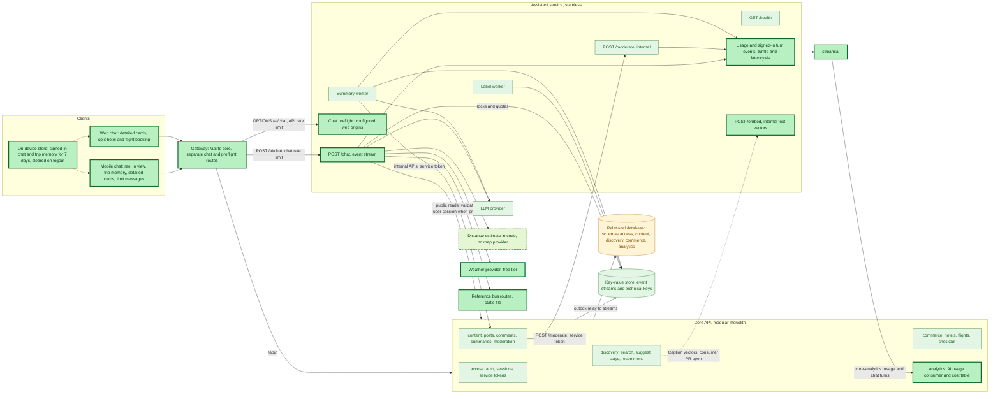
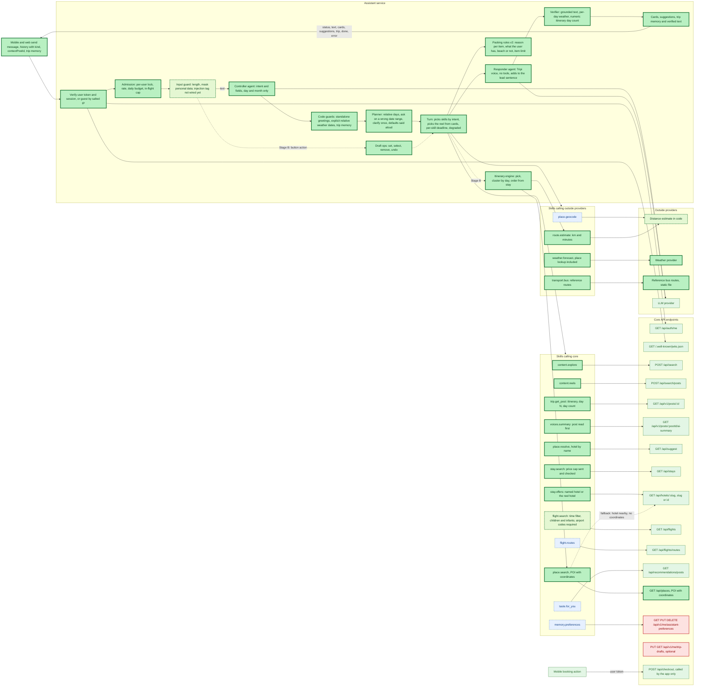
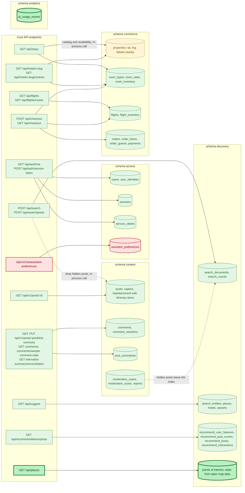
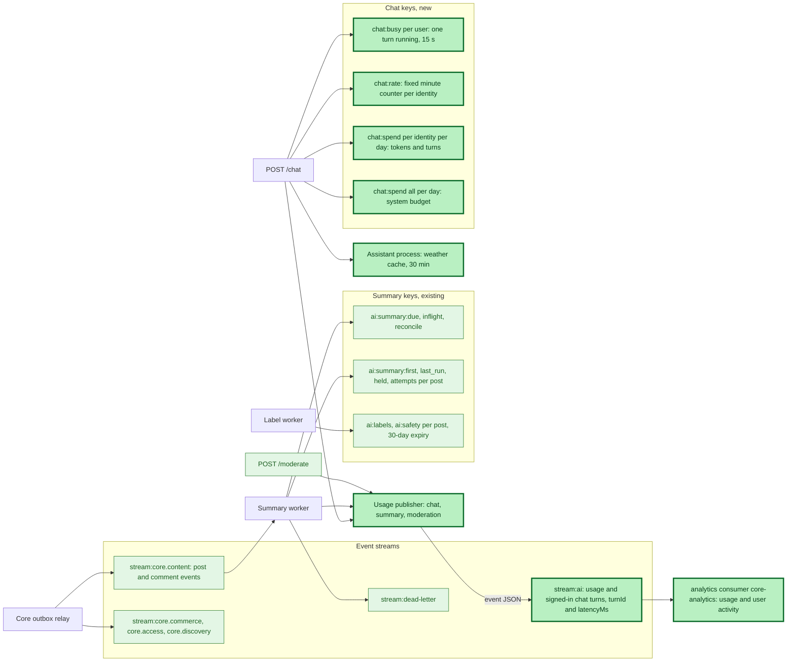
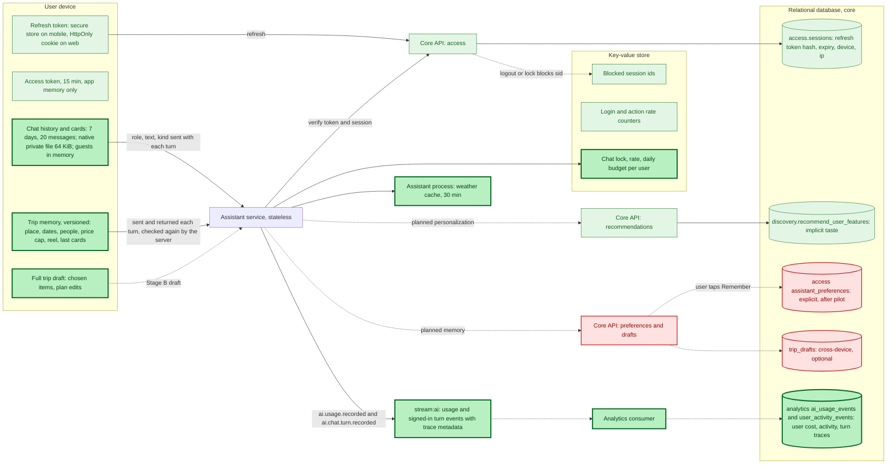

# Tripi: kiến trúc chi tiết nối với core và database

- **Ngày** 2026-11-19 · **Người viết** Bảo (dùng AI) · **Trạng thái v1.1**. Tripi có trên mobile và web; phần đã merge tô xanh đậm, runtime ghi riêng. Việc còn lại ở mục 7.
- **v1.1 (19/11).** Đã đối chiếu trạng thái PR trên GitHub ngày 19/11; “đã merge” không thay cho xác nhận image đang chạy.
  - ✅ Lộ trình lồng dịch vụ: hỏi nơi đi/ngày trước; đủ thì tìm song song vé đi sớm nhất còn chỗ, khách sạn Tripflix, điểm/thời tiết và vé về muộn nhất. `CardLine.service` đánh dấu `flight`/`stay`; `Card.actions` có `select`/`book`, Controller v9 có `confirm_booking`. Chốt kiểm lại phòng và vé cả chiều về. Nơi không có tuyến bay dùng xe tham khảo, không có nút combo. [AI #46](https://github.com/Sukemcute/tripflix-ai/pull/46) · [AI #47](https://github.com/Sukemcute/tripflix-ai/pull/47)
  - ✅ Mobile và web đều có Tripi; quyết định “chỉ mobile” ngày 17/11 được thay từ 18/11. Mobile làm nổi dòng dịch vụ; kế hoạch hợp lệ nạp cả điểm, phòng và chuyến bay vào tab Đặt `/(tabs)/book`, thẻ khác vẫn mở `/trip-builder`. Web chưa có trang combo nên tách “Đặt phòng” `/hotels/{id}` và “Đặt vé” `/flights`. [FE #230](https://github.com/Sukemcute/tripflix-fe/pull/230) · [FE #235](https://github.com/Sukemcute/tripflix-fe/pull/235) · [FE #239](https://github.com/Sukemcute/tripflix-fe/pull/239) · [FE #241](https://github.com/Sukemcute/tripflix-fe/pull/241)
  - ✅ Bảo chốt giữ thẻ khi mở lại: phiên lưu cả `cards`, lọc lại như thẻ từ server. Android chuyển từ SecureStore 2.048 byte sang file riêng của app, trần 64 KB; vẫn 7 ngày/20 tin, khách chỉ trong bộ nhớ. [FE #244](https://github.com/Sukemcute/tripflix-fe/pull/244)
  - ✅ `ai.chat.turn.recorded`: mỗi lượt đã đăng nhập, câu hỏi che PII trước rồi cắt 120 ký tự, cùng intent/answerKind/isAction; khách không phát. `turnId` và `latencyMs` nối chi phí từng lần gọi LLM với cả lượt, có cả lỗi/huỷ. Một consumer `core-analytics` đọc chung `stream:ai`; BE có API hành vi, chi phí theo người và trace, admin có trang Hành vi người dùng. [AI #48](https://github.com/Sukemcute/tripflix-ai/pull/48) · [AI #50](https://github.com/Sukemcute/tripflix-ai/pull/50) · [BE #272](https://github.com/Sukemcute/tripflix-be/pull/272) · [BE #278](https://github.com/Sukemcute/tripflix-be/pull/278) · [BE #280](https://github.com/Sukemcute/tripflix-be/pull/280) · [FE #260](https://github.com/Sukemcute/tripflix-fe/pull/260) · [FE #262](https://github.com/Sukemcute/tripflix-fe/pull/262)
  - ✅ ai-service có thêm `POST /embed` (Duy, không thuộc Tripi), multilingual-e5-small INT8, chỉ core gọi; phía discovery dùng caption cho For-you **đang mở**, chưa ghi là đã triển khai. [AI #49](https://github.com/Sukemcute/tripflix-ai/pull/49) · [BE #277](https://github.com/Sukemcute/tripflix-be/pull/277)
  - ✅ Compose dev nhận biến LLM, `CHAT_LLM_ENABLED` mặc định false. Anh Phong xác nhận: 18/11 staging lên `sha-9cd62d2` (AI #46), hạn mức khách 300 lượt/ngày, người dùng 500, trần 3 USD/ngày; 19/11 lên `sha-ea0a96a` (AI #48). `sha-3819dc0` (AI #50) và bản có `/embed` (AI #49) chờ anh Phong đổi `AI_TAG`. [AI #46](https://github.com/Sukemcute/tripflix-ai/pull/46) · [AI #48](https://github.com/Sukemcute/tripflix-ai/pull/48) · [AI #50](https://github.com/Sukemcute/tripflix-ai/pull/50) · [AI #49](https://github.com/Sukemcute/tripflix-ai/pull/49) `ai-summary` chưa có trả 204 rỗng, bài không tồn tại/không được xem vẫn 404. [BE #270](https://github.com/Sukemcute/tripflix-be/pull/270) · [AI #42](https://github.com/Sukemcute/tripflix-ai/pull/42) · [BE #268](https://github.com/Sukemcute/tripflix-be/pull/268) · [BE #260](https://github.com/Sukemcute/tripflix-be/pull/260) · [AI #45](https://github.com/Sukemcute/tripflix-ai/pull/45)
  - 🟡 Còn kiểm giờ tham quan chiều sát giờ đến, mặc định 2 người lớn và ảnh Android/web. Nhánh `phong/TF31-luna-reasoning` đã có ở `tripflix-be` (commit `942b4d5`) nhưng chưa mở PR; việc chuyển Controller sang `gpt-5.6-luna` trên staging **[CẦN NC]**. Cần `OPENAI_REASONING_EFFORT=none`. [AI #47](https://github.com/Sukemcute/tripflix-ai/pull/47) · [FE #239](https://github.com/Sukemcute/tripflix-fe/pull/239) · [FE #244](https://github.com/Sukemcute/tripflix-fe/pull/244) · [BE #270](https://github.com/Sukemcute/tripflix-be/pull/270)
- **Mốc đối chiếu 17/11 (v1.0)**
  - AI: [#36](https://github.com/Sukemcute/tripflix-ai/pull/36) cờ tắt và injection · [#37](https://github.com/Sukemcute/tripflix-ai/pull/37) sân bay theo tên · [#38](https://github.com/Sukemcute/tripflix-ai/pull/38) đủ 100 kịch bản và 50 câu tìm kiếm · [#39](https://github.com/Sukemcute/tripflix-ai/pull/39) Giai đoạn B (Itinerary Engine, bản nháp, Controller v5).
  - BE: [#222](https://github.com/Sukemcute/tripflix-be/pull/222) seed Vũng Tàu · [#227](https://github.com/Sukemcute/tripflix-be/pull/227) `GET /api/places` · [#228](https://github.com/Sukemcute/tripflix-be/pull/228) chi phí AI ở analytics.
  - FE: [#170](https://github.com/Sukemcute/tripflix-fe/pull/170) thẻ chuyến bay · [#175](https://github.com/Sukemcute/tripflix-fe/pull/175) thẻ kế hoạch có nút Chọn, Hoàn tác · [#176](https://github.com/Sukemcute/tripflix-fe/pull/176) trang admin Chi phí AI.
- **Mốc đối chiếu 16/11**
  - `tripflix-ai` `develop@20e0a9d`. Hai agent và bộ nhớ chuyến đi, sửa cấu hình, hồi quy demo, producer TF95, giữ đúng ngày đặt phòng và bỏ điểm đến khi người dùng đổi ý. [AI #30](https://github.com/Sukemcute/tripflix-ai/pull/30) · [#31](https://github.com/Sukemcute/tripflix-ai/pull/31) · [#32](https://github.com/Sukemcute/tripflix-ai/pull/32) · [#33](https://github.com/Sukemcute/tripflix-ai/pull/33) · [#34](https://github.com/Sukemcute/tripflix-ai/pull/34)
  - `tripflix-be` `develop@51c2c97`; phần Tripi giữ nguyên từ `5ab83c8`. Gateway, cấu hình deploy, preflight cho Web và cải thiện lọc nơi ở Discovery. [BE #206](https://github.com/Sukemcute/tripflix-be/pull/206) · [#207](https://github.com/Sukemcute/tripflix-be/pull/207) · [#214](https://github.com/Sukemcute/tripflix-be/pull/214) · [#215](https://github.com/Sukemcute/tripflix-be/pull/215)
  - `tripflix-fe` `develop@088f412` (thêm `aad75ee` vuốt đóng chat, `258d0fe` bản EAS preview gọi AI staging). Màn chat mobile, lưu phiên, đăng nhập quay lại Tripi và lọc lượt bị từ chối. [FE #164](https://github.com/Sukemcute/tripflix-fe/pull/164) · [#165](https://github.com/Sukemcute/tripflix-fe/pull/165)
- [Draw.io cùng thư mục](tripi-agent-kien-truc-chi-tiet.drawio) mở ở trang use case. Các tab sau thể hiện kiến trúc và trạng thái triển khai.
- **Thiết kế đi kèm:**
  - [tripi-agent-v3-de-xuat.md](tripi-agent-v3-de-xuat.md): 2 agent.
  - [DeepResearch_Tripi_tro_ly_du_lich_day_du.md](../research/reports/DeepResearch_Tripi_tro_ly_du_lich_day_du.md): Skill, Engine, Draft.
  - [DeepResearch_Tripi_2_agent_SWE.md](../research/reports/DeepResearch_Tripi_2_agent_SWE.md): hạn mức, bộ nhớ.

## Chú giải màu

| Màu | Nghĩa |
|---|---|
| 🟩 Xanh | Đã có trong code, dùng được ngay |
| 🟨 Vàng | Đã có nhưng thiếu dữ liệu hoặc phải sửa |
| 🟥 **Đỏ** | **API, bảng, khóa hoặc nguồn dữ liệu chưa có** |
| 🟦 Xanh dương, viền đứt | Thành phần bên trong ai-service sẽ viết mới (không phải API) |
| ✅ **Xanh đậm, viền dày** | **Đã xong trong code và đã merge vào `develop`**. Kiểm tra runtime được ghi riêng |
| Xanh nhạt, viền đứt | Đã xây một phần |

Nhãn trong sơ đồ dùng tiếng Anh, mô tả chung, không gắn tên công nghệ (CONTEXT §6). Tên endpoint và tên bảng là tên thật trong code.

---

## 1. Toàn hệ thống

**Ghi chú từng ô vàng và đỏ:**

| Thành phần | Vì sao | Chủ |
|---|---|---|
| Web: khung trợ lý ✅ | Dũng làm, apps/web do Thành phụ trách. Có thẻ/nút, nhưng combo tách phòng và vé; chưa có trang đặt theo lộ trình. [FE #230](https://github.com/Sukemcute/tripflix-fe/pull/230) · [FE #235](https://github.com/Sukemcute/tripflix-fe/pull/235) · [FE #239](https://github.com/Sukemcute/tripflix-fe/pull/239) | Dũng, Thành |
| Mobile chat ✅ | FE #164 và #165 đã merge. App gửi `contextPostId`, `trip`, `kind`; hiện chi tiết thẻ và chip 44; xử lý 409/429/503. Đăng nhập bằng mật khẩu hoặc Google dùng chung đường quay về `/assistant`. Expo Web đã có evidence, còn thiếu ảnh Android | Bảo, chị Trang |
| Lưu trên máy ✅ | 7 ngày/20 tin, lưu cả thẻ và lọc khi khôi phục. Android file riêng 64 KB; web localStorage; logout/đổi tài khoản xoá. [FE #244](https://github.com/Sukemcute/tripflix-fe/pull/244) | Bảo, chị Trang, Thành |
| Gateway ✅ | BE #206 và #214 đã merge. `POST /ai/chat` dùng `rate-limit-chat` 20 request/phút/IP, burst 5. `OPTIONS /ai/chat` dùng `rate-limit-api`. Preflight staging đã trả `200` và cho phép `https://tripflix.io.vn` | Dũng, anh Phong |
| `POST /chat` ✅ | AI #30–#32 có hai agent, `trip`, kiểm đầu ra Controller, SSE và sửa hồi quy lời chào, ngày dự báo và stream lộ trình | Bảo |
| Producer usage ✅ | AI #33 phát `ai.usage.recorded` v1 vào `stream:ai` từ chat, tóm tắt và kiểm duyệt | Bảo |
| Analytics consumer ✅ | Cùng consumer `core-analytics` đọc usage và lượt chat ở stream:ai; bảng ai_usage_events/user_activity_events, API hành vi, chi phí theo người và trace. Admin có trang hành vi. [BE #272](https://github.com/Sukemcute/tripflix-be/pull/272) · [BE #278](https://github.com/Sukemcute/tripflix-be/pull/278) · [BE #280](https://github.com/Sukemcute/tripflix-be/pull/280) · [FE #260](https://github.com/Sukemcute/tripflix-fe/pull/260) · [FE #262](https://github.com/Sukemcute/tripflix-fe/pull/262) | chị Trang |
| Database ✅ | Core có bảng usage và hành vi; sở thích dặn nhớ (M3b) và bản nháp dùng chung nhiều máy vẫn chưa làm. [BE #272](https://github.com/Sukemcute/tripflix-be/pull/272) · [BE #278](https://github.com/Sukemcute/tripflix-be/pull/278) | chị Trang |
| Thời tiết ✅; quãng đường và xe khách ✅ (ước tính) | Quãng đường = đường chim bay × 1,3, ghi "ước tính". Xe khách là tuyến mẫu, nhãn "Tham khảo", không giá. Chưa dùng nhà cung cấp bản đồ | Bảo, mentor |

---

## 2. Bên trong `POST /chat` và các API core mà Skill gọi

**Cách đọc:**
- `skills/` hiện có tìm video, chỗ ở (có trần giá), vé (lọc giờ, gộp hạng vé), đọc lộ trình và tóm tắt theo reel, kiểm phòng (khách sạn gọi tên hoặc của reel), thời tiết và checklist. Tìm vé còn phụ thuộc mã IATA.
- ✅ Discovery giữ được bài chưa có nơi chuẩn hóa nếu caption nhắc đúng nơi đang tìm. Bài chưa rõ nơi nhưng chỉ khớp từ chính được đưa vào nhóm kết quả thay thế của Core. [BE #215](https://github.com/Sukemcute/tripflix-be/pull/215)
- `voices.summary` vẫn đọc bài trước. Bài hiển thị nhưng chưa có tóm tắt: 204 rỗng; 404 vẫn cho bài thiếu/không được xem, AI còn nhận 404 từ core cũ. Có bản: 200, ETag/304 giữ nguyên. [BE #260](https://github.com/Sukemcute/tripflix-be/pull/260) · [AI #45](https://github.com/Sukemcute/tripflix-ai/pull/45)
- Ô "Code guards" (v0.7): eval live đầu tiên của Controller v3 chỉ đạt 78,6%; sau khi thêm lớp này đạt 95,2%.
- Các đường liên quan đến `Trip Draft`, chỉ đường, tuyến xe và Itinerary Engine thuộc Giai đoạn B.
- **Không có mũi tên nào từ ai-service tới `POST /api/checkout`.** Chỉ app gọi, bằng token của người dùng.

**Các API core chưa có (🟥):**

| API | Để làm gì | Thuộc module, chủ | Có thể thay tạm |
|---|---|---|---|
| `GET /api/places?near=&types=&radiusKm=` | POI có tọa độ (điểm tham quan, ăn uống) cho R5, R7, R11 | discovery, Duy. Loại `see/food/cafe` đã có trong hợp đồng `/api/search` nhưng rỗng | `nearby` của khách sạn (có tên và khoảng cách, không có tọa độ) + adapter seed hoặc map provider ở ai-service |
| `GET/PUT/DELETE /api/v1/me/assistant-preferences` | Bộ nhớ dài hạn M3b, chỉ ghi khi người dùng bấm "Nhớ" | access, Dũng (dữ liệu của user) | Không cần trong pilot |
| `PUT/GET /api/v1/me/trip-drafts` | Lưu bản nháp chuyến đi để đổi máy vẫn còn (cách B, báo cáo trợ lý đầy đủ §5.1) | content hoặc commerce, Thành hoặc Thắng | Client giữ draft (cách A, đề xuất) |

---

## 3. API core → module → bảng database

Chỉ vẽ phần Tripi và worker tóm tắt dùng. Bảng lấy từ `apps/core-api/src/modules/*/db/schema` [CODE].

**Ghi chú:**
- 🟨 `commerce.properties`: có `lat`, `lng` và `details.nearby` (tên + km) cho cả 2.200 khách sạn [CODE: seed], nhưng `nearby` không có tọa độ. Vũng Tàu chỉ có 1 khách sạn.
- ✅ `analytics`: bảng `ai_usage_events` (BE #228). Bảng `events` chung và `mart_*` vẫn thuộc TF60.
- Discovery không đọc bảng của module khác. Nó gọi `CommerceFacade`, `ContentFacade` trong cùng process (README discovery) [CODE]. Mũi tên nét đứt là lời gọi trong process, không phải truy vấn chéo schema.
- ai-service **không có mũi tên nào tới database** (RULES §10).

---

## 4. Bộ lưu khóa-giá trị: stream và khóa kỹ thuật

- Khóa admission không chứa nội dung chat. Riêng stream:ai có excerpt question đã che PII rồi cắt 120 ký tự, chỉ cho lượt đăng nhập; không lưu toàn bộ prompt/câu trả lời. Không ghi question vào log khi publish lỗi. [AI #48](https://github.com/Sukemcute/tripflix-ai/pull/48)
- ✅ `ai.usage.recorded` v1 do chat, worker tóm tắt và kiểm duyệt phát vào `stream:ai`. Các luồng dùng chung envelope camelCase với `eventId`, `occurredAt` và `userId` có thể null. Nếu ghi Redis lỗi, envelope được ghi vào log `ai.usage.publish_failed`. [Hợp đồng v1](https://github.com/Sukemcute/tripflix-ai/blob/4e9bb7d/contracts/events/ai.usage.recorded.v1.schema.json)
- ✅ BE #228: consumer ghi theo `eventId` nên giao lại không cộng trùng; payload sai hợp đồng thì bỏ qua. Trang admin "Chi phí AI" (FE #176) đọc `GET /api/analytics/ai-usage`. [SCRUM-123](https://tripflix.atlassian.net/browse/SCRUM-123)

---

- `turnId` dùng chung cho usage controller/responder và sự kiện lượt; `latencyMs` ở usage đo provider, ở lượt đo từ request tới, gồm cả lỗi/huỷ. BE nhận cả giá trị null; một consumer chung tránh chia mất sự kiện. [AI #50](https://github.com/Sukemcute/tripflix-ai/pull/50) · [BE #272](https://github.com/Sukemcute/tripflix-be/pull/272) · [BE #280](https://github.com/Sukemcute/tripflix-be/pull/280)

## 5. Hợp đồng `POST /chat`: phần có và phần thêm

| Trường hoặc sự kiện | Trạng thái | Ghi chú |
|---|---|---|
| `conversationId`, `message`, `history[{role, text}]` | 🟩 có | |
| `history[].kind` | ✅ đã xong ở AI và app | Dùng cùng `trip.asked` để tránh hỏi lại nhiều lần. FE #165 lọc lượt bị từ chối |
| `searchMode` | 🟩 có | |
| `contextPostId` | ✅ có (PR1, dùng ở PR2); ✅ app gửi khi mở Tripi từ reel (PR3) | Reel đang xem (R4) |
| `trip` (request) và SSE `trip` | ✅ có (PR5); ✅ app giữ và gửi lại (PR3) | Bộ nhớ chuyến đi bản gọn, version `v=1`: nơi, ngày đi/về, số người, trần giá, reel đang chọn, `lastCards` ≤ 5, `asked`. Server kiểm lại mọi thứ |
| `tripDraft` | ✅ AI #39 | Nằm trong `trip` v2: `stay`, `transport`, `days`, `pending`, `ops` (≤ 5 phép để hoàn tác) |
| `action` (bấm nút Chọn, Bỏ, Hoàn tác) | ✅ AI #39, FE #175 | Không gọi LLM |
| `Card.actions` và `CardLine.service` | ✅ AI/FE | Select/book do code tạo; service flight/stay được tô nổi. [AI #46](https://github.com/Sukemcute/tripflix-ai/pull/46) · [AI #47](https://github.com/Sukemcute/tripflix-ai/pull/47) · [FE #239](https://github.com/Sukemcute/tripflix-fe/pull/239) |
| `returnTransport` | ✅ trường bổ sung trong trip | Chọn vé về muộn nhất, chốt kiểm lại cả chiều về. [AI #47](https://github.com/Sukemcute/tripflix-ai/pull/47) |
| `noMemory` | 🟥 chưa có | Chế độ "không nhớ" (M3) |
| SSE `status`, `text`, `cards`, `done`, `error` | ✅ có; `text` gửi theo từng câu (PR2) | Thêm bước `searching`, `writing` |
| SSE `draft` | — không cần | Bản nháp trả trong sự kiện `trip` có sẵn |
| `done.degraded`, thẻ mới, chip | ✅ có ở AI (PR2); sự kiện `suggestions`; thẻ `weather`, `checklist`, `itinerary`, `summary` có `lines`, `source` | ✅ PR3: hiện dòng và nguồn, chip bấm là gửi, thẻ lộ trình có nút. App vẫn chờ hết body SSE rồi mới hiển thị |
| HTTP 409, 429, 503 có `retryAfterSeconds` | ✅ có, kèm `loginRequired` cho khách | ✅ khách hết lượt có nút Đăng nhập. Sau đăng nhập quay lại `/assistant` (FE #165) |

Mọi thay đổi chỉ là **thêm** trường; client cũ vẫn chạy. Sinh lại `contracts/openapi/ai-service.json`, FE chạy `pnpm gen:api` (RULES §4.1).

Action book chỉ có path `/trip-builder`; params gồm điểm đến, số người, ngày/số ngày, khách sạn/ngày nhận/số đêm và tuyến/ngày đi–về khi còn bán. Không có giá, mã phòng hoặc mã hạng vé. Mobile chuyển kế hoạch hợp lệ vào `/(tabs)/book`; thẻ khác vẫn mở builder. Web tạo link phòng/vé từ params, không mở path bất kỳ do server gửi. [AI #47](https://github.com/Sukemcute/tripflix-ai/pull/47) · [FE #235](https://github.com/Sukemcute/tripflix-fe/pull/235) · [FE #241](https://github.com/Sukemcute/tripflix-fe/pull/241)

---

## 6. Dữ liệu nào lưu ở đâu: phiên, lịch sử chat, bộ nhớ

Thêm ngày 16/11. Chi tiết về bộ nhớ ở [báo cáo SWE §3A](../research/reports/DeepResearch_Tripi_2_agent_SWE.md).

### 6.1. Quy tắc chọn chỗ lưu

| Chỗ lưu | Dùng cho | Ví dụ ở Tripflix |
|---|---|---|
| **Database quan hệ ở core** | Nguồn sự thật: phải bền, cần truy vấn hoặc transaction, phải xem và xóa được theo luật | phiên đăng nhập, đơn, sở thích dài hạn |
| **Bộ lưu khóa-giá trị** | Dữ liệu sống ngắn, đọc ghi liên tục, **mất cũng chấp nhận được**, có hạn giờ | chặn `sid`, đếm đăng nhập sai, hạn mức chat và khóa 1 lượt |
| **Máy người dùng** | Dữ liệu làm việc của chính người đó | refresh token, giỏ hàng, lịch sử chat, bản nháp chuyến đi |

**Hai luật cứng:**
- ai-service không có database riêng và không lưu dữ liệu nghiệp vụ (RULES §10). Redis dùng cho khóa, bộ đếm và sự kiện kỹ thuật, gồm usage TF95. Lịch sử chat nằm trên máy người dùng.
- Dữ liệu trên máy người dùng **không bao giờ được tin**. Mỗi lượt, server kiểm lại mọi ID bằng API của core.

### 6.2. Sơ đồ

### 6.3. Phiên đăng nhập: đã có, do core quản lý [CODE]

| Thứ | Lưu ở đâu | Bằng chứng |
|---|---|---|
| Phiên (mỗi máy một dòng): hash refresh token, hạn, tên máy, IP, lần dùng cuối | `access.sessions` | `access/db/schema/index.ts:53` |
| `sid` bị chặn (đăng xuất, khóa tài khoản: token cũ bị 401 ngay) | Bộ lưu khóa-giá trị (`RedisSidBlocklist`) | `access.module.ts:84`, `account.use-cases.ts:40` |
| Đếm đăng nhập sai, giới hạn thao tác | Bộ lưu khóa-giá trị | `RedisLoginRateLimiter`, `RedisActionRateLimiter` |
| Refresh token trên mobile | `expo-secure-store` | FE `apps/mobile/src/app/_layout.tsx:23` |
| Refresh token trên web | Cookie HttpOnly `tripflix_refresh` | `auth.controller.ts:59` |
| Access token (JWT, 15 phút) | Bộ nhớ app hoặc trình duyệt | suy từ `http.ts` [CẦN KIỂM] |

ai-service không giữ gì về phiên. Mỗi lượt nó kiểm chữ ký JWT bằng JWKS, rồi gọi `GET /api/auth/me`; core trả lời dựa trên `access.sessions` và danh sách `sid` bị chặn.

### 6.4. Phiên chat và dữ liệu của Tripi

| Thứ | Hôm nay [CODE] | Đề xuất cho pilot | Sau pilot |
|---|---|---|---|
| Lịch sử chat (M1) | ✅ Tin, kind, cards và trip lưu trên máy 7 ngày; Android file riêng, web localStorage; guest chỉ trong bộ nhớ | Tối đa 20 tin; native 64 KB. Thiếu chỗ bỏ thẻ cũ trước, giữ thẻ mới lâu nhất. Lượt bị từ chối và chip không lưu. [FE #244](https://github.com/Sukemcute/tripflix-fe/pull/244) | Lưu ở core nếu cần xem lại trên mọi máy |
| Bộ nhớ chuyến đi (M2, bản gọn) | ✅ `trip` do app giữ và gửi lại mỗi lượt. Server kiểm lại các trường và ID cần dùng | Khôi phục cùng phiên đã lưu | — |
| Bản nháp đầy đủ (M2: chọn khách sạn, sửa kế hoạch) | ✅ trip có stay, transport/returnTransport, days, pending, ops | Máy người dùng; chốt kiểm lại core. [AI #46](https://github.com/Sukemcute/tripflix-ai/pull/46) · [AI #47](https://github.com/Sukemcute/tripflix-ai/pull/47) | trip_drafts ở core để đổi máy vẫn còn |
| Hạn mức, khóa 1 lượt, cache | Hạn mức và khóa có ở Redis; cache thời tiết 30 phút trong tiến trình AI | Cân nhắc chia sẻ cache khi tăng số tiến trình | — |
| Gu ngầm (M3a) | Có ở core (`discovery.recommend_user_features`, làm mới mỗi 10 phút) | Đọc qua `GET /api/recommendations/posts` | — |
| Sở thích dặn nhớ (M3b) | Chưa có | Không làm | `assistant_preferences` ở `access`; chỉ ghi khi người dùng bấm "Nhớ" |
| Chi phí theo tính năng, ngày, model | ✅ Usage có userId/conversationId/turnId/latencyMs; lượt đăng nhập thêm câu hỏi đã che | BE lưu chi phí theo người và trace; API superadmin, liên kết người bị bỏ sau 90 ngày. [AI #48](https://github.com/Sukemcute/tripflix-ai/pull/48) · [AI #50](https://github.com/Sukemcute/tripflix-ai/pull/50) · [BE #278](https://github.com/Sukemcute/tripflix-be/pull/278) · [BE #280](https://github.com/Sukemcute/tripflix-be/pull/280) | Không lưu prompt/câu trả lời đầy đủ |

**Vì sao pilot lưu trên máy mà không lưu ở server:**
- PRD F9 chỉ yêu cầu "đăng nhập giữa chừng không mất hội thoại". Lưu trên máy là đủ.
- Không thêm bảng, API, migration ở core.
- Không thêm nghĩa vụ lưu và xóa dữ liệu cá nhân ở server (Luật Bảo vệ dữ liệu cá nhân 2025).
- Team đã làm đúng kiểu này cho giỏ hàng: `cart-store.ts` dùng `expo-secure-store` trên mobile, `localStorage` trên web, "không thêm thư viện".

### 6.5. Hành vi mở lại phiên

**Trong pilot**, phiên lưu giữ text, loại phản hồi, thẻ và `trip` đầy đủ trên cùng máy (FE #244). Ví dụ, người dùng đang đăng nhập mở lại chat cùng máy và hỏi về Reel đã chọn. App gửi các tin gần nhất và `trip`, rồi AI kiểm lại Reel với core. Chọn khách sạn/chuyến bay đã dựng lại lịch và nút đặt. [AI #47](https://github.com/Sukemcute/tripflix-ai/pull/47) · [FE #244](https://github.com/Sukemcute/tripflix-fe/pull/244)

| Tình huống | Nhớ không | Vì sao |
|---|---|---|
| Cùng máy, mở lại trong 7 ngày, vẫn đăng nhập | **Có** | Khôi phục tin và `trip` đã lưu trong giới hạn thiết bị |
| Chat dài | **Dùng ngữ cảnh gọn** | App gửi tối đa 20 tin hợp lệ, server nhận tối đa 30; không gửi lại cards trong history. [AI #42](https://github.com/Sukemcute/tripflix-ai/pull/42) |
| Ngày trong `trip` đã qua | **Kiểm lại ngày** | Planner áp dụng quy tắc của luồng thời tiết hoặc chỗ ở |
| Đổi máy, hoặc web sau khi chat trên điện thoại | **Không** | Dữ liệu chỉ nằm trên máy cũ |
| Cài lại app, xóa dữ liệu app | **Không** | Mất dữ liệu trên máy |
| Đăng xuất rồi đăng nhập lại | **Không** | Đăng xuất phải xóa, để người dùng chung máy không thấy chat của nhau |
| Khách chat rồi đăng nhập | **Có** | FE #165 quay về `/assistant`, giữ phiên đang mở và lưu các lượt hợp lệ |
| Quá 7 ngày | **Không** | Hết hạn lưu (chỉnh được) |
| Cuộc chat mới hoàn toàn | **Bắt đầu phiên rỗng** | Gu ở core có thể dùng sau khi nối Skill đề xuất cá nhân hoá |

**Giao diện [ĐỀ XUẤT, chị Trang]:**
- Mở lại mà còn hội thoại cũ thì hiện "Tiếp tục chuyến Vũng Tàu" và "Cuộc trò chuyện mới". Người dùng tự chọn; Tripi không tự kéo ngữ cảnh cũ vào một câu hỏi không liên quan.
- Bấm "Cuộc trò chuyện mới" thì xóa lịch sử và draft cũ trên máy.

### 6.6. Rủi ro bên FE

| Rủi ro | Xử lý | Chủ |
|---|---|---|
| Vượt kích thước kho chat | ✅ Bảo chốt chuyển chat native sang file riêng 64 KB thay SecureStore 2.048 byte; giữ thẻ, chuyển dữ liệu cũ và xoá key cũ, ghi tuần tự. [FE #244](https://github.com/Sukemcute/tripflix-fe/pull/244) | Bảo, chị Trang |
| Lịch sử còn sau đăng xuất | ✅ Khi `user.id` đổi hoặc mất, app xoá phiên trên máy và trong bộ nhớ | Bảo, chị Trang |
| Draft cũ sau khi đổi version | Có trường `v`; server không đọc được thì bỏ draft và nói "mình bắt đầu lại kế hoạch nha" | Bảo |
| `localStorage` trên web đọc được bằng JavaScript (nguy cơ XSS) | Không lưu token hay PII trong draft; chỉ lưu ID và lựa chọn | Thành |

## 7. Danh sách việc ngoài ai-service suy ra từ sơ đồ

Đối chiếu v1.1 (19/11): mobile mở kế hoạch vào tab Đặt, web tách phòng/vé. Merge đã xác nhận bằng PR; ảnh runtime mới vẫn ghi riêng. [FE #241](https://github.com/Sukemcute/tripflix-fe/pull/241) · [FE #239](https://github.com/Sukemcute/tripflix-fe/pull/239)

| # | Việc | Repo, module | Chủ | Trạng thái |
|---|---|---|---|---|
| O1 | Router chat và preflight có hạn mức riêng | be `deploy/traefik` | Dũng | ✅ BE #206 và #214 đã merge |
| O2 | `GET /api/places` + POI có tọa độ (nạp từ OSM) | be discovery | Duy | ✅ BE #227: 630 điểm, 7 thành phố, dữ liệu tĩnh, ghi nguồn ODbL |
| O3 | Usage, lượt chat và trace cho admin | be analytics, fe admin | chị Trang, Thành | ✅ Đã merge: [BE #272](https://github.com/Sukemcute/tripflix-be/pull/272) · [BE #278](https://github.com/Sukemcute/tripflix-be/pull/278) · [BE #280](https://github.com/Sukemcute/tripflix-be/pull/280) · [FE #260](https://github.com/Sukemcute/tripflix-fe/pull/260) · [FE #262](https://github.com/Sukemcute/tripflix-fe/pull/262) |
| O4 | Thẻ dịch vụ, nút đặt và giữ phiên/thẻ khi mở lại | fe mobile, api-client | chị Trang, Bảo, Thắng | ✅ [FE #239](https://github.com/Sukemcute/tripflix-fe/pull/239) · [FE #241](https://github.com/Sukemcute/tripflix-fe/pull/241) · [FE #244](https://github.com/Sukemcute/tripflix-fe/pull/244). 🟡 Ảnh Android/web còn chờ |
| O5 | Tripi web và trang đặt theo lộ trình | fe web | Dũng, Thành | ✅ Chat đã có ([FE #230](https://github.com/Sukemcute/tripflix-fe/pull/230)); ⬜ trang combo chưa có, nút tách phòng/vé ([FE #235](https://github.com/Sukemcute/tripflix-fe/pull/235)) |
| O6 | Chọn điểm demo và bổ sung seed Vũng Tàu | be commerce seed | Thắng, Bảo | ✅ BE #222 thêm khách sạn Vũng Tàu |
| O7 | `assistant-preferences` (sau pilot) | be access | Dũng | ⬜ sau pilot |
| O8 | Deploy cấu hình `CHAT_*` và CORS | deploy | anh Phong | ✅ Đã nạp cấu hình staging. Xác nhận `OPTIONS /ai/chat` trả `200` với `Access-Control-Allow-Origin: https://tripflix.io.vn`. 🟡 Còn kiểm chat khách và chat sau đăng nhập từ Web sau bản sửa, cùng log usage theo tag đang chạy |
| O9 | Đo 10 rồi 30 lượt chat đồng thời với `/moderate` | deploy, ai | anh Phong, Bảo | ⬜ Chờ đo staging với trần 0,5 USD. Đạt khi p95 `/moderate` dưới 3 giây và ai-service không restart do hết RAM |
| O10 | Buổi tham quan ngày đến | ai itinerary | Bảo | 🟡 Đã bỏ sáng/trưa khi đến chiều nhưng điểm chiều vẫn có thể quá sát giờ bay đến. [AI #47](https://github.com/Sukemcute/tripflix-ai/pull/47) |
| O11 | Số khách | ai planner/controller | Bảo | 🟡 Mặc định 2 người lớn nếu chưa nói; cần người dùng xác nhận. [AI #47](https://github.com/Sukemcute/tripflix-ai/pull/47) |
| O12 | Controller mới | deploy, ai | anh Phong, Bảo | Nhánh `phong/TF31-luna-reasoning` đã có ở `tripflix-be` (commit `942b4d5`) nhưng chưa mở PR; việc chuyển Controller sang `gpt-5.6-luna` trên staging **[CẦN NC]**. Cần `OPENAI_REASONING_EFFORT=none`. Điều kiện cấu hình được ghi ở [BE #270](https://github.com/Sukemcute/tripflix-be/pull/270) |
| O13 | Image và hạn mức staging | deploy | anh Phong | ✅ Anh Phong xác nhận: 18/11 staging lên `sha-9cd62d2` (AI #46), hạn mức khách 300 lượt/ngày, người dùng 500, trần 3 USD/ngày; 19/11 lên `sha-ea0a96a` (AI #48). `sha-3819dc0` (AI #50) và bản có `/embed` (AI #49) chờ anh Phong đổi `AI_TAG`. [AI #42](https://github.com/Sukemcute/tripflix-ai/pull/42) · [BE #268](https://github.com/Sukemcute/tripflix-be/pull/268) · [BE #270](https://github.com/Sukemcute/tripflix-be/pull/270) |
| O14 | Nối caption vectors vào For-you | be discovery, ngoài Tripi | Duy | Endpoint AI đã merge; consumer **đang mở**, v1 chưa bật theo mô tả PR. [AI #49](https://github.com/Sukemcute/tripflix-ai/pull/49) · [BE #277](https://github.com/Sukemcute/tripflix-be/pull/277) |
