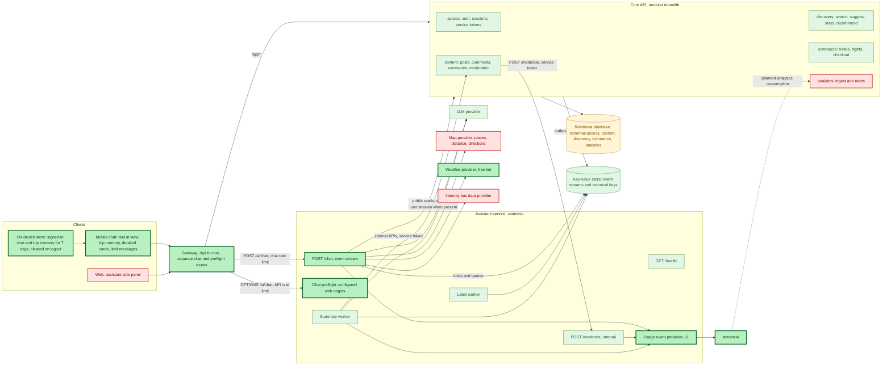
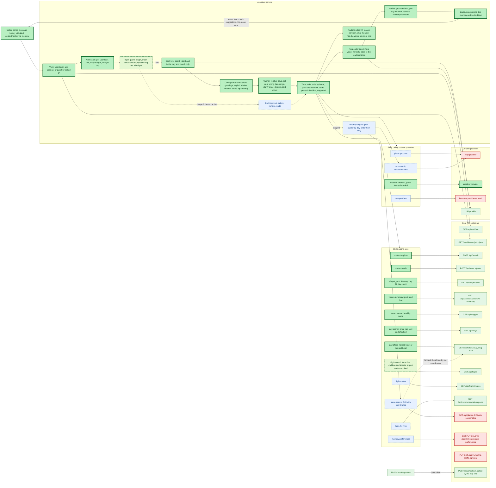
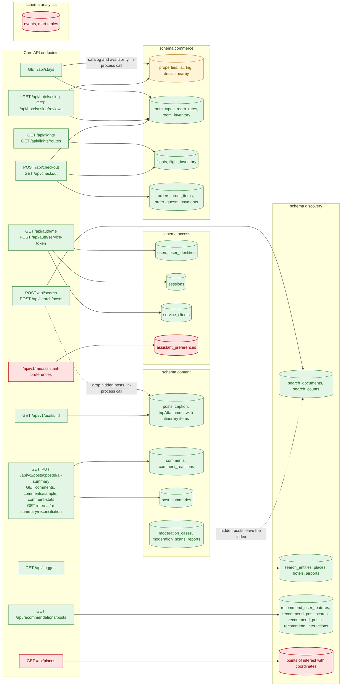
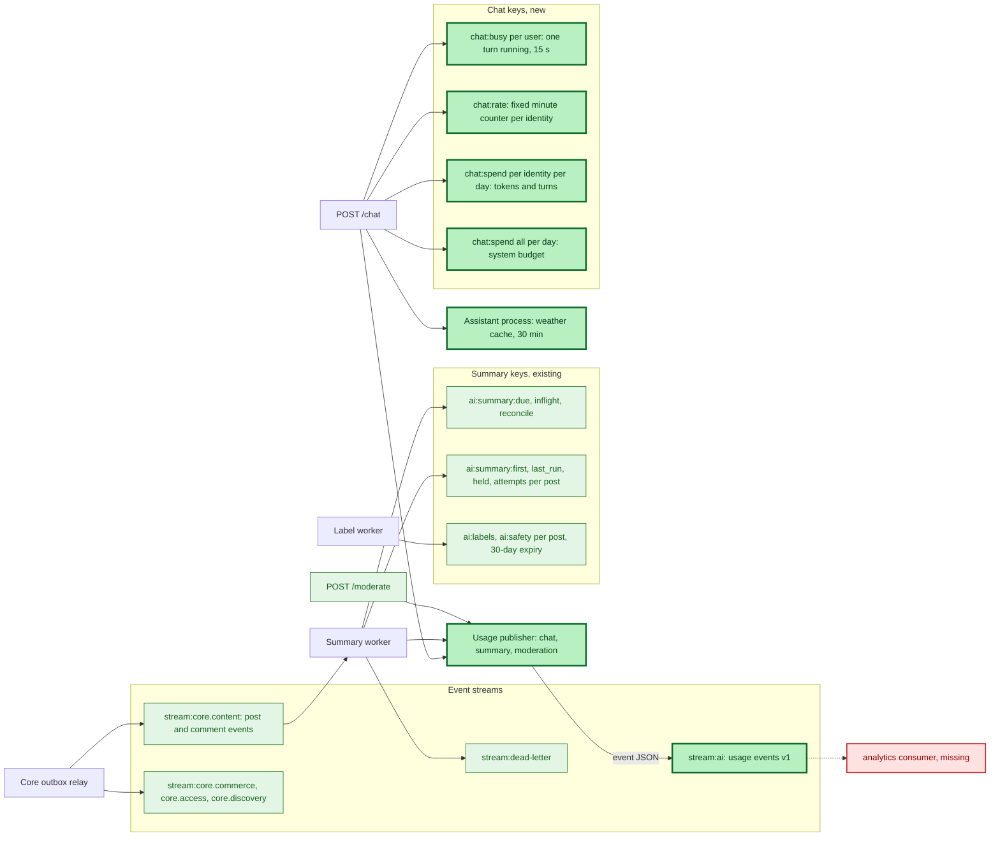
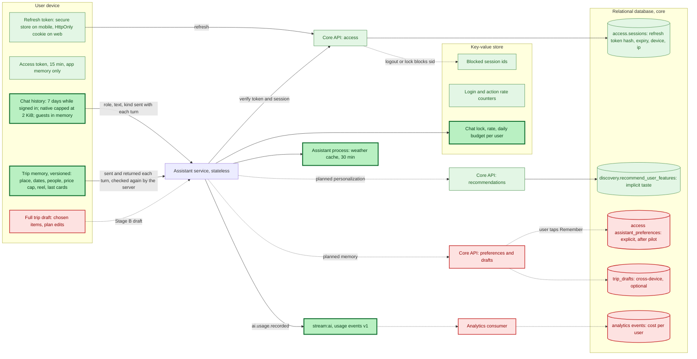

# Tripi: kiến trúc chi tiết nối với core và database

- **Ngày** 2026-11-16 · **Người viết** Bảo (dùng AI) · **Trạng thái v0.9**. Các phần TF31 đã merge vào `develop` được tô xanh đậm. Xác nhận trên môi trường chạy và phần analytics còn lại được ghi tại mục 7.
- **Mốc đối chiếu 16/11**
  - `tripflix-ai` `develop@20e0a9d`. Hai agent và bộ nhớ chuyến đi, sửa cấu hình, hồi quy demo, producer TF95, giữ đúng ngày đặt phòng và bỏ điểm đến khi người dùng đổi ý. [AI #30](https://github.com/Sukemcute/tripflix-ai/pull/30) · [#31](https://github.com/Sukemcute/tripflix-ai/pull/31) · [#32](https://github.com/Sukemcute/tripflix-ai/pull/32) · [#33](https://github.com/Sukemcute/tripflix-ai/pull/33) · [#34](https://github.com/Sukemcute/tripflix-ai/pull/34)
  - `tripflix-be` `develop@51c2c97`; phần Tripi giữ nguyên từ `5ab83c8`. Gateway, cấu hình deploy, preflight cho Web và cải thiện lọc nơi ở Discovery. [BE #206](https://github.com/Sukemcute/tripflix-be/pull/206) · [#207](https://github.com/Sukemcute/tripflix-be/pull/207) · [#214](https://github.com/Sukemcute/tripflix-be/pull/214) · [#215](https://github.com/Sukemcute/tripflix-be/pull/215)
  - `tripflix-fe` `develop@088f412` (thêm `aad75ee` vuốt đóng chat, `258d0fe` bản EAS preview gọi AI staging). Màn chat mobile, lưu phiên, đăng nhập quay lại Tripi và lọc lượt bị từ chối. [FE #164](https://github.com/Sukemcute/tripflix-fe/pull/164) · [#165](https://github.com/Sukemcute/tripflix-fe/pull/165)
- [Draw.io cùng thư mục](tripi-agent-kien-truc-chi-tiet.drawio) mở ở trang use case. Các tab sau thể hiện kiến trúc và trạng thái triển khai.
- **Thiết kế đi kèm:**
  - [tripi-agent-v3-de-xuat.md](tripi-agent-v3-de-xuat.md): 2 agent.
  - [DeepResearch_Tripi_tro_ly_du_lich_day_du.md](../research/reports/DeepResearch_Tripi_tro_ly_du_lich_day_du.md): Skill, Engine, Draft.
  - [DeepResearch_Tripi_2_agent_SWE.md](../research/reports/DeepResearch_Tripi_2_agent_SWE.md): hạn mức, bộ nhớ.

## Chú giải màu

| Màu | Nghĩa |
|---|---|
| 🟩 Xanh | Đã có trong code, dùng được ngay |
| 🟨 Vàng | Đã có nhưng thiếu dữ liệu hoặc phải sửa |
| 🟥 **Đỏ** | **API, bảng, khóa hoặc nguồn dữ liệu chưa có** |
| 🟦 Xanh dương, viền đứt | Thành phần bên trong ai-service sẽ viết mới (không phải API) |
| ✅ **Xanh đậm, viền dày** | **Đã xong trong code và đã merge vào `develop`**. Kiểm tra runtime được ghi riêng |
| Xanh nhạt, viền đứt | Đã xây một phần |

Nhãn trong sơ đồ dùng tiếng Anh, mô tả chung, không gắn tên công nghệ (CONTEXT §6). Tên endpoint và tên bảng là tên thật trong code.

---

## 1. Toàn hệ thống

**Ghi chú từng ô vàng và đỏ:**

| Thành phần | Vì sao | Chủ |
|---|---|---|
| Web: khung trợ lý 🟥 | Trong `apps/web` chưa có màn chat Tripi; mới có trên mobile [CODE: FE] | Thành |
| Mobile chat ✅ | FE #164 và #165 đã merge. App gửi `contextPostId`, `trip`, `kind`; hiện chi tiết thẻ và chip 44; xử lý 409/429/503. Đăng nhập bằng mật khẩu hoặc Google dùng chung đường quay về `/assistant`. Expo Web đã có evidence, còn thiếu ảnh Android | Bảo, chị Trang |
| Lưu trên máy ✅ | Lưu 7 ngày khi còn đăng nhập, tính từ lần lưu gần nhất. Khách chỉ giữ phiên trong bộ nhớ app. Đăng xuất hoặc đổi tài khoản sẽ xoá phiên. Lượt bị từ chối và thẻ cũ được loại khỏi dữ liệu lưu ở FE #165 | Bảo, chị Trang |
| Gateway ✅ | BE #206 và #214 đã merge. `POST /ai/chat` dùng `rate-limit-chat` 20 request/phút/IP, burst 5. `OPTIONS /ai/chat` dùng `rate-limit-api`. Preflight staging đã trả `200` và cho phép `https://tripflix.io.vn` | Dũng, anh Phong |
| `POST /chat` ✅ | AI #30–#32 có hai agent, `trip`, kiểm đầu ra Controller, SSE và sửa hồi quy lời chào, ngày dự báo và stream lộ trình | Bảo |
| Producer usage ✅ | AI #33 phát `ai.usage.recorded` v1 vào `stream:ai` từ chat, tóm tắt và kiểm duyệt | Bảo |
| Analytics consumer 🟥 | Module và schema đã khai báo. Consumer, bảng sự kiện và số liệu Admin thuộc TF95/TF60 | chị Trang |
| Database 🟨 | Schema `analytics` trống | chị Trang |
| Thời tiết ✅; map và xe khách 🟥 | Dự báo Open-Meteo đã có; chỉ đường và nguồn xe khách thuộc Giai đoạn B. | Bảo, mentor |

---

## 2. Bên trong `POST /chat` và các API core mà Skill gọi

**Cách đọc:**
- `skills/` hiện có tìm video, chỗ ở (có trần giá), vé (lọc giờ, gộp hạng vé), đọc lộ trình và tóm tắt theo reel, kiểm phòng (khách sạn gọi tên hoặc của reel), thời tiết và checklist. Tìm vé còn phụ thuộc mã IATA.
- ✅ Discovery giữ được bài chưa có nơi chuẩn hóa nếu caption nhắc đúng nơi đang tìm. Bài chưa rõ nơi nhưng chỉ khớp từ chính được đưa vào nhóm kết quả thay thế của Core. [BE #215](https://github.com/Sukemcute/tripflix-be/pull/215)
- `voices.summary` đọc `GET /api/v1/posts/:id` trước. Nếu bài hiển thị, cả `404` của `ai-summary` và phản hồi `200` có `summary: null`, `content: null`, `keyTakeaways: []` đều được xử lý là chưa có tóm tắt.
- Ô "Code guards" (v0.7): eval live đầu tiên của Controller v3 chỉ đạt 78,6%; sau khi thêm lớp này đạt 95,2%.
- Các đường liên quan đến `Trip Draft`, chỉ đường, tuyến xe và Itinerary Engine thuộc Giai đoạn B.
- **Không có mũi tên nào từ ai-service tới `POST /api/checkout`.** Chỉ app gọi, bằng token của người dùng.

**Các API core chưa có (🟥):**

| API | Để làm gì | Thuộc module, chủ | Có thể thay tạm |
|---|---|---|---|
| `GET /api/places?near=&types=&radiusKm=` | POI có tọa độ (điểm tham quan, ăn uống) cho R5, R7, R11 | discovery, Duy. Loại `see/food/cafe` đã có trong hợp đồng `/api/search` nhưng rỗng | `nearby` của khách sạn (có tên và khoảng cách, không có tọa độ) + adapter seed hoặc map provider ở ai-service |
| `GET/PUT/DELETE /api/v1/me/assistant-preferences` | Bộ nhớ dài hạn M3b, chỉ ghi khi người dùng bấm "Nhớ" | access, Dũng (dữ liệu của user) | Không cần trong pilot |
| `PUT/GET /api/v1/me/trip-drafts` | Lưu bản nháp chuyến đi để đổi máy vẫn còn (cách B, báo cáo trợ lý đầy đủ §5.1) | content hoặc commerce, Thành hoặc Thắng | Client giữ draft (cách A, đề xuất) |

---

## 3. API core → module → bảng database

Chỉ vẽ phần Tripi và worker tóm tắt dùng. Bảng lấy từ `apps/core-api/src/modules/*/db/schema` [CODE].

**Ghi chú:**
- 🟨 `commerce.properties`: có `lat`, `lng` và `details.nearby` (tên + km) cho cả 2.200 khách sạn [CODE: seed], nhưng `nearby` không có tọa độ. Vũng Tàu chỉ có 1 khách sạn.
- 🟥 `analytics`: schema đã khai báo (`pgSchema('analytics')`) nhưng chưa có bảng.
- Discovery không đọc bảng của module khác. Nó gọi `CommerceFacade`, `ContentFacade` trong cùng process (README discovery) [CODE]. Mũi tên nét đứt là lời gọi trong process, không phải truy vấn chéo schema.
- ai-service **không có mũi tên nào tới database** (RULES §10).

---

## 4. Bộ lưu khóa-giá trị: stream và khóa kỹ thuật

- Không có khóa nào chứa nội dung chat (báo cáo SWE §3A.5).
- ✅ `ai.usage.recorded` v1 do chat, worker tóm tắt và kiểm duyệt phát vào `stream:ai`. Các luồng dùng chung envelope camelCase với `eventId`, `occurredAt` và `userId` có thể null. Nếu ghi Redis lỗi, envelope được ghi vào log `ai.usage.publish_failed`. [Hợp đồng v1](https://github.com/Sukemcute/tripflix-ai/blob/4e9bb7d/contracts/events/ai.usage.recorded.v1.schema.json)
- 🟥 Consumer và bảng số liệu chưa có trên `develop` của BE. Khi tích hợp, consumer dùng `eventId` để chống cộng trùng. [SCRUM-123](https://tripflix.atlassian.net/browse/SCRUM-123)

---

## 5. Hợp đồng `POST /chat`: phần có và phần thêm

| Trường hoặc sự kiện | Trạng thái | Ghi chú |
|---|---|---|
| `conversationId`, `message`, `history[{role, text}]` | 🟩 có | |
| `history[].kind` | ✅ đã xong ở AI và app | Dùng cùng `trip.asked` để tránh hỏi lại nhiều lần. FE #165 lọc lượt bị từ chối |
| `searchMode` | 🟩 có | |
| `contextPostId` | ✅ có (PR1, dùng ở PR2); ✅ app gửi khi mở Tripi từ reel (PR3) | Reel đang xem (R4) |
| `trip` (request) và SSE `trip` | ✅ có (PR5); ✅ app giữ và gửi lại (PR3) | Bộ nhớ chuyến đi bản gọn, version `v=1`: nơi, ngày đi/về, số người, trần giá, reel đang chọn, `lastCards` ≤ 5, `asked`. Server kiểm lại mọi thứ |
| `tripDraft` | 🟥 chưa có | Bản nháp đầy đủ M2 (chọn khách sạn, sửa kế hoạch), Giai đoạn B |
| `action` (bấm nút Chọn, Đổi, Bỏ, Hoàn tác) | 🟥 chưa có | Không gọi LLM |
| `noMemory` | 🟥 chưa có | Chế độ "không nhớ" (M3) |
| SSE `status`, `text`, `cards`, `done`, `error` | ✅ có; `text` gửi theo từng câu (PR2) | Thêm bước `searching`, `writing` |
| SSE `draft` | 🟥 chưa có | Trả draft mới |
| `done.degraded`, thẻ mới, chip | ✅ có ở AI (PR2); sự kiện `suggestions`; thẻ `weather`, `checklist`, `itinerary`, `summary` có `lines`, `source` | ✅ PR3: hiện dòng và nguồn, chip bấm là gửi, thẻ lộ trình có nút. App vẫn chờ hết body SSE rồi mới hiển thị |
| HTTP 409, 429, 503 có `retryAfterSeconds` | ✅ có, kèm `loginRequired` cho khách | ✅ khách hết lượt có nút Đăng nhập. Sau đăng nhập quay lại `/assistant` (FE #165) |

Mọi thay đổi chỉ là **thêm** trường; client cũ vẫn chạy. Sinh lại `contracts/openapi/ai-service.json`, FE chạy `pnpm gen:api` (RULES §4.1).

---

## 6. Dữ liệu nào lưu ở đâu: phiên, lịch sử chat, bộ nhớ

Thêm ngày 16/11. Chi tiết về bộ nhớ ở [báo cáo SWE §3A](../research/reports/DeepResearch_Tripi_2_agent_SWE.md).

### 6.1. Quy tắc chọn chỗ lưu

| Chỗ lưu | Dùng cho | Ví dụ ở Tripflix |
|---|---|---|
| **Database quan hệ ở core** | Nguồn sự thật: phải bền, cần truy vấn hoặc transaction, phải xem và xóa được theo luật | phiên đăng nhập, đơn, sở thích dài hạn |
| **Bộ lưu khóa-giá trị** | Dữ liệu sống ngắn, đọc ghi liên tục, **mất cũng chấp nhận được**, có hạn giờ | chặn `sid`, đếm đăng nhập sai, hạn mức chat và khóa 1 lượt |
| **Máy người dùng** | Dữ liệu làm việc của chính người đó | refresh token, giỏ hàng, lịch sử chat, bản nháp chuyến đi |

**Hai luật cứng:**
- ai-service không có database riêng và không lưu dữ liệu nghiệp vụ (RULES §10). Redis dùng cho khóa, bộ đếm và sự kiện kỹ thuật, gồm usage TF95. Lịch sử chat nằm trên máy người dùng.
- Dữ liệu trên máy người dùng **không bao giờ được tin**. Mỗi lượt, server kiểm lại mọi ID bằng API của core.

### 6.2. Sơ đồ

### 6.3. Phiên đăng nhập: đã có, do core quản lý [CODE]

| Thứ | Lưu ở đâu | Bằng chứng |
|---|---|---|
| Phiên (mỗi máy một dòng): hash refresh token, hạn, tên máy, IP, lần dùng cuối | `access.sessions` | `access/db/schema/index.ts:53` |
| `sid` bị chặn (đăng xuất, khóa tài khoản: token cũ bị 401 ngay) | Bộ lưu khóa-giá trị (`RedisSidBlocklist`) | `access.module.ts:84`, `account.use-cases.ts:40` |
| Đếm đăng nhập sai, giới hạn thao tác | Bộ lưu khóa-giá trị | `RedisLoginRateLimiter`, `RedisActionRateLimiter` |
| Refresh token trên mobile | `expo-secure-store` | FE `apps/mobile/src/app/_layout.tsx:23` |
| Refresh token trên web | Cookie HttpOnly `tripflix_refresh` | `auth.controller.ts:59` |
| Access token (JWT, 15 phút) | Bộ nhớ app hoặc trình duyệt | suy từ `http.ts` [CẦN KIỂM] |

ai-service không giữ gì về phiên. Mỗi lượt nó kiểm chữ ký JWT bằng JWKS, rồi gọi `GET /api/auth/me`; core trả lời dựa trên `access.sessions` và danh sách `sid` bị chặn.

### 6.4. Phiên chat và dữ liệu của Tripi

| Thứ | Hôm nay [CODE] | Đề xuất cho pilot | Sau pilot |
|---|---|---|---|
| Lịch sử chat (M1) | ✅ FE #164–#165. Lưu 7 ngày khi còn đăng nhập, tính từ lần lưu gần nhất. Native dùng SecureStore, Expo Web dùng `localStorage`. Khách chỉ giữ phiên trong bộ nhớ app. Đăng xuất hoặc đổi tài khoản sẽ xoá phiên | Tối đa 20 tin lưu. Native có trần 2.048 byte UTF-8 nên có thể giữ ít hơn. Bỏ thẻ, chip và lượt bị từ chối khỏi bản lưu | Lưu ở core nếu cần xem lại trên mọi máy |
| Bộ nhớ chuyến đi (M2, bản gọn) | ✅ `trip` do app giữ và gửi lại mỗi lượt. Server kiểm lại các trường và ID cần dùng | Khôi phục cùng phiên đã lưu | — |
| Bản nháp đầy đủ (M2: chọn khách sạn, sửa kế hoạch) | Chưa có | Giai đoạn B, máy người dùng | `trip_drafts` ở core để đổi máy vẫn còn |
| Hạn mức, khóa 1 lượt, cache | Hạn mức và khóa có ở Redis; cache thời tiết 30 phút trong tiến trình AI | Cân nhắc chia sẻ cache khi tăng số tiến trình | — |
| Gu ngầm (M3a) | Có ở core (`discovery.recommend_user_features`, làm mới mỗi 10 phút) | Đọc qua `GET /api/recommendations/posts` | — |
| Sở thích dặn nhớ (M3b) | Chưa có | Không làm | `assistant_preferences` ở `access`; chỉ ghi khi người dùng bấm "Nhớ" |
| Chi phí theo user | ✅ Producer phát `ai.usage.recorded` vào `stream:ai`. Khách có `userId: null` | Đọc sự kiện khi kiểm tra tích hợp | 🟥 Consumer và bảng `events` ở `analytics` |

**Vì sao pilot lưu trên máy mà không lưu ở server:**
- PRD F9 chỉ yêu cầu "đăng nhập giữa chừng không mất hội thoại". Lưu trên máy là đủ.
- Không thêm bảng, API, migration ở core.
- Không thêm nghĩa vụ lưu và xóa dữ liệu cá nhân ở server (Luật Bảo vệ dữ liệu cá nhân 2025).
- Team đã làm đúng kiểu này cho giỏ hàng: `cart-store.ts` dùng `expo-secure-store` trên mobile, `localStorage` trên web, "không thêm thư viện".

### 6.5. Hành vi mở lại phiên

**Trong pilot**, phiên lưu giữ text, loại phản hồi và `trip` bản gọn. Ví dụ, người dùng đang đăng nhập mở lại chat cùng máy và hỏi về Reel đã chọn. App gửi các tin gần nhất và `trip`, rồi AI kiểm lại Reel với core. Chọn khách sạn để xếp lại kế hoạch thuộc thiết kế Giai đoạn B.

| Tình huống | Nhớ không | Vì sao |
|---|---|---|
| Cùng máy, mở lại trong 7 ngày, vẫn đăng nhập | **Có** | Khôi phục tin và `trip` đã lưu trong giới hạn thiết bị |
| Chat dài | **Dùng ngữ cảnh gọn** | App gửi tối đa 10 tin. Controller mặc định đọc tối đa 6 tin cho người đăng nhập hoặc 4 tin cho khách, cùng `trip` |
| Ngày trong `trip` đã qua | **Kiểm lại ngày** | Planner áp dụng quy tắc của luồng thời tiết hoặc chỗ ở |
| Đổi máy, hoặc web sau khi chat trên điện thoại | **Không** | Dữ liệu chỉ nằm trên máy cũ |
| Cài lại app, xóa dữ liệu app | **Không** | Mất dữ liệu trên máy |
| Đăng xuất rồi đăng nhập lại | **Không** | Đăng xuất phải xóa, để người dùng chung máy không thấy chat của nhau |
| Khách chat rồi đăng nhập | **Có** | FE #165 quay về `/assistant`, giữ phiên đang mở và lưu các lượt hợp lệ |
| Quá 7 ngày | **Không** | Hết hạn lưu (chỉnh được) |
| Cuộc chat mới hoàn toàn | **Bắt đầu phiên rỗng** | Gu ở core có thể dùng sau khi nối Skill đề xuất cá nhân hoá |

**Giao diện [ĐỀ XUẤT, chị Trang]:**
- Mở lại mà còn hội thoại cũ thì hiện "Tiếp tục chuyến Vũng Tàu" và "Cuộc trò chuyện mới". Người dùng tự chọn; Tripi không tự kéo ngữ cảnh cũ vào một câu hỏi không liên quan.
- Bấm "Cuộc trò chuyện mới" thì xóa lịch sử và draft cũ trên máy.

### 6.6. Rủi ro bên FE

| Rủi ro | Xử lý | Chủ |
|---|---|---|
| Vượt kích thước của `expo-secure-store` | ✅ FE #165 bỏ dữ liệu thẻ và chip, giảm tin cũ khi JSON native vượt 2.048 byte UTF-8, hiện thông báo khi lưu hoặc đọc lỗi. Đã export bundle Android, ảnh thiết bị còn thiếu | Bảo, chị Trang |
| Lịch sử còn sau đăng xuất | ✅ Khi `user.id` đổi hoặc mất, app xoá phiên trên máy và trong bộ nhớ | Bảo, chị Trang |
| Draft cũ sau khi đổi version | Có trường `v`; server không đọc được thì bỏ draft và nói "mình bắt đầu lại kế hoạch nha" | Bảo |
| `localStorage` trên web đọc được bằng JavaScript (nguy cơ XSS) | Không lưu token hay PII trong draft; chỉ lưu ID và lựa chọn | Thành |

## 7. Danh sách việc ngoài ai-service suy ra từ sơ đồ

Đối chiếu 16/11 (v0.8): bản sửa gateway và mobile đã merge. Từ thẻ lộ trình, người dùng qua màn bài viết để tiếp tục đặt chỗ trong app.

| # | Việc | Repo, module | Chủ | Trạng thái |
|---|---|---|---|---|
| O1 | Router chat và preflight có hạn mức riêng | be `deploy/traefik` | Dũng | ✅ BE #206 và #214 đã merge |
| O2 | `GET /api/places` + bảng POI có tọa độ (nạp từ OSM như khách sạn) | be discovery | Duy | ⬜ Giai đoạn B (R5, R7, R11) |
| O3 | Consumer `ai.usage.recorded`, bảng `events` và số liệu Admin | be analytics | chị Trang | 🟡 Producer AI đã xong. Consumer và kiểm thử chống đếm trùng thuộc SCRUM-123/TF60 |
| O4 | Gửi `kind`, `contextPostId`, `trip`, hiện thẻ, xử lý 409/429/503, lưu phiên và quay lại Tripi sau đăng nhập | fe mobile, api-client | chị Trang | ✅ FE #164 và #165 đã merge. Expo Web đã kiểm local, còn thiếu ảnh Android |
| O5 | Khung Tripi trên web | fe web | Thành | ⬜ để sau (Thành đồng ý 16/11) |
| O6 | Chọn điểm demo và bổ sung seed Vũng Tàu | be commerce seed | Thắng, Bảo | 🟡 Đà Lạt cho demo, Nha Trang dự phòng. Bổ sung seed Vũng Tàu sau demo |
| O7 | `assistant-preferences` (sau pilot) | be access | Dũng | ⬜ sau pilot |
| O8 | Deploy cấu hình `CHAT_*` và CORS | deploy | anh Phong | ✅ Đã nạp cấu hình staging. Xác nhận `OPTIONS /ai/chat` trả `200` với `Access-Control-Allow-Origin: https://tripflix.io.vn`. 🟡 Còn kiểm chat khách và chat sau đăng nhập từ Web sau bản sửa, cùng log usage theo tag đang chạy |
| O9 | Đo 10 rồi 30 lượt chat đồng thời với `/moderate` | deploy, ai | anh Phong, Bảo | ⬜ Chờ đo staging với trần 0,5 USD. Đạt khi p95 `/moderate` dưới 3 giây và ai-service không restart do hết RAM |
