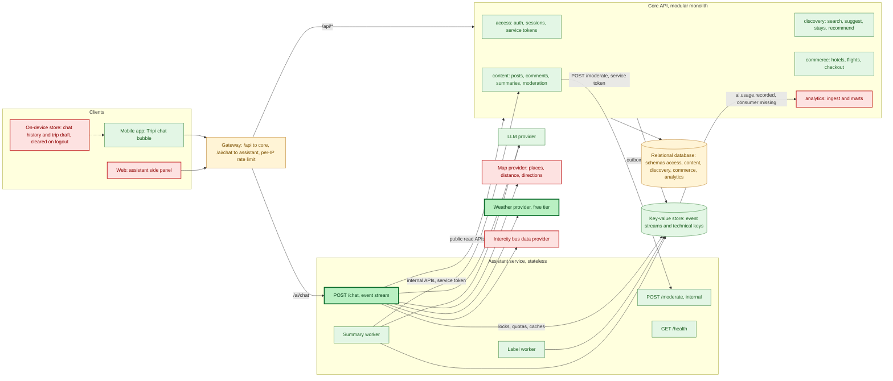
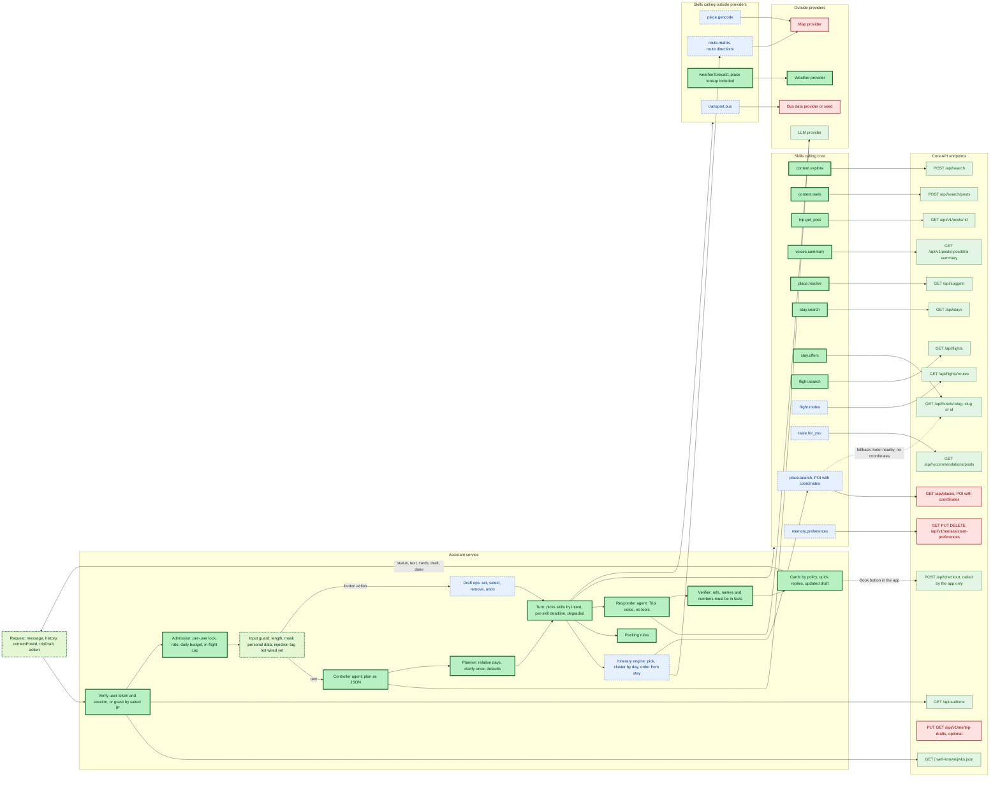
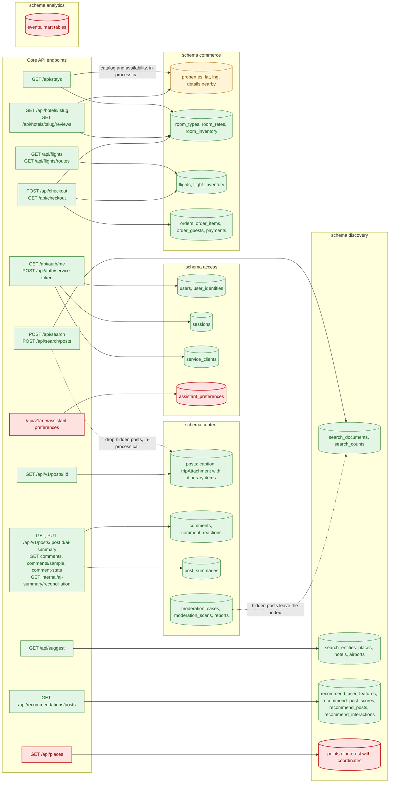
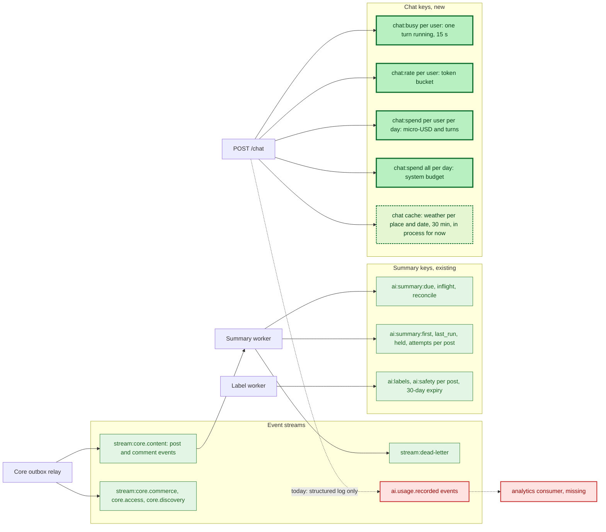
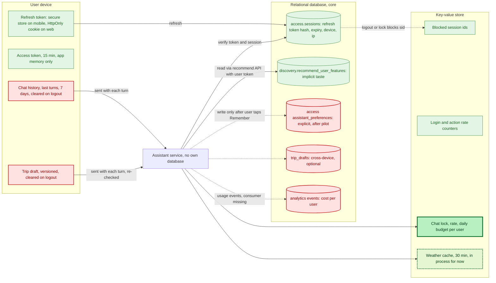

# Tripi: kiến trúc chi tiết nối với core và database

- **Ngày:** 2026-11-16 · **Người viết:** Bảo (dùng AI: có) · **Trạng thái:** cập nhật 16/11. Giai đoạn A phía AI đã xây (PR1 `bao/TF31-tripi-v3-nen`, PR2 `bao/TF31-tripi-v3-hai-agent`), phần đã xây tô xanh đậm
- **Đọc từ code ngày 16/11:**
  - `tripflix-ai`: nhánh hiện tại, develop `ca8390d` + 2 commit.
  - `tripflix-be`: develop `c00fa5e`, `contracts/openapi/core-api.json`, `db/schema` của 5 module, `deploy/`.
  - `tripflix-fe`: develop `cef1f04`, `packages/api-client`, `apps/mobile/src/features/assistant`.
- **Thiết kế đi kèm:**
  - [tripi-agent-v3-de-xuat.md](tripi-agent-v3-de-xuat.md): 2 agent.
  - [DeepResearch_Tripi_tro_ly_du_lich_day_du.md](../research/reports/DeepResearch_Tripi_tro_ly_du_lich_day_du.md): Skill, Engine, Draft.
  - [DeepResearch_Tripi_2_agent_SWE.md](../research/reports/DeepResearch_Tripi_2_agent_SWE.md): hạn mức, bộ nhớ.

## Chú giải màu

| Màu | Nghĩa |
|---|---|
| 🟩 Xanh | Đã có trong code, dùng được ngay |
| 🟨 Vàng | Đã có nhưng thiếu dữ liệu hoặc phải sửa |
| 🟥 **Đỏ** | **API, bảng, khóa hoặc nguồn dữ liệu chưa có** |
| 🟦 Xanh dương, viền đứt | Thành phần bên trong ai-service sẽ viết mới (không phải API) |
| ✅ **Xanh đậm, viền dày** | **Đã xây trong Giai đoạn A** (PR1, PR2, 16/11): có test và đã chạy thật với core local |
| Xanh nhạt, viền đứt | Đã xây một phần |

Nhãn trong sơ đồ dùng tiếng Anh, mô tả chung, không gắn tên công nghệ (CONTEXT §6). Tên endpoint và tên bảng là tên thật trong code.

---

## 1. Toàn hệ thống

**Ghi chú từng ô vàng và đỏ:**

| Thành phần | Vì sao | Chủ |
|---|---|---|
| Web: khung trợ lý 🟥 | Trong `apps/web` chưa có màn chat Tripi; mới có trên mobile [CODE: FE] | Thành |
| Lưu trên máy 🟥 | Mobile chỉ giữ lịch sử trong React state; tắt app là mất; chưa có Trip Draft | chị Trang |
| Gateway 🟨 | Đã có `/ai/chat` trên server (`server.yml`), nhưng dùng chung `rate-limit-api` 50 request/giây mỗi IP; thiếu hạn mức riêng cho chat (H0) | Dũng |
| `POST /chat` 🟨 | Chạy được (TF31), phải viết lại theo v3 và mở rộng hợp đồng | Bảo |
| analytics 🟥 | Module có, nhưng **chưa có bảng nào** và chưa có consumer `ai.usage.recorded` [CODE: `analytics/README.md`] | chị Trang |
| Database 🟨 | Schema `analytics` trống | chị Trang |
| Map, thời tiết, xe khách 🟥 | Chưa có adapter nào | Bảo (adapter), mentor (chọn nhà cung cấp) |

---

## 2. Bên trong `POST /chat` và các API core mà Skill gọi

**Cách đọc:**
- 🟩 `content.explore`, `place.resolve`, `stay.search`, `flight.search` đang chạy trong `app/services/assistant.py` [CODE]. v3 chỉ chuyển chúng vào `skills/`.
- 🟦 Các Skill khác là code mới, gọi API **đã có** (xanh) hoặc **chưa có** (đỏ).
- **Không có mũi tên nào từ ai-service tới `POST /api/checkout`.** Chỉ app gọi, bằng token của người dùng.

**Các API core chưa có (🟥):**

| API | Để làm gì | Thuộc module, chủ | Có thể thay tạm |
|---|---|---|---|
| `GET /api/places?near=&types=&radiusKm=` | POI có tọa độ (điểm tham quan, ăn uống) cho R5, R7, R11 | discovery, Duy. Loại `see/food/cafe` đã có trong hợp đồng `/api/search` nhưng rỗng | `nearby` của khách sạn (có tên và khoảng cách, không có tọa độ) + adapter seed hoặc map provider ở ai-service |
| `GET/PUT/DELETE /api/v1/me/assistant-preferences` | Bộ nhớ dài hạn M3b, chỉ ghi khi người dùng bấm "Nhớ" | access, Dũng (dữ liệu của user) | Không cần trong pilot |
| `PUT/GET /api/v1/me/trip-drafts` | Lưu bản nháp chuyến đi để đổi máy vẫn còn (cách B, báo cáo trợ lý đầy đủ §5.1) | content hoặc commerce, Thành hoặc Thắng | Client giữ draft (cách A, đề xuất) |

---

## 3. API core → module → bảng database

Chỉ vẽ phần Tripi và worker tóm tắt dùng. Bảng lấy từ `apps/core-api/src/modules/*/db/schema` [CODE].

**Ghi chú:**
- 🟨 `commerce.properties`: có `lat`, `lng` và `details.nearby` (tên + km) cho cả 2.200 khách sạn [CODE: seed], nhưng `nearby` không có tọa độ. Vũng Tàu chỉ có 1 khách sạn.
- 🟥 `analytics`: schema đã khai báo (`pgSchema('analytics')`) nhưng chưa có bảng.
- Discovery không đọc bảng của module khác. Nó gọi `CommerceFacade`, `ContentFacade` trong cùng process (README discovery) [CODE]. Mũi tên nét đứt là lời gọi trong process, không phải truy vấn chéo schema.
- ai-service **không có mũi tên nào tới database** (RULES §10).

---

## 4. Bộ lưu khóa-giá trị: stream và khóa kỹ thuật

- Không có khóa nào chứa nội dung chat (báo cáo SWE §3A.5).
- `ai.usage.recorded` hiện chỉ là log có cấu trúc ở chat, summary và moderation [CODE]. Đẩy lên stream chỉ có ích khi analytics có consumer.

---

## 5. Hợp đồng `POST /chat`: phần có và phần thêm

| Trường hoặc sự kiện | Trạng thái | Ghi chú |
|---|---|---|
| `conversationId`, `message`, `history[{role, text}]` | 🟩 có | |
| `history[].kind` | ✅ server dùng (PR2); 🟨 app chưa gửi | Cần cho "hỏi lại một lần" |
| `searchMode` | 🟩 có | |
| `contextPostId` | ✅ có (PR1, dùng ở PR2); 🟨 app chưa gửi | Reel đang xem (R4) |
| `tripDraft` | 🟥 chưa có | Bộ nhớ làm việc M2 |
| `action` (bấm nút Chọn, Đổi, Bỏ, Hoàn tác) | 🟥 chưa có | Không gọi LLM |
| `noMemory` | 🟥 chưa có | Chế độ "không nhớ" (M3) |
| SSE `status`, `text`, `cards`, `done`, `error` | ✅ có; `text` gửi theo từng câu (PR2) | Thêm bước `searching`, `writing` |
| SSE `draft` | 🟥 chưa có | Trả draft mới |
| `done.degraded`, `cards[].kind` loại mới, chip gợi ý | ✅ có (PR2): sự kiện `suggestions`; thẻ `weather`, `checklist`, `itinerary`, `summary` có `lines`, `source` | App chưa hiển thị |
| HTTP 409, 429, 503 có `retryAfterSeconds` | ✅ có (PR1), kèm `loginRequired` cho khách | Hạn mức (báo cáo SWE §3.4) |

Mọi thay đổi chỉ là **thêm** trường; client cũ vẫn chạy. Sinh lại `contracts/openapi/ai-service.json`, FE chạy `pnpm gen:api` (RULES §4.1).

---

## 6. Dữ liệu nào lưu ở đâu: phiên, lịch sử chat, bộ nhớ

Thêm ngày 16/11. Chi tiết về bộ nhớ ở [báo cáo SWE §3A](../research/reports/DeepResearch_Tripi_2_agent_SWE.md).

### 6.1. Quy tắc chọn chỗ lưu

| Chỗ lưu | Dùng cho | Ví dụ ở Tripflix |
|---|---|---|
| **Database quan hệ ở core** | Nguồn sự thật: phải bền, cần truy vấn hoặc transaction, phải xem và xóa được theo luật | phiên đăng nhập, đơn, sở thích dài hạn |
| **Bộ lưu khóa-giá trị** | Dữ liệu sống ngắn, đọc ghi liên tục, **mất cũng chấp nhận được**, có hạn giờ | chặn `sid`, đếm đăng nhập sai, hạn mức chat, khóa 1 lượt, cache thời tiết |
| **Máy người dùng** | Dữ liệu làm việc của chính người đó | refresh token, giỏ hàng, lịch sử chat, bản nháp chuyến đi |

**Hai luật cứng:**
- ai-service không có database riêng và không lưu dữ liệu nghiệp vụ (RULES §10). Bộ lưu khóa-giá trị chỉ dùng cho bộ đếm và cache kỹ thuật, **không dùng để lưu lịch sử chat**: đó là dữ liệu nghiệp vụ trá hình, và khởi động lại là mất.
- Dữ liệu trên máy người dùng **không bao giờ được tin**. Mỗi lượt, server kiểm lại mọi ID bằng API của core.

### 6.2. Sơ đồ

### 6.3. Phiên đăng nhập: đã có, do core quản lý [CODE]

| Thứ | Lưu ở đâu | Bằng chứng |
|---|---|---|
| Phiên (mỗi máy một dòng): hash refresh token, hạn, tên máy, IP, lần dùng cuối | `access.sessions` | `access/db/schema/index.ts:53` |
| `sid` bị chặn (đăng xuất, khóa tài khoản: token cũ bị 401 ngay) | Bộ lưu khóa-giá trị (`RedisSidBlocklist`) | `access.module.ts:84`, `account.use-cases.ts:40` |
| Đếm đăng nhập sai, giới hạn thao tác | Bộ lưu khóa-giá trị | `RedisLoginRateLimiter`, `RedisActionRateLimiter` |
| Refresh token trên mobile | `expo-secure-store` | FE `apps/mobile/src/app/_layout.tsx:23` |
| Refresh token trên web | Cookie HttpOnly `tripflix_refresh` | `auth.controller.ts:59` |
| Access token (JWT, 15 phút) | Bộ nhớ app hoặc trình duyệt | suy từ `http.ts` [CẦN KIỂM] |

ai-service không giữ gì về phiên. Mỗi lượt nó kiểm chữ ký JWT bằng JWKS, rồi gọi `GET /api/auth/me`; core trả lời dựa trên `access.sessions` và danh sách `sid` bị chặn.

### 6.4. Phiên chat và dữ liệu của Tripi

| Thứ | Hôm nay [CODE] | Đề xuất cho pilot | Sau pilot |
|---|---|---|---|
| Lịch sử chat (M1) | **Chỉ trong React state**: tắt app là mất | Máy người dùng: mobile `expo-secure-store`, web `localStorage`; giữ 7 ngày; xóa khi đăng xuất | Lưu ở core nếu cần xem lại trên mọi máy |
| Bản nháp chuyến đi (M2) | Chưa có | Máy người dùng; server kiểm lại mỗi lượt | `trip_drafts` ở core để đổi máy vẫn còn |
| Hạn mức, khóa 1 lượt, cache | Chưa có | Bộ lưu khóa-giá trị, có hạn giờ (báo cáo SWE §3A.5) | — |
| Gu ngầm (M3a) | Có ở core (`discovery.recommend_user_features`, làm mới mỗi 10 phút) | Đọc qua `GET /api/recommendations/posts` | — |
| Sở thích dặn nhớ (M3b) | Chưa có | Không làm | `assistant_preferences` ở `access`; chỉ ghi khi người dùng bấm "Nhớ" |
| Chi phí theo user | Log có cấu trúc | Log có cấu trúc | Bảng `events` ở `analytics` |

**Vì sao pilot lưu trên máy mà không lưu ở server:**
- PRD F9 chỉ yêu cầu "đăng nhập giữa chừng không mất hội thoại". Lưu trên máy là đủ.
- Không thêm bảng, API, migration ở core.
- Không thêm nghĩa vụ lưu và xóa dữ liệu cá nhân ở server (Luật Bảo vệ dữ liệu cá nhân 2025).
- Team đã làm đúng kiểu này cho giỏ hàng: `cart-store.ts` dùng `expo-secure-store` trên mobile, `localStorage` trên web, "không thêm thư viện".

### 6.5. Lần sau mở lại, Tripi có nhớ không

**Ví dụ:**
1. Hôm nay người dùng chat: "đi vũng tàu 2n1đ", "mình ở sài gòn, 2 người, thứ 7 này", rồi chọn khách sạn A.
2. Hai ngày sau mở lại app và gõ "thời tiết hôm đó sao".
3. App gửi lịch sử và bản nháp đã lưu. Draft còn Vũng Tàu, TP.HCM, 2 người, 21/11, khách sạn A.
4. Controller hiểu "hôm đó" là 21/11; server kiểm lại khách sạn A và ngày; Tripi trả lời đúng ngữ cảnh mà không hỏi lại.

| Tình huống | Nhớ không | Vì sao |
|---|---|---|
| Cùng máy, mở lại trong 7 ngày | **Có** | Lịch sử và draft còn trên máy |
| Chat dài quá 6 lượt | **Nhớ ý chính**, quên câu chữ cũ | Server chỉ đọc 6 lượt gần nhất, nhưng nơi đi, ngày, nơi ở nằm trong draft |
| Ngày trong draft đã qua | Nhớ, **hỏi lại ngày mới** | Mỗi lượt server kiểm lại |
| Đổi máy, hoặc web sau khi chat trên điện thoại | **Không** | Dữ liệu chỉ nằm trên máy cũ |
| Cài lại app, xóa dữ liệu app | **Không** | Mất dữ liệu trên máy |
| Đăng xuất rồi đăng nhập lại | **Không** | Đăng xuất phải xóa, để người dùng chung máy không thấy chat của nhau |
| Quá 7 ngày | **Không** | Hết hạn lưu (chỉnh được) |
| Cuộc chat mới hoàn toàn | **Không nhớ câu chữ**, nhưng **biết gu** | Gu ở core, đi theo tài khoản |

**Giao diện [ĐỀ XUẤT, chị Trang]:**
- Mở lại mà còn hội thoại cũ thì hiện "Tiếp tục chuyến Vũng Tàu" và "Cuộc trò chuyện mới". Người dùng tự chọn; Tripi không tự kéo ngữ cảnh cũ vào một câu hỏi không liên quan.
- Bấm "Cuộc trò chuyện mới" thì xóa lịch sử và draft cũ trên máy.

### 6.6. Rủi ro bên FE

| Rủi ro | Xử lý | Chủ |
|---|---|---|
| `expo-secure-store` có thể giới hạn kích thước mỗi giá trị (em nhớ khoảng 2 KB, nhất là iOS) [CẦN KIỂM] | Lưu gọn: 6 lượt, cắt mỗi lượt; draft chỉ chứa ID. Vẫn vượt thì cân nhắc thư viện lưu khác, **phải hỏi trước** (RULES §4) | chị Trang |
| Đăng xuất không xóa lịch sử chat | Xóa lịch sử và draft cùng lúc với refresh token | chị Trang |
| Draft cũ sau khi đổi version | Có trường `v`; server không đọc được thì bỏ draft và nói "mình bắt đầu lại kế hoạch nha" | Bảo |
| `localStorage` trên web đọc được bằng JavaScript (nguy cơ XSS) | Không lưu token hay PII trong draft; chỉ lưu ID và lựa chọn | Thành |

## 7. Danh sách việc ngoài ai-service suy ra từ sơ đồ

Cập nhật 16/11: chưa việc nào xong. O1 và O4 là PR4, PR3 em làm khi có đồng ý của Dũng và chị Trang.

| # | Việc | Repo, module | Chủ | Cần cho |
|---|---|---|---|---|
| O1 | Router riêng `/ai/chat` có hạn mức theo IP | be `deploy/traefik` | Dũng | H0 |
| O2 | `GET /api/places` + bảng POI có tọa độ (nạp từ OSM như khách sạn) | be discovery | Duy | R5, R7, R11 (Giai đoạn B) |
| O3 | Consumer `ai.usage.recorded` + bảng `events` | be analytics | chị Trang | TF40 báo cáo chi phí |
| O4 | Gửi `kind`, `contextPostId`, `tripDraft`; lưu xuống máy, xóa khi đăng xuất; thẻ mới; mã 409/429/503 | fe mobile, api-client | chị Trang | v3, R2, M1 |
| O5 | Khung Tripi trên web | fe web | Thành | PRD F9 (web) |
| O6 | Seed thêm khách sạn Vũng Tàu, hoặc chọn điểm demo khác | be commerce seed | Thắng | X9 |
| O7 | `assistant-preferences` (sau pilot) | be access | Dũng | M3b |
