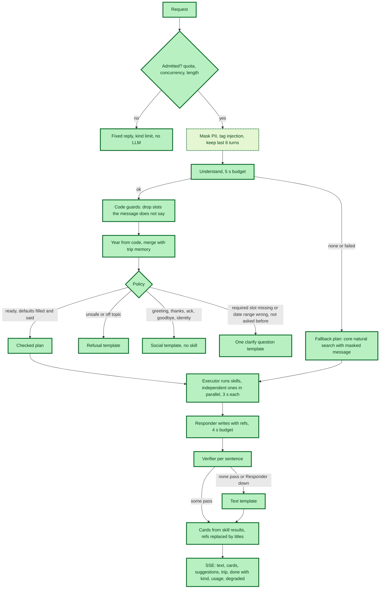

# Tripi v3: nghiên cứu, kiến trúc, kế hoạch và trạng thái triển khai

- **Ngày** 2026-11-19 · **Người viết** Bảo (dùng AI) · **Trạng thái v1.1**. Giai đoạn A và B đã merge vào `develop` ở cả 3 repo.
- **v1.1 (19/11).** Đã đối chiếu trạng thái PR trên GitHub ngày 19/11; “đã merge” không thay cho xác nhận image đang chạy.
  - ✅ Lộ trình lồng dịch vụ: hỏi nơi đi/ngày trước; đủ thì tìm song song vé đi sớm nhất còn chỗ, khách sạn Tripflix, điểm/thời tiết và vé về muộn nhất. `CardLine.service` đánh dấu `flight`/`stay`; `Card.actions` có `select`/`book`, Controller v9 có `confirm_booking`. Chốt kiểm lại phòng và vé cả chiều về. Nơi không có tuyến bay dùng xe tham khảo, không có nút combo. [AI #46](https://github.com/Sukemcute/tripflix-ai/pull/46) · [AI #47](https://github.com/Sukemcute/tripflix-ai/pull/47)
  - ✅ Mobile và web đều có Tripi; quyết định “chỉ mobile” ngày 17/11 được thay từ 18/11. Mobile làm nổi dòng dịch vụ; kế hoạch hợp lệ nạp cả điểm, phòng và chuyến bay vào tab Đặt `/(tabs)/book`, thẻ khác vẫn mở `/trip-builder`. Web chưa có trang combo nên tách “Đặt phòng” `/hotels/{id}` và “Đặt vé” `/flights`. [FE #230](https://github.com/Sukemcute/tripflix-fe/pull/230) · [FE #235](https://github.com/Sukemcute/tripflix-fe/pull/235) · [FE #239](https://github.com/Sukemcute/tripflix-fe/pull/239) · [FE #241](https://github.com/Sukemcute/tripflix-fe/pull/241)
  - ✅ Bảo chốt giữ thẻ khi mở lại: phiên lưu cả `cards`, lọc lại như thẻ từ server. Android chuyển từ SecureStore 2.048 byte sang file riêng của app, trần 64 KB; vẫn 7 ngày/20 tin, khách chỉ trong bộ nhớ. [FE #244](https://github.com/Sukemcute/tripflix-fe/pull/244)
  - ✅ `ai.chat.turn.recorded`: mỗi lượt đã đăng nhập, câu hỏi che PII trước rồi cắt 120 ký tự, cùng intent/answerKind/isAction; khách không phát. `turnId` và `latencyMs` nối chi phí từng lần gọi LLM với cả lượt, có cả lỗi/huỷ. Một consumer `core-analytics` đọc chung `stream:ai`; BE có API hành vi, chi phí theo người và trace, admin có trang Hành vi người dùng. [AI #48](https://github.com/Sukemcute/tripflix-ai/pull/48) · [AI #50](https://github.com/Sukemcute/tripflix-ai/pull/50) · [BE #272](https://github.com/Sukemcute/tripflix-be/pull/272) · [BE #278](https://github.com/Sukemcute/tripflix-be/pull/278) · [BE #280](https://github.com/Sukemcute/tripflix-be/pull/280) · [FE #260](https://github.com/Sukemcute/tripflix-fe/pull/260) · [FE #262](https://github.com/Sukemcute/tripflix-fe/pull/262)
  - ✅ ai-service có thêm `POST /embed` (Duy, không thuộc Tripi), multilingual-e5-small INT8, chỉ core gọi; phía discovery dùng caption cho For-you **đang mở**, chưa ghi là đã triển khai. [AI #49](https://github.com/Sukemcute/tripflix-ai/pull/49) · [BE #277](https://github.com/Sukemcute/tripflix-be/pull/277)
  - ✅ Compose dev nhận biến LLM, `CHAT_LLM_ENABLED` mặc định false. Anh Phong xác nhận: 18/11 staging lên `sha-9cd62d2` (AI #46), hạn mức khách 300 lượt/ngày, người dùng 500, trần 3 USD/ngày; 19/11 lên `sha-ea0a96a` (AI #48). `sha-3819dc0` (AI #50) và bản có `/embed` (AI #49) chờ anh Phong đổi `AI_TAG`. [AI #46](https://github.com/Sukemcute/tripflix-ai/pull/46) · [AI #48](https://github.com/Sukemcute/tripflix-ai/pull/48) · [AI #50](https://github.com/Sukemcute/tripflix-ai/pull/50) · [AI #49](https://github.com/Sukemcute/tripflix-ai/pull/49) `ai-summary` chưa có trả 204 rỗng, bài không tồn tại/không được xem vẫn 404. [BE #270](https://github.com/Sukemcute/tripflix-be/pull/270) · [AI #42](https://github.com/Sukemcute/tripflix-ai/pull/42) · [BE #268](https://github.com/Sukemcute/tripflix-be/pull/268) · [BE #260](https://github.com/Sukemcute/tripflix-be/pull/260) · [AI #45](https://github.com/Sukemcute/tripflix-ai/pull/45)
  - 🟡 Còn kiểm giờ tham quan chiều sát giờ đến, mặc định 2 người lớn và ảnh Android/web. Nhánh `phong/TF31-luna-reasoning` đã có ở `tripflix-be` (commit `942b4d5`) nhưng chưa mở PR; việc chuyển Controller sang `gpt-5.6-luna` trên staging **[CẦN NC]**. Cần `OPENAI_REASONING_EFFORT=none`. [AI #47](https://github.com/Sukemcute/tripflix-ai/pull/47) · [FE #239](https://github.com/Sukemcute/tripflix-fe/pull/239) · [FE #244](https://github.com/Sukemcute/tripflix-fe/pull/244) · [BE #270](https://github.com/Sukemcute/tripflix-be/pull/270)
- **v1.0 (17/11).**
  - Giai đoạn A còn lại: cờ tắt Responder và từng Skill, gắn cờ nghi prompt injection, bảng A/B một hay hai agent ([AI #36](https://github.com/Sukemcute/tripflix-ai/pull/36)); tìm sân bay theo tên thành phố, Controller v4 ([AI #37](https://github.com/Sukemcute/tripflix-ai/pull/37)); bấm thẻ chuyến bay mở màn chọn vé ([FE #170](https://github.com/Sukemcute/tripflix-fe/pull/170)); đủ 100 kịch bản trợ lý và 50 câu tìm kiếm ([AI #38](https://github.com/Sukemcute/tripflix-ai/pull/38)).
  - Giai đoạn B: điểm tham quan có toạ độ từ OpenStreetMap ([BE #227](https://github.com/Sukemcute/tripflix-be/pull/227)); khách sạn Vũng Tàu ([BE #222](https://github.com/Sukemcute/tripflix-be/pull/222)); Itinerary Engine, bản nháp chuyến đi (`trip` v2), nút Chọn/Bỏ/Hoàn tác chạy không cần LLM, Controller v5 ([AI #39](https://github.com/Sukemcute/tripflix-ai/pull/39)); thẻ kế hoạch trên mobile ([FE #175](https://github.com/Sukemcute/tripflix-fe/pull/175)).
  - Chi phí AI: consumer `stream:ai` và API báo cáo ([BE #228](https://github.com/Sukemcute/tripflix-be/pull/228)); trang admin Chi phí AI ([FE #176](https://github.com/Sukemcute/tripflix-fe/pull/176)).
  - **Tripi chỉ có trên app mobile** (Bảo chốt 17/11). Không làm khung trợ lý trên web.
  - Chưa làm so với thiết kế Giai đoạn B: Responder v3 và Verifier v4 (dung sai làm tròn km/phút), hạn chót riêng 15 giây cho lượt dựng lộ trình, nhà cung cấp bản đồ (đang ước tính bằng code).
- **v0.9 (16/11).**
  - AI #34: câu trả lời ngày như "Ngày 17 18" sau câu hỏi nhận và trả phòng được đọc theo tháng hiện tại; khoảng ngày chưa rõ thì hỏi lại trước khi gọi core. Người dùng nói không đi điểm đến đang nhớ thì xóa `trip` và hỏi điểm đến mới.
  - Mobile: vuốt từ giữa danh sách đóng được chat AI (`aad75ee`); bản EAS preview gọi AI staging (`258d0fe`).
- **v0.8 (16/11).** AI sửa lời chào sau checklist, ngày thời tiết và SSE của lộ trình. Mobile sửa quay lại Tripi sau đăng nhập, lưu phiên 7 ngày khi còn đăng nhập và lọc lượt bị từ chối. Gateway có preflight cho Web. Producer `ai.usage.recorded` đã xong, phần consumer analytics vẫn đang chờ.
- **v0.7 (16/11), sửa theo báo cáo lỗi Expo Web** (`docs/evidence/TF31-bao-cao-loi-tripi-expo-web.md`):
  - Bộ nhớ chuyến đi `trip` (app giữ, server kiểm lại).
  - Controller v3 chỉ ghi ngày/tháng, có 5 ý định xã giao; kiểm lại đầu ra Controller bằng code.
  - Planner hỏi lại khi khoảng ngày sai; thời tiết và checklist dùng chung một dự báo.
  - Verifier v3, Responder v2.
  - Mobile gửi `contextPostId`, `trip`, `kind`; gateway có hạn mức riêng cho `/ai/chat`.
  - Đọc `ai-summary` sau khi đọc bài, theo góp ý của Thành.
  - Chi tiết và số đo: `docs/evidence/TF31-tripi-v3-ngu-canh.md`.
- **v0.5 (16/11), Bảo chốt để code Giai đoạn A:**
  - Chỉ làm trên mobile (reel); web để sau.
  - Khách chưa đăng nhập dùng được với hạn mức nhỏ hơn nhiều (5 lượt hoặc 8.000 token mỗi ngày). Ngữ cảnh của khách chỉ nằm trong bộ nhớ app: đăng nhập thì chat tiếp với nguyên ngữ cảnh, không đăng nhập thì mất.
  - Gateway có router hạn mức riêng cho `/ai/chat`.
  - Thời tiết dùng Open-Meteo bản miễn phí.
  - Gợi ý ngoài hệ thống được phép nếu gắn nhãn "tham khảo" (Giai đoạn B).
  - Mã task TF31.
  - Các báo cáo `docs/research/reports/DeepResearch_Tripi_*.md` nằm trong thư mục bị `.gitignore`, chỉ có trên máy Bảo.
- **v0.4 (16/11):** Bảo mô tả trợ lý du lịch đầy đủ (R1–R13, mục 0A). Thiết kế lại ở [DeepResearch_Tripi_tro_ly_du_lich_day_du.md](../research/reports/DeepResearch_Tripi_tro_ly_du_lich_day_du.md).
- **v0.3 (16/11):** Bảo chốt 2 agent. Tải đồng thời, hạn mức, edge case, SLO, kiểm thử: xem [DeepResearch_Tripi_2_agent_SWE.md](../research/reports/DeepResearch_Tripi_2_agent_SWE.md). Chỗ nào hai tài liệu khác nhau thì theo tài liệu đó.
- **v0.2 (16/11):** Bảo muốn multi-agent. Thêm mục 2A (nghiên cứu và chọn kiểu multi-agent); sửa D1, D2 và các mục 3, 4, 6 theo lựa chọn đó.
- **Thay cho:** chưa thay. Khi được duyệt, mục 3–6 sẽ gộp vào `tripflix-travel-agent-architecture.md` thành v3.0.
- **Mốc đối chiếu 16/11**
  - AI `develop@20e0a9d`. [AI #30](https://github.com/Sukemcute/tripflix-ai/pull/30) · [#31](https://github.com/Sukemcute/tripflix-ai/pull/31) · [#32](https://github.com/Sukemcute/tripflix-ai/pull/32) · [#33](https://github.com/Sukemcute/tripflix-ai/pull/33) · [#34](https://github.com/Sukemcute/tripflix-ai/pull/34)
  - FE `develop@088f412`. [FE #164](https://github.com/Sukemcute/tripflix-fe/pull/164) · [#165](https://github.com/Sukemcute/tripflix-fe/pull/165) · `aad75ee` · `258d0fe`
  - BE `develop@51c2c97` (phần Tripi không đổi từ `5ab83c8`). [BE #206](https://github.com/Sukemcute/tripflix-be/pull/206) · [#207](https://github.com/Sukemcute/tripflix-be/pull/207) · [#214](https://github.com/Sukemcute/tripflix-be/pull/214) · [#215](https://github.com/Sukemcute/tripflix-be/pull/215)

**Nhãn dùng trong tài liệu:**
- **[CODE]**: đã kiểm trong code.
- **[NGUỒN]**: có nguồn ở mục 8. Phần lớn nguồn mới đọc ở mức tóm tắt kết quả tìm kiếm, chưa đọc toàn văn.
- **[ĐỀ XUẤT]**: đề xuất của Claude.
- **[HIỆU CHỈNH]**: con số tạm, phải đo lại.
- **[CẦN CHỐT]**: cần người có tên trả lời.

---

## Trạng thái triển khai (cập nhật 19/11, v1.1)

**Ký hiệu:**
- ✅ đã xong trong code và có trên `develop`
- 🟡 đã xong một phần hoặc còn cần xác nhận trên môi trường chạy
- ⬜ chưa làm

| Phần | Trạng thái | Ở đâu |
|---|---|---|
| Tách package `app/services/assistant/` | ✅ | PR1 `bao/TF31-tripi-v3-nen` |
| Adapter LLM async, gọi 1 lần, đọc `finish_reason` | ✅ | PR1 |
| Khách chưa đăng nhập, hạn mức 5 tầng, khóa 1 lượt, 409/429/503 | ✅ | PR1 (`admission.py`) |
| Controller OpenAI `gpt-5-nano` + Responder DeepSeek, mỗi vai một breaker | ✅ | PR1, PR2 |
| Planner: ngày tương đối theo giờ Việt Nam, hỏi lại một lần | ✅ | PR2 (`planner.py`) |
| Skill: tìm reel, chỗ ở, chuyến bay (có từ TF31) | ✅ | PR2 (`skills/`) |
| Skill mới: lộ trình, review, khách sạn của reel đang xem | ✅ | PR2 (`skills/trip.py`) |
| Thời tiết Open-Meteo, đồ mang theo bằng luật | ✅ | PR2 (`clients/weather.py`, `skills/weather.py`) |
| Responder giọng Tripi + Verifier V1–V7 | ✅ | PR2 (`responder.py`, `verifier.py`) |
| Thẻ theo câu hỏi, chip gợi ý, chữ gửi theo câu, `done.degraded` | ✅ | PR2 (`turn.py`, `api/chat.py`) |
| Eval 40 câu (ci + live, pass^3) | ✅ | PR2 (`evals/assistant/`); live: 97,5% ý định, pass^3 97,5% |
| Bộ nhớ chuyến đi `trip` (app giữ, server kiểm; `lastCards` để chọn "video thứ hai") | ✅ | PR5 (`schemas.py` `TripContext`, `turn.py` `next_trip`) |
| Controller v3: ngày/tháng không năm, 5 ý định xã giao, ràng buộc giá/giờ/khách sạn/em bé/checklist | ✅ | PR5 (`controller.py`, `assistant-controller.v3.md`) |
| Kiểm lại đầu ra Controller bằng code (`apply_guards`) | ✅ | PR5; bỏ ngày, khứ hồi, tên khách sạn mà tin nhắn không nói |
| Planner hỏi lại khi khoảng ngày sai; chỉ có ngày nhận thì tính 1 đêm và nói rõ | ✅ | PR5 (`planner.py`) |
| Khách sạn gọi tên thắng khách sạn của reel; bỏ luật `ROOM_QUESTION` | ✅ | PR5 (`skills/trip.py`) |
| Thời tiết, checklist dùng chung dự báo đúng ngày; `packing.v2.yaml` | ✅ | PR5 (`skills/weather.py`) |
| Verifier v3 (V8 số đúng ngày, tên theo từng chữ, ≤ 4 câu), Responder v2 (câu chính do code viết) | ✅ | PR5 (`verifier.py`, `responder.py`, `assistant-responder.v2.md`) |
| Đọc bài trước rồi mới đọc `ai-summary` | ✅ | 204 rỗng khi chưa có bản; 404 cho bài thiếu/không được xem, vẫn nhận 404 từ core cũ. [BE #260](https://github.com/Sukemcute/tripflix-be/pull/260) · [AI #45](https://github.com/Sukemcute/tripflix-ai/pull/45) |
| Eval v2 (30 ca từ báo cáo, kiểm request gửi core) + chế độ `chain` | ✅ | PR5; ci 70/70, live 95,2% / pass^3 90,0%, chain 91,7% |
| Mobile gửi `kind`, `contextPostId`, `trip`, hiện chi tiết thẻ và xử lý 409/429/503 | ✅ | FE #164 đã merge. App đọc trọn body SSE rồi mới hiển thị |
| Quay lại Tripi sau đăng nhập, lưu phiên 7 ngày khi còn đăng nhập, chip 44, lọc lượt bị từ chối | ✅ | Lưu cả thẻ; native chuyển sang file riêng 64 KB, web localStorage. Ảnh luồng mới còn chờ. [FE #244](https://github.com/Sukemcute/tripflix-fe/pull/244) |
| Hạn mức riêng và CORS của `/ai/chat` | ✅ | BE #206 và #214 đã merge. `POST` dùng `rate-limit-chat` 20/phút/IP, burst 5. `OPTIONS` dùng `rate-limit-api`. `CORS_ORIGINS` nhận từ `AUTH_WEB_ORIGINS` |
| Biến `CHAT_*` để trống không làm ai-service ngừng chạy | ✅ | AI #31 có `env_ignore_empty` và test hồi quy cho giá bỏ trống |
| Lời chào sau checklist, ngày tương đối rõ ràng và SSE lộ trình | ✅ | AI #32 có test hồi quy và kiểm lại live local. Dự báo trực tiếp vẫn có ca trả fallback |
| Đọc câu trả lời ngày "17 18" sau câu hỏi lại; bỏ điểm đến đang nhớ khi người dùng đổi ý | ✅ | AI #34 (`planner.py`, `turn.py`). Core nhận đúng 17–18/11 thay vì 21–22/11 |
| Producer `ai.usage.recorded` v1 | ✅ | AI #33 phát vào `stream:ai` từ chat, tóm tắt và kiểm duyệt. Schema camelCase trong `contracts/events/` |
| Preflight Web trên staging | ✅ | Anh Phong đã nạp cấu hình BE #214. Kiểm lại `OPTIONS /ai/chat` trả `200`, cho phép `https://tripflix.io.vn` |
| Consumer usage và số liệu Admin | ✅ | BE #228 (`analytics.ai_usage_events`, `GET /api/analytics/ai-usage`), FE #176 (trang Chi phí AI). Chat trên web không làm |
| Cờ `CHAT_RESPONDER_ENABLED`, `CHAT_SKILLS_DISABLED` | ✅ | AI #36. Skill bị tắt ghi vào `done.degraded` |
| Gắn cờ injection (`match_injection`) vào luồng chat | ✅ | AI #36: đánh dấu `suspectedInjection` cho Controller và ghi log; không chặn cứng, an toàn chính vẫn dựa vào cấu trúc (mục 3.7) |
| Sân bay theo tên qua `/api/suggest?types=airport` (T8) | ✅ | Lọc sân bay mơ hồ bằng tuyến có thật; không còn tuyến thì báo rõ, không nhầm với hết chỗ. [AI #46](https://github.com/Sukemcute/tripflix-ai/pull/46) |
| Giai đoạn B: Itinerary Engine, Trip Draft, chỉ đường, xe khách, chỗ ở ngoài | ✅ | AI #39, BE #227, FE #175. Quãng đường và xe khách là ước tính/tham khảo. Eval live v5: 97,6%, pass^3 94,6% |

| Lộ trình hỏi trước, ghép vé đi/phòng/điểm/vé về; chọn và chốt | ✅ | `TripPlanner`, Controller v9; re-check khi chốt. [AI #46](https://github.com/Sukemcute/tripflix-ai/pull/46) · [AI #47](https://github.com/Sukemcute/tripflix-ai/pull/47) |
| Nút đặt và dòng dịch vụ trên mobile/web | ✅ | `Card.actions`, `CardLine.service`; mobile kế hoạch vào tab Đặt, web tách phòng/vé. [FE #235](https://github.com/Sukemcute/tripflix-fe/pull/235) · [FE #239](https://github.com/Sukemcute/tripflix-fe/pull/239) · [FE #241](https://github.com/Sukemcute/tripflix-fe/pull/241) |
| Khung Tripi trên web | ✅ | Dũng làm, apps/web do Thành phụ trách; thay quyết định chỉ mobile. [FE #230](https://github.com/Sukemcute/tripflix-fe/pull/230) |
| Giữ thẻ khi mở lại trên cùng máy | ✅ | Native file riêng 64 KB, web localStorage; parse lại cards. [FE #244](https://github.com/Sukemcute/tripflix-fe/pull/244) |
| Hành vi, chi phí AI theo người, trace lượt | ✅ | AI phát sự kiện; BE chung consumer, API superadmin; trang hành vi FE. [AI #48](https://github.com/Sukemcute/tripflix-ai/pull/48) · [AI #50](https://github.com/Sukemcute/tripflix-ai/pull/50) · [BE #272](https://github.com/Sukemcute/tripflix-be/pull/272) · [BE #278](https://github.com/Sukemcute/tripflix-be/pull/278) · [BE #280](https://github.com/Sukemcute/tripflix-be/pull/280) · [FE #260](https://github.com/Sukemcute/tripflix-fe/pull/260) |
| Caption vectors, ngoài phạm vi Tripi | 🟡 | Endpoint AI đã merge, consumer For-you BE đang mở. [AI #49](https://github.com/Sukemcute/tripflix-ai/pull/49) · [BE #277](https://github.com/Sukemcute/tripflix-be/pull/277) |

**Khác thiết kế** (đã ghi trong evidence):
- **Controller ra ý định và thông tin, không ra danh sách bước.**
  - Lý do: strict mode của OpenAI không cho tham số tự do trong JSON.
  - Chuỗi bước do code quyết định (`turn.py`); "Plan checker" và "Executor" nằm trong `planner.py` và `turn.py`.
- **`build_llm` không chuyển chỗ.** Chat có hàm riêng `get_role_llm(role)`.
- **Cache thời tiết nằm trong process**, chưa nằm trong Redis.
- **Hạn mức code đã nới để test:** người đăng nhập 2.000.000 token, khách 1.000.000 mỗi ngày; staging đã áp dụng hạn mức này từ 18/11 theo xác nhận của anh Phong. [AI #42](https://github.com/Sukemcute/tripflix-ai/pull/42) · [BE #268](https://github.com/Sukemcute/tripflix-be/pull/268)
- **LLM không ghi năm** (v0.7): live run đã gửi năm 2126, 2108 cho core rồi báo hết phòng sai. Code gán năm, kiểm khoảng ngày.
- **Có lớp kiểm bằng code ngay sau Controller** (v0.7): eval live đầu tiên của v3 chỉ đạt 78,6% vì model tự điền "hôm nay", bịa tên khách sạn. Sau khi kiểm lại: 95,2%.
- **`gpt-5-nano` đã bị OpenAI đánh dấu deprecated** trên trang model. Giá hiện tại: 0,05 / 0,005 / 0,40 USD mỗi 1M token (input / cached / output). Bản kế nhiệm `gpt-5.4-nano` đắt hơn (0,20 / 0,02 / 1,25). Đổi model thì phải chạy lại eval live.

Màu xanh đậm viền dày trong các sơ đồ dưới đây là phần **đã xây**.

**Kiểm tra v1.0 (17/11).** AI sau #39: ruff, pyright sạch, 729 test pass, 6 skip, eval CI 112/112; live 112 ca × 3: 97,6% ý định + thông tin, pass^3 94,6%; chain 91,8% lượt (3/6 lượt trượt do timeout mạng, `reel-6.1` lùi so với v4). BE #227, #228: 49/49 tác vụ lint, typecheck, test. FE #175, #176: 17/17 tác vụ.

**Kiểm tra v0.9 (16/11, trên `develop`).** AI `20e0a9d`: ruff, pyright sạch, 674 test pass, 7 skip, eval CI 70/70. FE `088f412`: mobile, api-client, app-core, i18n 11/11 tác vụ lint, typecheck, test. BE `51c2c97`: `rate-limit-chat` có ở cả `dynamic.yml` và `server.yml`.

**Kiểm tra v0.8 (16/11).** AI #33 ghi nhận 677 test pass, 1 skip với Redis thật và 70/70 eval CI. FE #165 qua 18 tác vụ sau khi đồng bộ `develop`. Expo Web local đã kiểm hết lượt khách, đăng nhập quay lại `/assistant` và khôi phục lịch sử hợp lệ. [Evidence AI](https://github.com/Sukemcute/tripflix-ai/blob/4e9bb7d/docs/evidence/TF95-ai-usage-stream.md) · [Evidence Mobile](https://github.com/Sukemcute/tripflix-fe/blob/314dcd1/docs/evidence/TF31-tripi-v3-mobile-fix.md)

**Staging.** Trước bản sửa CORS, client Mobile quan sát một lượt chat khách `200` và một lượt `429 GUEST_LIMIT_REACHED` kèm `loginRequired`. Sau khi anh Phong nạp BE #214, đã kiểm lại `OPTIONS /ai/chat` trả `200` và `Access-Control-Allow-Origin: https://tripflix.io.vn`. Còn kiểm chat khách và chat sau đăng nhập từ Web, đủ 5 lượt từ bộ đếm mới, và log usage theo tag đang chạy. Phép đo tải 10/30 lượt chat với `/moderate` còn chờ.

**Kiểm tra local 16/11 (v0.6):** Expo SDK 58 từ FE `b1af019` phục vụ manifest và bundle Android. Trên AI TF31, chat khách “Mình muốn đi Đà Lạt 2 ngày 1 đêm” trả một video và ba chỗ ở. API gửi kèm ID reel Đà Lạt trả thẻ `itinerary`. Câu hỏi dự báo Vũng Tàu trả thẻ `weather` và dùng câu mẫu khi Responder suy giảm. Bước mở app và thao tác trên điện thoại để người dùng thử trực tiếp.

## 0. Tóm tắt một trang

**Vấn đề của bản TF31 ban đầu:**
- Route `/chat` vừa gọi LLM vừa chọn nhánh vừa xử lý lỗi.
- Chỉ có 3 kiểu tìm: bài/reel, chỗ ở, chuyến bay.
- Không biết người dùng đang xem reel nào.
- Một API hỏng là cả lượt lỗi.

**Đề xuất v3** (giữ hợp đồng SSE và thẻ hiện có, chỉ **thêm** trường):

| # | Quyết định | Vì sao (ngắn) |
|---|---|---|
| D1 | **Hai agent LLM có vai trò cách ly** (mục 2A). **Controller** đọc câu và lập kế hoạch dưới dạng JSON, không bao giờ thấy kết quả core. **Responder** đọc kết quả rồi viết câu trả lời, không có tool. Giữa hai agent là **các Skill chuyên trách** viết bằng code (reel, chỗ ở, chuyến bay, lộ trình, tóm tắt) và một **Verifier** bằng code **[✅ PR2]** | Đây là mẫu Dual LLM / plan-then-execute [NGUỒN 3, 4, 12]. Đổi Skill thành agent LLM riêng thì hỏng nặng hơn với việc tuần tự và nặng tool (−39 đến −70%) [NGUỒN 14], tốn token hơn [NGUỒN 15, 17] |
| D2 | **Tối đa hai lần gọi LLM mỗi lượt**. Chỉ gọi Responder khi có dữ kiện và còn thời gian. Dùng câu mẫu nếu Responder lỗi hoặc các câu bị Verifier lọc hết **[✅ PR2]** | Verifier kiểm văn bản dựa trên dữ kiện trước khi trả người dùng |
| D3 | **Mỗi vai là một cổng (port)**: Controller, Plan checker, Skill, Responder, Verifier. Mỗi cổng có bản thật và bản giả; mỗi agent và mỗi Skill tắt được bằng cờ **[✅ Skill lỗi chỉ hỏng phần của nó; cờ tắt Responder và từng Skill có từ AI #36]** | Báo cáo 11/11 mục 3, seam "Chạy một lượt Tripi" |
| D4 | **Gọi LLM qua `LlmClient` + `GuardedLlmClient` có sẵn**, không gọi DeepSeek trực tiếp trong route **[✅ PR1]** | Bỏ bảng giá trùng, có circuit breaker, đổi được nhà cung cấp |
| D5 | **Thêm ba ý định** `post_itinerary`, `check_room` và `post_reviews` **[✅ đã xong]** | Đọc lộ trình, kiểm phòng và xem tóm tắt bình luận của Reel |
| D6 | **Client gửi thêm `contextPostId`, `kind` và `trip`** **[✅ AI #30 và FE #164–#165]** | Xác định Reel đang xem và giữ các thông tin cần cho lượt hỏi tiếp |
| D7 | **Hỏng một công cụ thì chỉ mất phần đó.** LLM hỏng thì core tự hiểu câu (chế độ dự phòng) **[✅ PR2]** | PRD: AI hỏng thì tìm và đặt vẫn chạy |
| D8 | **Bộ eval hội thoại** `evals/assistant/`: chạy bằng LLM giả trong CI, chạy bằng LLM thật khi đổi prompt; đo pass^3 **[✅ PR2]** | PRD yêu cầu 100 kịch bản; RULES §10 yêu cầu điểm trước/sau |

**Không làm** ở v3:
- Tool ghi (đặt chỗ, sửa lộ trình).
- Lưu hội thoại ở server.
- Vector DB.
- Agent LLM riêng cho từng nghiệp vụ, agent tự tranh luận, agent LLM chấm lại agent LLM.
- Stream từng token (stream theo câu đã qua Verifier).

**Thời gian:** hôm nay thứ Hai 16/11, ngừng thêm tính năng thứ Năm 19/11, demo thứ Sáu 20/11. Còn 3 ngày làm việc nên kế hoạch ở mục 6 chia P0/P1, cắt được từ cuối lên.

---

## 0A. Yêu cầu chức năng do Bảo mô tả (16/11)

Ghi lại theo lời Bảo; ví dụ là của Bảo. Phần này **mở rộng** phạm vi của các mục sau. Thiết kế lại theo phần này nằm ở [DeepResearch_Tripi_tro_ly_du_lich_day_du.md](../research/reports/DeepResearch_Tripi_tro_ly_du_lich_day_du.md); tài liệu đó thay danh sách Skill (§2A.3), luật Verifier (§2A.4), bảng ý định (§3.5) và kế hoạch (§6) của tài liệu này. Mâu thuẫn ghi ở 0A.3, khuyến nghị cho từng mâu thuẫn ở mục 11 của tài liệu kia.

### 0A.1. Agent nói chuyện như một trợ lý du lịch thật

| # | Khả năng | Ví dụ của Bảo | Hiện có? |
|---|---|---|---|
| R1 | Gợi ý theo câu tự nhiên, kèm thẻ video | "muốn đi Vũng Tàu 2 ngày 1 đêm" → 3 thẻ video | ✅ Có (TF31) |
| R2 | **Không phải câu nào cũng hiện 3 thẻ video**: loại thẻ và số thẻ theo câu hỏi | hỏi thời tiết thì không cần thẻ video | ✅ Xong (PR2) |
| R3 | Trả lời các câu hỏi tiếp theo về chuyến đi | "lộ trình như nào", "ở đâu", "thời tiết sắp tới", "cần mang gì" | ✅ Xong (PR2): thời tiết, đồ mang theo, lộ trình reel, chỗ ở |
| R4 | Đọc lộ trình của video đang nói tới | "lộ trình của video này" | ✅ Chọn theo Reel đang xem, theo thẻ hoặc theo tên. Hỏi được ngày N và số ngày. Mobile gửi `contextPostId` |
| R5 | **Tự đề xuất lộ trình** | Vũng Tàu 2N1Đ | ✅ AI #39 (Itinerary Engine) |
| R6 | Đề xuất vé máy bay, chỗ ở **từ kho dữ liệu** của Tripflix | | ✅ Có; ngày tương đối do code đổi (PR2) |
| R7 | Thêm các điểm đi chơi nổi tiếng | Ngọn Hải Đăng, Mũi Nghinh Phong, bãi biển | ✅ BE #227 (điểm từ OSM), AI #39 |
| R8 | Hỏi người dùng đang ở đâu, rồi **hướng dẫn cách đi** tới nơi đến | ở TP.HCM → Vũng Tàu | ✅ AI #39; quãng đường, thời gian là ước tính |
| R9 | Có chuyến bay thì đề xuất vé; không có thì đề xuất **nhà xe** | | ✅ AI #39; xe khách là tuyến mẫu, nhãn "Tham khảo", không giá, không tên nhà xe |
| R10 | Đề xuất nơi ở (khách sạn, nhà nghỉ, resort): **ưu tiên dịch vụ Tripflix có bán trước, ngoài hệ thống sau** | | ✅ AI #39; chỗ ngoài có nhãn "Ngoài Tripflix", không giá |
| R11 | Xếp lộ trình thuận đường **tính từ nơi ở** | resort → Hải Đăng → Mũi Nghinh Phong → biển | ✅ AI #39 (vòng ngắn nhất từ nơi ở, ≤ 40 km/ngày) |
| R12 | **Sửa kế hoạch theo yêu cầu**, agent tự gợi ý phương án thay | đổi máy bay sang xe, đổi hãng bay, đổi nơi ở | ✅ Đổi phòng/chuyến rồi chọn sẽ dựng lại lịch và nút đặt; bỏ điểm, hoàn tác có sẵn. [AI #46](https://github.com/Sukemcute/tripflix-ai/pull/46) · [AI #47](https://github.com/Sukemcute/tripflix-ai/pull/47) |
| R13 | Responder diễn đạt theo giọng Tripi | | ✅ Responder và Verifier đã merge. Kiểm thử live còn gặp câu phụ lệch trọng tâm khi đổi Reel |

**Giả định của Bảo:** có API bản đồ (kiểu Google Maps: tìm địa điểm, khoảng cách, chỉ đường) và API thời tiết.

### 0A.2. Hành trình mẫu (Vũng Tàu 2N1Đ)

1. Người dùng: "muốn đi vũng tàu 2n1đ" → Tripi gợi ý 3 reel, rồi hỏi "Bạn xuất phát từ đâu nè?"
2. "ở sài gòn" → không có chuyến bay TP.HCM–Vũng Tàu trong kho, nên gợi ý xe khách: hãng, giờ chạy, thời gian đi.
3. Gợi ý nơi ở: khách sạn hoặc resort Tripflix có bán, kèm giá thật; sau đó mới tới chỗ ngoài hệ thống (ghi rõ là không đặt được trên Tripflix).
4. Lộ trình 2 ngày xếp theo khoảng cách từ nơi ở: Hải Đăng → Mũi Nghinh Phong → biển…, kèm thời tiết những ngày đó và đồ cần mang.
5. "đổi resort khác gần biển hơn" → gợi ý 2–3 nơi thay, lộ trình tự xếp lại theo nơi ở mới.

### 0A.3. Mâu thuẫn cần chốt trước khi thiết kế lại

| # | Yêu cầu mới | Va chạm với | Ai chốt |
|---|---|---|---|
| X1 | R10: gợi ý chỗ ở ngoài hệ thống; R9: nhà xe | PRD F9 AC: "100% dịch vụ gợi ý (khách sạn, vé máy bay)… phải là thực thể có thật trong cơ sở dữ liệu hệ thống". PRD Won't: "đặt dịch vụ ngoài hệ thống" | Leader tuần, mentor |
| X2 | R3: câu hỏi chung (đồ mang theo, mẹo) | Thiết kế v2 và v0.1: "trợ lý không tự trả lời từ trí nhớ của LLM". Câu hỏi chung không có API nào trả lời được | Bảo |
| X3 | R5, R11: tự đề xuất lộ trình | TravelPlanner: LLM lập kế hoạch nhiều ràng buộc rất kém (0,6%). Thứ tự điểm đi phải do code tính từ khoảng cách, LLM chỉ diễn đạt | (cách làm, không cần chốt) |
| X4 | R12: sửa kế hoạch qua nhiều lượt | ai-service không lưu dữ liệu nghiệp vụ (RULES §10). Kế hoạch đang dở phải nằm ở đâu: client giữ, core lưu, hay Redis có hạn | Bảo, Thành |
| X5 | R8: hỏi nơi người dùng đang ở | PRD: không gửi PII sang LLM. Mức thành phố thì ổn; tọa độ GPS chỉ gửi cho API bản đồ, không gửi cho LLM | Bảo |
| X6 | R13: Responder tự do và vui hơn | Verifier G2 cấm số tiền. Lộ trình lại cần nói "tổng khoảng X đồng", và câu trả lời thời tiết cần số độ | Bảo |
| X7 | Toàn bộ 0A | Ngừng thêm tính năng 19/11, còn 3 ngày; P0 hiện tại đã khoảng 22 giờ | Bảo, leader tuần |
| X8 | Dữ liệu xe khách, POI, nơi ở ngoài | Không có trong core. Google Maps gần như không có tuyến xe khách liên tỉnh Việt Nam [CẦN NC]. Giả định có API thì cần adapter giả với dữ liệu mẫu trước | Bảo |

## 1. Hiện trạng và các vấn đề từ bản TF31 ban đầu

### 1.1. Đường chạy đã đối chiếu trong code

~~~text
Mobile và web develop (FE #230, #239, #241, #244)
  → POST /chat { conversationId, message, history[{role,text,kind}], contextPostId, trip }
  (POST qua rate-limit-chat 20/phút mỗi IP, burst 5; web có preflight riêng)
Tripi AI develop (AI #46–#50)
  → khách theo IP băm hoặc người dùng có token đã kiểm
  → khóa một lượt, hạn mức, trần ngày và giới hạn đồng thời
  → Controller v9 trả ý định + trường dữ liệu (ngày/tháng, không năm)
  → apply_guards bỏ thông tin tin nhắn không nói; to_understanding gán năm, gộp với trip
  → planner.py kiểm khoảng ngày; turn.py chọn Skill, chọn reel, xử lý lỗi riêng
  → Responder diễn đạt sau câu chính do code viết, Verifier v3 lọc câu, dùng câu mẫu nếu cần
  → SSE status, text theo câu, cards, suggestions, trip, done{kind,usage,degraded} hoặc error
Mobile / web
  → chờ body SSE hoàn tất, nối text.delta, hiện thẻ có dòng và nguồn, chip; giữ trip cho lượt sau
  → lưu phiên 7 ngày khi còn đăng nhập; khách chỉ giữ trong bộ nhớ app
  → hết lượt khách: đăng nhập rồi quay lại /assistant, bỏ lượt bị từ chối khỏi history
~~~

Nút «Đặt theo lộ trình» do code tạo, path `/trip-builder`, params không có giá hoặc mã phòng/vé. Mobile chuyển kế hoạch hợp lệ sang tab Đặt `/(tabs)/book` với cả các điểm; thẻ khác vẫn mở `/trip-builder`. Web tách thành link đặt phòng và vé. FE mới gọi checkout khi người dùng xác nhận. [AI #47](https://github.com/Sukemcute/tripflix-ai/pull/47) · [FE #235](https://github.com/Sukemcute/tripflix-fe/pull/235) · [FE #241](https://github.com/Sukemcute/tripflix-fe/pull/241)

### 1.2. Cái đã tốt, giữ nguyên

- LLM chỉ ra JSON ý định. Giá, chỗ, ID đều lấy từ core. Thẻ do code dựng (`build_cards`).
- Che PII trước khi gọi LLM (`mask_pii`), áp cho cả lịch sử.
- Kiểm token bằng JWKS và fail closed. Có timeout cả lượt (12 giây).
- LLM tắt hoặc hỏng thì đi chế độ dự phòng: gửi nguyên câu (đã che PII) cho core tìm.
- Core đã hiểu câu tự nhiên tốt: nơi, ngân sách, số ngày, không dấu, gõ sai (`POST /api/search`, README discovery mục 6). Core cũng đã bỏ bài bị ẩn khỏi kết quả.
- Discovery đã cải thiện lọc địa điểm cho bài chưa có nơi chuẩn hóa. Caption nhắc đúng nơi có thể xuất hiện trong kết quả chính. [BE #215](https://github.com/Sukemcute/tripflix-be/pull/215)

### 1.3. Các vấn đề của bản đầu và trạng thái xử lý

| # | Phát hiện | Ở đâu | Hệ quả |
|---|---|---|---|
| H1 | Route gọi DeepSeek bằng httpx riêng, có bảng giá riêng trong `ChatSettings` | [chat.py:117](../../app/api/chat.py#L117), [chat.py:48](../../app/api/chat.py#L48) | Hai bảng giá lệch nhau theo thời gian. Không có breaker. Không đổi được nhà cung cấp **[✅ PR1]** |
| H2 | Định tuyến là chuỗi `if` lồng nhau, có regex đọc thẳng câu gốc ("rẻ nhất", "reel") | [chat.py:202-263](../../app/api/chat.py#L202) | Thêm một ý định phải sửa route. Khó test từng nhánh **[✅ PR2]** |
| H3 | Một API core lỗi thì cả lượt trả `DEPENDENCY_UNAVAILABLE` | [chat.py:274](../../app/api/chat.py#L274) | Chuyến bay chậm làm hỏng cả câu hỏi về reel **[✅ PR2]** |
| H4 | Bản đầu thiếu `kind` trong lịch sử FE | FE `assistant-transport.ts`, AI `planner.py` | **[✅ đã xong]**. App gửi `kind`, planner dùng cùng `trip.asked` |
| H5 | Bắt buộc đăng nhập, trong khi PRD F9 cho khách vãng lai dùng | [chat.py:84](../../app/api/chat.py#L84), PRD F9 AC 1 | Lệch PRD. Đây cũng là mâu thuẫn TF31 đã ghi ở v2 **[✅ PR1]** |
| H6 | Bản đầu thiếu ngữ cảnh Reel đang xem | `ChatRequest` | **[✅ đã xong]**. FE gửi `contextPostId` khi mở từ Reel, AI tra đúng bài với core |
| H7 | Chuyến bay cần LLM tự đoán mã sân bay IATA | prompt v2 | Người trẻ gõ "bay ra hn", không gõ "HAN". Core đã có `/api/suggest?types=airport` **[✅ AI #37]** |
| H8 | Mỗi lượt tạo 3 `httpx.AsyncClient` mới (auth, LLM, core) | chat.py | Mỗi lượt bắt tay TCP/TLS lại, thêm độ trễ **[✅ PR1]** |
| H9 | Chưa có hạn mức theo người, trần chi phí ngày, giới hạn số lượt chạy đồng thời | — | OWASP LLM10 (tiêu thụ không giới hạn) [NGUỒN 7] **[✅ PR1]** |
| H10 | Chưa có bộ eval hội thoại | `evals/` chỉ có summary, moderation | Không có số đo cho TF14/TF40 **[✅ PR2]** |
| H11 | Bản đầu chỉ ghi usage vào log | AI `app/services/usage_events.py`, BE module `analytics` | **[✅ producer đã xong]**. AI #33 phát sự kiện v1. **[✅ consumer và số liệu Admin: BE #228, FE #176]** |

Chat v3 gọi adapter LLM bất đồng bộ theo vai. Worker tóm tắt vẫn dùng adapter đồng bộ.

---

## 2. Nghiên cứu: 6 câu hỏi và kết luận

### Q1. Workflow cố định hay để LLM tự gọi tool?

- Anthropic chia hệ thống agent thành workflow (đường đi định sẵn bằng code) và agent (LLM tự quyết). Họ khuyên chọn cách đơn giản nhất chạy được; định tuyến (routing) hợp với việc phân loại đầu vào rồi chuyển sang xử lý chuyên biệt [NGUỒN 1].
- τ-bench đo agent gọi tool trong hội thoại bán lẻ và hàng không. Agent gọi tool tốt nhất lúc đó (gpt-4o) đúng dưới 50%, và pass^8 (đúng cả 8 lần chạy lại) dưới 25% ở mảng bán lẻ [NGUỒN 2]. Tức là cùng một câu, chạy lại có thể ra kết quả khác.
- TravelPlanner: GPT-4 chỉ lập kế hoạch đạt mọi ràng buộc ở 0,6% trường hợp (đã dẫn ở v2).
- **Kết luận:** đường đi do code giữ, LLM không tự gọi tool trong vòng lặp (mục 2A chọn kiểu multi-agent phù hợp với điều này). Câu nhiều bước ("reel này → khách sạn → còn phòng") viết thành kế hoạch trong code. TF14 vẫn cần so 2 cách; mục 3.4 để sẵn chỗ chạy cách "LLM gọi tool" trên cùng bộ công cụ, không cần viết lại.

### Q2. Chống prompt injection thế nào khi tên bài, caption do người dùng viết?

- Plan-then-execute: kế hoạch chốt trước khi đọc dữ liệu không tin cậy, nên chữ chen trong kết quả tool không thêm được hành động mới [NGUỒN 3].
- Dual LLM và CaMeL: LLM có quyền không bao giờ đọc kết quả tool. Hạn chế còn lại: dữ liệu vẫn có thể lái **tham số** của tool [NGUỒN 4].
- **Áp vào Tripi:**
  - LLM chỉ đọc tin nhắn người dùng, không bao giờ đọc kết quả core.
  - Tham số gửi core là tham số đã qua schema: ngày, số người, `postId` lấy từ client, không lấy từ chữ LLM.
  - Không có tool ghi, nên tham số bị lái cũng chỉ ra một lượt tìm khác.
  - Đây đúng là nhóm mẫu "LLM chỉ chọn hành động" mà v2 đã dẫn.

### Q3. Giữ hội thoại ở đâu khi ai-service không được lưu dữ liệu nghiệp vụ?

- Giữ lịch sử ở client là cách mặc định phổ biến (ví dụ `useChat` của AI SDK). Nhược điểm: client sửa được, mất khi đổi máy, payload lớn dần. Lưu ở server thì bền hơn, nhưng vẫn phải cắt ngữ cảnh trước mỗi lần gọi LLM [NGUỒN 5].
- **Kết luận:** giữ ở client (như v2). Lý do:
  - Lịch sử chỉ là ngữ cảnh để hiểu câu, không bao giờ là căn cứ gợi ý. Gợi ý chỉ lấy từ kết quả core của lượt hiện tại.
  - Sửa lịch sử chỉ làm hỏng câu trả lời của chính người sửa.
  - Đăng nhập giữa chừng không mất hội thoại (PRD F9), vì lịch sử không gắn với tài khoản.
  - Không thêm token ký tên (signed state): chưa có nhu cầu nào mà `kind` trong lịch sử không giải được.

### Q4. Khi nào hỏi lại, hỏi mấy lần?

- AwN (EMNLP 2025): agent nên hỏi khi thiếu tham số bắt buộc của hàm, không đoán [NGUỒN 6a].
- ClarifyMT-Bench: theo dõi từng thông tin ở 3 trạng thái (chưa có, đã có, mâu thuẫn) [NGUỒN 6b].
- v2 đã dẫn: hỏi nhiều lượt làm giảm hài lòng.
- **Kết luận [ĐỀ XUẤT]:**
  - Mỗi ý định khai báo thông tin **bắt buộc** (bảng mục 3.5). Code kiểm, không để LLM quyết.
  - Câu hỏi lấy từ mẫu cố định.
  - Đã hỏi một lần (đếm `kind=clarify` trong lịch sử) thì không hỏi nữa: chạy với mặc định và nói rõ đã giả định gì.

### Q5. Có nên stream chữ và kiểm chữ khi stream không?

- Muốn kiểm chữ khi đang stream thì phải gom theo câu rồi mới thả ra (Guardrails AI, SentGuard). Kiểm cả bài trước khi gửi thì chắc hơn, nhưng chậm hơn và tốn gấp đôi [NGUỒN 8].
- **Kết luận:** Responder stream ra, server gom theo câu, Verifier kiểm từng câu rồi mới gửi `text` (mỗi câu một sự kiện). Gửi `status` ngay khi nhận request. Hợp đồng SSE giữ nguyên: FE hiện đang cộng dồn mọi `text.delta`, nên nhiều sự kiện `text` vẫn chạy đúng.

### Q6. Chi phí và lạm dụng

- OWASP LLM06 (quyền quá mức): không cho model tự làm hành động nguy hiểm, ghi log mọi lần gọi tool. LLM10 (tiêu thụ không giới hạn): đặt hạn mức tài nguyên và chi phí [NGUỒN 7].
- DeepSeek tự cache tiền tố prompt, không cần cờ bật. Giá trên các trang tổng hợp lệch nhau [NGUỒN 9]. Adapter đang ghi giá giờ cao điểm 0,3 / 1,2 USD mỗi triệu token vào / ra, xem như cận trên.
- **Ước tính một lượt:** xem mục 2A.6.

**Giới hạn của nghiên cứu này:** các OTA lớn (Expedia Romie, Booking) không công bố kiến trúc kỹ thuật; chỉ có bài báo chí [NGUỒN 10]. Không có nguồn nào đo trực tiếp tiếng Việt không dấu kiểu người trẻ: phải tự đo bằng bộ eval.

---

## 2A. Multi-agent: nghiên cứu và lựa chọn

### 2A.1. Nghiên cứu nói gì

| Nguồn | Phát hiện | Áp vào Tripi |
|---|---|---|
| Google Research + MIT, "Towards a Science of Scaling Agent Systems" (2025) [NGUỒN 14] | 180 cấu hình, 5 kiến trúc. Việc **song song được**: multi-agent tốt hơn tới +81%. Việc **tuần tự**: mọi biến thể multi-agent kém đi 39–70%. Việc **nặng tool**: chịu chi phí phối hợp nặng nhất. Agent độc lập không trao đổi khuếch đại lỗi 17,2 lần | Một lượt Tripi là chuỗi tuần tự, nặng tool: hiểu câu → tìm nơi → kiểm phòng → nói |
| Anthropic, hệ thống multi-agent cho Research [NGUỒN 15] | Lead agent chia việc cho subagent chạy song song. Hợp với việc "nhiều hướng độc lập"; **không hợp** khi các agent cần chung ngữ cảnh hoặc phụ thuộc nhau nhiều. Tốn khoảng 15 lần token so với chat thường (số từ bài tóm tắt) | Tripi không có nhiều hướng tìm độc lập kéo dài; các bước dùng chung slot (nơi, ngày, số người) |
| Cognition, "Don't Build Multi-Agents" [NGUỒN 16] | Hai nguyên tắc: chia sẻ đủ ngữ cảnh; mỗi hành động mang quyết định ngầm. Subagent thiếu ngữ cảnh sẽ ra quyết định mâu thuẫn | Nếu "agent chỗ ở" và "agent chuyến bay" tự hiểu "cuối tuần này" khác nhau, câu trả lời lệch ngày nhau |
| MAST, NeurIPS 2025 [NGUỒN 13] | 1.642 lượt chạy của 7 framework, 14 kiểu hỏng trong 3 nhóm. Phần lớn lỗi đến từ **thiết kế hệ thống** (giao việc, phối hợp, kiểm tra), không chỉ từ model | Mỗi chỗ nối giữa các agent là một chỗ có thể hỏng; càng ít chỗ nối do LLM quyết thì càng ít lỗi |
| LangChain benchmark trên τ-bench [NGUỒN 17] | Supervisor (một agent điều phối các agent con) luôn tốn token hơn swarm; ở supervisor, agent con không trả lời thẳng người dùng | Mỗi tầng LLM thêm một lần gọi, tức thêm 1–2 giây và thêm tiền |
| OpenAI Agents SDK [NGUỒN 19] | Hai kiểu: **handoff** (chuyển hẳn hội thoại cho agent chuyên trách) và **agent-as-tool** (agent quản lý giữ hội thoại, gọi agent con cho việc nhỏ có giới hạn) | Tripi chỉ có một "giọng" nói với người dùng, nên hợp kiểu "một agent giữ hội thoại" hơn handoff |
| Dual LLM (Willison 2023), CaMeL, 6 mẫu thiết kế (2025) [NGUỒN 3, 4, 12] | Tách **LLM có quyền** (đọc câu người dùng, lập kế hoạch, không đọc dữ liệu lạ) và **LLM cách ly** (đọc dữ liệu lạ, không có tool). Hai bên trao nhau **biến tượng trưng** (`$r1`), không trao nội dung | Đúng ý "1 agent đọc hiểu, điều khiển, 1 agent xuất output" của Bảo, và có thêm lý do an toàn |
| Huang và cộng sự, ICLR 2024 [NGUỒN 18] | LLM tự sửa câu trả lời mà không có phản hồi bên ngoài thì không tốt hơn, có khi tệ hơn. Phản hồi từ công cụ bên ngoài mới giúp | Không thêm "agent LLM kiểm tra agent LLM". Bộ kiểm là code (Verifier) |

### 2A.2. Bốn phương án

| | A. Một agent (bản v0.1) | **B. Hai agent cách ly + Skill bằng code** | C. Supervisor + agent LLM cho từng nghiệp vụ + Responder | D. Hội đồng (planner, critic, debate) |
|---|---|---|---|---|
| Lần gọi LLM mỗi lượt | 1 | **2** | 3–6 | 4+ |
| Độ trễ ước tính (p50) [HIỆU CHỈNH] | ~2 s | **~4 s** | 6–10 s | > 10 s |
| Chữ trả lời tự nhiên | Không (câu mẫu) | **Có** | Có | Có |
| Chống chen lệnh qua caption, tên bài | Rất tốt | **Rất tốt**: Controller không đọc kết quả; Responder không có tool | Kém: agent con vừa đọc kết quả vừa gọi tool | Kém |
| Hợp việc tuần tự, nặng tool | Tốt | **Tốt** | Kém [NGUỒN 14] | Kém |
| Test, tái hiện lỗi | Dễ | **Dễ**: plan là JSON, Skill là code | Khó | Rất khó |
| Đổi, thêm nghiệp vụ | Thêm planner + mẫu | **Thêm một Skill** (file mới, đăng ký vào registry) | Thêm một agent + prompt | — |
| Thay model riêng từng vai | — | **Có** (mỗi agent một `LlmClient`) | Có | Có |

### 2A.3. Lựa chọn: B, gọi là "Controller – Skills – Responder"

```mermaid
flowchart LR
classDef built fill:#b9f0c2,stroke:#0b6b2b,color:#053d17,stroke-width:3px
classDef partbuilt fill:#e4f7d2,stroke:#0b6b2b,color:#053d17,stroke-width:2px,stroke-dasharray:4 2
U["User message, recent turns, post in view"] --> G["Admission and input guard, code"]
G --> C["Controller agent: intent and validated fields"]
C --> PV["Planner: relative dates, slots, clarification"]
PV -->|clarify or refuse| TPL["Fixed templates"]
PV -->|plan| EX["Turn: select read-only skills by intent"]
subgraph SK["Skills, code, read only, one module each"]
  K1["Content: posts and reels"]
  K2["Stay: place, stays, hotel offers"]
  K3["Flight: airports, flights"]
  K4["Trip: post itinerary"]
  K5["Voices: stored comment summary"]
  K6["Weather: forecast"]
  K7["Packing rules"]
end
EX --> SK
SK --> CORE["Core API"]
EX --> FACTS["Fact sheet: short fields with refs r1, r2, no prices"]
FACTS --> R["Responder agent, LLM, no tools: write the reply with refs"]
R --> V["Verifier, code: per sentence"]
V -->|pass| OUT["Stream text, then cards from skill results"]
V -->|nothing left or Responder down| TPL
TPL --> OUT
class G,C,TPL,EX,K1,K2,K4,K5,K6,K7,CORE,FACTS,R,V,OUT built
class PV,K3 partbuilt
```



**Mỗi vai làm gì:**

| Vai | Là gì | Thấy gì | Không được | Ra gì |
|---|---|---|---|---|
| **Controller** | Agent phân loại | Tin nhắn và lịch sử đã che PII, ngày hôm nay và cờ có reel | Kết quả core, ID reel | `Understanding` gồm ý định và các trường dữ liệu |
| **Planner** | Code | `Understanding` và lịch sử | — | Ngày đã chuẩn hóa, mặc định hoặc câu hỏi lại theo mẫu |
| **Turn + Skills** | Code | Ý định và tham số đã kiểm | Tác vụ ghi | Dữ kiện, thẻ, gợi ý và các Skill lỗi trong `degraded` |
| **Responder** | Agent LLM cách ly | Câu hỏi đã che PII + **bảng dữ kiện rút gọn**: mã `r1…`, loại, tên, nơi, số ngày, lý do khớp, còn hay hết; không có giá | Không có tool; không được nhắc mã ngoài bảng | 1–4 câu tiếng Việt, nhắc kết quả bằng `[r1]` |
| **Verifier** | Code | Từng câu của Responder + tập mã được phép | — | Câu đạt thì gửi; câu trượt thì bỏ |

- **Trạng thái sơ đồ trên:** xanh đậm là đã xây.
- Plan checker là xây một phần: nằm trong `planner.py` và `turn.py`, Controller không ra danh sách bước.
- Skill chuyến bay đã tìm sân bay theo tên và lọc theo tuyến; không có tuyến khác với hết chỗ trong ngày. [AI #46](https://github.com/Sukemcute/tripflix-ai/pull/46)

- **Vì sao Skill là code mà không phải agent LLM:** mỗi Skill chỉ là "tham số đã rõ → gọi 1–3 API → lọc". Không có gì cần LLM suy luận. Biến chúng thành agent LLM là thêm lần gọi, thêm chỗ hỏng (MAST), và thêm cửa cho chen lệnh.
- **Khi nào nâng một Skill thành agent LLM:** khi eval chỉ ra có nghiệp vụ cần suy luận nhiều bước mà code không viết được. Ví dụ sau pilot: "sửa lộ trình cho rẻ hơn mà vẫn gần biển". Skill đó vẫn giữ cùng interface, nên Controller và Responder không phải sửa.

### 2A.4. Hợp đồng giữa các agent

**Phương án thiết kế ban đầu dưới đây** minh họa `Plan.steps`. PR2 thực tế dùng prompt `assistant-controller.v2.md` và trả `Understanding`; `turn.py` tự chọn Skill. Ví dụ thiết kế cho câu hỏi phòng theo reel:

```json
{"intent": "check_room",
 "slots": {"checkIn": "2026-11-21", "checkOut": "2026-11-22", "adults": 2},
 "missing": null,
 "steps": [
   {"id": "s1", "skill": "trip.get_post", "args": {"postId": "$context.postId"}},
   {"id": "s2", "skill": "stay.hotel_offers",
    "args": {"hotelId": "$s1.hotelId", "checkIn": "$slots.checkIn", "checkOut": "$slots.checkOut", "adults": "$slots.adults"}}
 ]}
```

- `$s1.hotelId` là **biến tượng trưng**. Executor thay giá trị thật sau khi s1 chạy xong. Controller không bao giờ thấy `hotelId` thật hay tên khách sạn [NGUỒN 12].
- **Plan checker từ chối plan nếu:**
  - Gọi Skill không có trong registry.
  - Có quá 4 bước [HIỆU CHỈNH].
  - Có vòng phụ thuộc.
  - `$context.postId` mà client không gửi.
  - Thiếu thông tin bắt buộc của ý định (bảng 3.5).
- **Không có vòng lặp ReAct.** Có tối đa **một lần lập lại kế hoạch** khi mọi bước đều `empty`. Lúc đó Controller chỉ nhận **mã trạng thái** (`{"s2": "empty"}`), không nhận nội dung, để vẫn giữ được cách ly. Ví dụ dùng để nới điều kiện: bỏ "hồ bơi", giữ nơi và ngày.
- **Thêm ý định đơn giản không cần plan dài:** `find_trip` chỉ có một bước `content.explore {q}`. Plan JSON vẫn dùng cùng một khuôn.

**Responder nhận bảng dữ kiện** (prompt `assistant-responder.v1.md`):

```json
{"question": "ks trong video nay t7 nay con phong k",
 "assumptions": ["2 người", "nhận 21/11, trả 22/11"],
 "facts": [{"ref": "r1", "kind": "room", "title": "Deluxe hướng đồi", "hotel": "Khách sạn A Đà Lạt",
            "available": true, "reason": "khách sạn trong reel bạn đang xem"}],
 "degraded": []}
```

- Ra: `"Khách sạn trong reel vẫn còn phòng tối 21/11 cho 2 người nè, ví dụ [r1]. Bấm thẻ để xem giá và đặt nhé."`
- Server thay `[r1]` bằng tên lấy từ thẻ trước khi gửi, nên **FE không phải sửa**.
- Tên bài, tên khách sạn là chữ do người dùng hoặc đối tác viết, có thể chứa lệnh. Chúng chỉ tới Responder, mà Responder không có tool. Tệ nhất là một câu lạ, và câu đó vẫn phải qua Verifier.

**Verifier bỏ câu nếu (luật G của v2, viết lại cho vai mới):**

| Luật | Kiểm |
|---|---|
| G1 | Mã `[rN]` không có trong `facts` |
| G2 | Có số tiền, "k", "tr", "%", "giảm", số phòng còn lại |
| G3 | Có liên kết, số điện thoại, email |
| G4 | Có từ tạo khan hiếm ("sắp hết", "chỉ còn", "nhanh tay") |
| G5 | Nói "còn phòng" hoặc "còn vé" khi fact tương ứng `available=false`, hoặc ngược lại |
| G6 | Dài quá 4 câu thì cắt phần thừa |

Không còn câu nào thì dùng câu mẫu. Thẻ luôn do code dựng từ kết quả Skill, không qua LLM.

### 2A.5. Hai agent dùng model khác nhau được

- Mỗi vai có một `LlmClient` riêng, chọn bằng cấu hình: `CHAT_CONTROLLER_PROVIDER/MODEL`, `CHAT_RESPONDER_PROVIDER/MODEL`. Mỗi vai một circuit breaker.
- Cấu hình chạy thật trong evidence dùng Controller OpenAI `gpt-5-nano` và Responder DeepSeek. Hai vai dùng adapter và circuit breaker riêng.

### 2A.6. Chi phí và độ trễ [HIỆU CHỈNH, chưa đo]

| Bước | Token vào | Token ra | Thời gian |
|---|---|---|---|
| Controller | ~1.300 (phần lớn là prompt cố định, được cache) | ~200 | 1–2 s |
| Skills (core) | — | — | 0,3–1 s, song song khi được |
| Responder | ~900 | ~150 | 1–2 s; câu đầu hiện sau ~0,5 s nhờ stream theo câu |
| **Một lượt** | **~2.200** | **~350** | **p50 ~4 s, p95 ~7 s** |

- Theo giá cận trên trong adapter (0,3 USD vào, 1,2 USD ra mỗi triệu token): khoảng 0,0011 USD một lượt, 0,006 USD một cuộc 5 lượt.
- Hỏi lại và từ chối không gọi Responder (câu mẫu), nên rẻ hơn.
- Số thật lấy từ bộ eval (TF40).

### 2A.7. Đường lui của multi-agent

| Hỏng | Người dùng thấy | Tắt bằng |
|---|---|---|
| Controller hỏng, chậm, sai JSON | Chế độ dự phòng: core tự hiểu câu, thẻ + câu mẫu | `CHAT_CONTROLLER_ENABLED=false`, breaker |
| Plan checker từ chối plan | Câu hỏi lại theo mẫu hoặc chế độ dự phòng | — |
| Responder hỏng, chậm (quá 4 s) | Thẻ + câu mẫu, `done.degraded=["responder"]` | `CHAT_RESPONDER_ENABLED=false` (quay về đúng phương án A) |
| Responder viết câu sai | Verifier bỏ câu đó; hết câu thì dùng câu mẫu | — |
| Một Skill lỗi | Các Skill khác vẫn ra; câu "chưa kiểm được…" | `CHAT_SKILLS_DISABLED=flight` |

Các cờ tắt theo vai và theo Skill trong bảng là phương án thiết kế. Code hiện có kill switch `CHAT_LLM_ENABLED`; khi Responder hỏng, server giữ thẻ và dùng câu mẫu.

---

## 3. Kiến trúc v3

### 3.1. Thành phần

Sơ đồ ở mục 2A.3. Trong mục 3, "Hiểu câu" là **Controller**, "Planner/Policy" là **Plan checker**, "Tool" là **Skill**.

**Bốn điều bất biến (kiểm bằng test):**
1. Controller chỉ thấy tin nhắn và lịch sử đã che PII. Không bao giờ thấy kết quả core.
2. Responder không có tool. Chữ của Responder chỉ tới người dùng sau khi qua Verifier.
3. Mọi ID, giá, tình trạng còn chỗ trong thẻ đến từ kết quả Skill **của lượt này**, không qua LLM.
4. Không có Skill ghi. Đặt chỗ là nút mở màn sẵn có; FE gọi `POST /api/checkout` bằng token của người dùng.

### 3.2. Cây module [ĐỀ XUẤT]

Theo kiểu đang có của `app/services/summary/`: một package, mỗi file một việc, phần logic thuần không gọi mạng.

```
app/api/chat.py                    # chỉ còn: xác thực (tùy chọn), cổng nhận, đổi kết quả sang SSE
app/services/assistant/
├─ schemas.py      # ChatRequest, Turn, Plan, Step, Fact, Card, Answer (chuyển từ assistant.py, giữ tên cũ)
├─ controller.py   # agent Controller: LlmController (qua LlmClient), NoController (dự phòng)
├─ plan_check.py   # thuần: schema, Skill có trong registry, ≤ 4 bước, hỏi lại một lần, mặc định
├─ executor.py     # chạy step theo phụ thuộc, thay biến $s1.x, timeout từng step
├─ skills/         # mỗi file một Skill đọc core: content, stay, flight, trip, voices
├─ responder.py    # agent Responder: LlmResponder, TemplateResponder (dự phòng = câu mẫu)
├─ verifier.py     # thuần: luật G1–G6 từng câu
├─ render.py       # thẻ từ kết quả Skill (build_cards chuyển sang đây), thay [rN] bằng tên
├─ turn.py         # run_turn(): ghép các vai, có deadline, trả kết quả và lý do suy giảm
└─ usage.py        # cộng token, chi phí theo vai; ghi ai.usage.recorded
app/prompts/assistant-controller.v1.md   # thay vai của assistant-understand.v2 (v1, v2 giữ nguyên)
app/prompts/assistant-responder.v1.md
```

- `app/services/assistant.py` cũ: chuyển dần vào package, giữ đường import cũ cho `tests/test_chat.py` trong lúc chuyển (re-export). Đây là code của chính Bảo, không đụng phần người khác.
- **Kiểm thử:**
  - `plan_check.py`, `verifier.py`, `render.py` test bằng dữ liệu thuần.
  - `skills/` test bằng `httpx.MockTransport`.
  - `turn.py` test bằng Controller giả (trả `Plan` ghi sẵn), Responder giả và Skill giả.

### 3.3. Cổng và adapter

| Cổng | Hình dạng | Adapter | Tắt bằng |
|---|---|---|---|
| Controller | `async plan(request) -> Plan \| None` | `LlmController`: `await asyncio.to_thread(llm.generate, system, user, schema)`, với `llm = GuardedLlmClient(build_llm(...), CircuitBreaker("chat-controller"))`. `NoController`: trả `None` để đi dự phòng | `CHAT_CONTROLLER_ENABLED=false` |
| Skill | `async run(args, deps) -> SkillResult` (ok / empty / failed / disabled) | Gọi core qua **một** `httpx.AsyncClient` dùng chung (tạo trong `lifespan`) | `CHAT_SKILLS_DISABLED=flight,stay` |
| Responder | `async write(question, facts) -> AsyncIterator[str]` (từng câu) | `LlmResponder` (breaker `chat-responder`); `TemplateResponder` (câu mẫu) | `CHAT_RESPONDER_ENABLED=false` |
| Hiển thị | `render(results) -> list[Card]` | Một bản, thuần | — |
| Đo | `record(step, LlmResult)` | Log có cấu trúc (như summary, moderation) | — |

- `build_llm` hiện nằm trong `summary_worker.py:604`. [ĐỀ XUẤT] chuyển sang `app/clients/llm/__init__.py` để chat và worker dùng chung, worker import lại từ đó. Code của Bảo, không đổi hành vi.
- Container API hiện không có `LLM_PROVIDER` (docstring `ModerationSettings`). Chat dùng `ChatSettings` riêng: `chat_controller_provider/model` và `chat_responder_provider/model` (mặc định `deepseek`), rồi gọi `build_llm` cho từng vai. Bỏ 3 trường giá trong `ChatSettings`; adapter tự biết giá của mình.
- **Responder cần stream.** `LlmClient.generate` hiện trả cả cục. [ĐỀ XUẤT] T7 làm Responder không stream trước (Verifier kiểm cả bài rồi gửi theo câu). Chỉ thêm `generate_stream` vào adapter DeepSeek nếu đo thấy thời gian tới chữ đầu quá chậm.

### 3.4. Một lượt chạy thế nào



(Nhánh "Understand" và "Policy" ở sơ đồ trên chính là Controller và Plan checker.)

Xanh đậm: đã xây. Xanh nhạt viền đứt: xây một phần ("tag injection" chưa gắn vào luồng chat).

- **Deadline:** tổng 12 giây như hiện tại [HIỆU CHỈNH]:
  - Controller tối đa 4 giây.
  - Skill 3 giây mỗi bước.
  - Responder tối đa 4 giây.
  - Còn dưới 4 giây thì bỏ Responder, dùng câu mẫu.
- **Suy giảm:** tool lỗi hoặc bị tắt thì trả `failed`/`disabled`, không coi là "hết chỗ". Ví dụ: kế hoạch `find_trip` có 2 bước; nếu bước `stays` lỗi thì vẫn trả thẻ reel, câu mẫu thêm "Chưa kiểm được phòng lúc này", và `done.degraded=["stays"]`. Báo cáo 11/11 mục 4 yêu cầu đúng điểm này: "không chuyển lỗi upstream thành hết chỗ".
- **So sánh cho TF14:** cùng bộ eval, chạy với `CHAT_RESPONDER_ENABLED=true` (B, hai agent) và `false` (A, một agent), trên 2 model. Không cần viết thêm đường chạy nào.

### 3.5. Ý định có trong TF31 v3

| Ý định | Ngữ cảnh cần có | Dữ liệu trả về |
|---|---|---|
| `search`, `find_reel` | Câu hỏi hoặc điểm đến | Thẻ tìm kiếm hoặc video từ Core |
| `find_stay` | Nơi ở (từ câu hoặc `trip`), ngày đi, số người, trần giá tùy chọn | Thẻ `stay` với ngày và giá thật. Chỉ có ngày nhận thì tính 1 đêm và nói rõ; quá trần thì hỏi nới ngân sách |
| `find_flight` | Nơi đi/đến, ngày, số khách và giờ tùy chọn | Tìm sân bay qua core, chỉ chuyến còn chỗ, có nút Chọn; không có tuyến khác hết chỗ. [AI #46](https://github.com/Sukemcute/tripflix-ai/pull/46) |
| `post_itinerary` | Reel đang mở, hoặc chọn từ thẻ vừa hiện (thứ tự, tên) | Thẻ `itinerary`; hỏi ngày N hay số ngày thì câu chính trả lời thẳng |
| `check_room` | Khách sạn gọi tên, hoặc khách sạn của reel; ngày đi | Thẻ `stay` và tình trạng phòng; lời và thẻ nói cùng một khách sạn, đúng ngày |
| `post_reviews` | Reel đang mở (đọc bài trước; 200 mà `summary`/`content` null cũng là chưa có) | Thẻ `summary` khi có tóm tắt đã lưu; bài ẩn thì báo không còn hiển thị; còn lại báo chưa có tóm tắt |
| `weather`, `packing` | Điểm đến, ngày đi từ câu hỏi, `trip` hoặc reel | Thẻ `weather` đúng ngày được hỏi (ngày đã qua, ngoài 16 ngày thì nói rõ); thẻ `checklist` theo luật v2, có lý do từng món |
| `greeting`, `identity`, `thanks`, `ack`, `goodbye` | — | Câu ngắn theo tình huống, 0 thẻ, 0 Skill (v0.7, thay `small_talk`) |
| `plan_trip` | Điểm đến, nơi xuất phát và ngày; thiếu thì hỏi trước | Một thẻ itinerary lồng dịch vụ, gốc là khách sạn; đổi lựa chọn thì dựng lại. [AI #47](https://github.com/Sukemcute/tripflix-ai/pull/47) |
| `confirm_booking` | Phòng/chuyến đã chọn | Kiểm lại phòng, vé đi và về; chỉ đưa phần còn bán vào nút đặt. [AI #46](https://github.com/Sukemcute/tripflix-ai/pull/46) · [AI #47](https://github.com/Sukemcute/tripflix-ai/pull/47) |
| `clarify`, `refusal` | — | Hỏi lại (tối đa một lần) hoặc từ chối |

Planner dùng ngày Việt Nam, đọc `history[].kind` và `trip.asked` để tránh hỏi lại.

### 3.6. Hợp đồng hiện tại của `POST /chat`

| Thành phần | Phía AI | Mobile (FE #164–#165) |
|---|---|---|
| Request | `conversationId`, `message`, `history[].kind`, `contextPostId` tùy chọn, `trip` tùy chọn | Gửi đủ các trường; `contextPostId` chỉ khi mở Tripi từ reel |
| SSE | `status`, `text` theo câu, `cards`, `suggestions`, `trip`, `done.degraded`, `error` | Chờ hết body, đọc text/cards/suggestions/trip/degraded |
| Thẻ | `lines`, `source`, `CardLine.service`, `Card.actions` select/book; có booking | Mobile/web tô dòng dịch vụ và xử lý nút; web chưa có trang combo. [AI #47](https://github.com/Sukemcute/tripflix-ai/pull/47) · [FE #239](https://github.com/Sukemcute/tripflix-fe/pull/239) |
| Admission | 409/429/503, `retryAfterSeconds`, `loginRequired` khi khách hết hạn mức ngày | Khách hết lượt được mời đăng nhập và quay lại `/assistant`. Lượt bị từ chối nằm trên màn hình và được lọc khỏi `history` và phiên lưu |
| Bộ nhớ | `trip` v2 có stay, transport, returnTransport, days, pending, ops và awaiting | Lưu cả thẻ, 7 ngày/20 tin; native file riêng 64 KB, web localStorage. Khách trong bộ nhớ; logout/đổi tài khoản xoá phiên. [AI #47](https://github.com/Sukemcute/tripflix-ai/pull/47) · [FE #244](https://github.com/Sukemcute/tripflix-fe/pull/244) |
| Bản nháp | `action` và SSE `trip`, không cần SSE `draft`; vé về là trường bổ sung | Chọn/đổi phòng hoặc chuyến dựng lại lịch; không tạo đơn trong AI. [AI #46](https://github.com/Sukemcute/tripflix-ai/pull/46) · [AI #47](https://github.com/Sukemcute/tripflix-ai/pull/47) · [FE #241](https://github.com/Sukemcute/tripflix-fe/pull/241) |

Mọi trường mới đều là **thêm**, app cũ vẫn chạy với server mới và ngược lại.

Params của action book là chuỗi: `destination`, `adults`, `startDate`, `days`, phần phòng `hotelId`, `hotelName`, `checkIn`, `nights`, phần vé đi `flightFrom`, `flightTo`, `flightDate`, phần vé về `returnFrom`, `returnTo`, `returnDate` khi có. Không gửi giá hoặc mã phòng/hạng vé; màn đặt định giá lại từ core. [AI #46](https://github.com/Sukemcute/tripflix-ai/pull/46) · [AI #47](https://github.com/Sukemcute/tripflix-ai/pull/47)

`CHAT_REQUIRE_LOGIN` mặc định `false`. Server kiểm token khi có; khách dùng hạn mức theo IP đã băm.

### 3.7. An toàn

| Rủi ro | Chặn bằng | Tầng |
|---|---|---|
| Chen lệnh qua tin nhắn | Controller trả ý định có schema; code chọn Skill chỉ đọc; tích hợp `match_injection` còn thiếu | cấu trúc |
| Chen lệnh qua tiêu đề bài, caption | Controller không đọc kết quả core. Responder đọc nhưng không có tool; câu của nó phải qua Verifier | cấu trúc |
| Gợi ý bài ẩn | Core đã lọc ở thời điểm gọi; mỗi lượt chỉ dùng kết quả của chính lượt đó | core |
| Giá sai, khan hiếm giả | Responder không nhận giá; Verifier G2, G4, G5 bỏ câu có số tiền, từ tạo khan hiếm, hoặc nói sai còn/hết. Giá chỉ nằm trong thẻ | cấu trúc + code |
| Bịa thực thể ("khách sạn X rất đẹp") | Verifier G1: mọi kết quả phải nhắc bằng `[rN]` có trong bảng dữ kiện. V3 (v0.7): tên viết hoa phải có trong facts, câu hỏi hoặc `trip.place`, kiểm theo từng chữ | code |
| Controller bịa thông tin (ngày, tên khách sạn, khứ hồi) | `apply_guards`: thông tin phải có chữ tương ứng trong tin nhắn; LLM không ghi năm | code |
| Số thời tiết gán sai ngày | Verifier V8: con số phải thuộc đúng ngày câu văn nhắc tới; không có thời tiết "hôm qua" | code |
| Lộ PII | `mask_pii` cho tin nhắn và lịch sử; không gửi `sub`, email, tên sang LLM | code |
| Ngoài phạm vi, nguy hiểm | `intent=refusal` → mẫu từ chối thân thiện | LLM + mẫu |
| Lạm dụng chi phí | Hạn mức, trần ngày, giới hạn đồng thời (mục 4) | code |

### 3.8. Chừa đường lui

| Hỏng | Người dùng thấy | Tắt bằng | Phục hồi |
|---|---|---|---|
| Controller chậm, lỗi, sai JSON | Tìm kiếm tự nhiên qua core | `CHAT_LLM_ENABLED=false` tắt cả hai vai. Breaker tự mở sau lỗi lặp | Breaker thử lại sau thời gian chờ |
| Responder chậm, lỗi, viết sai | Thẻ và câu văn dựng sẵn | Cờ tắt riêng Responder thuộc đề xuất | Câu dự phòng được chọn theo từng lượt |
| Một API core (stays, flights) lỗi | Câu "chưa kiểm được…" đi cùng `degraded` | Cờ tắt từng Skill thuộc đề xuất | Lượt kế tiếp có thể gọi lại API |
| Core search lỗi | `error` → FE hiện nút thử lại | — | Client thử lại; lượt chat không có tác dụng phụ |
| Core auth lỗi | 503 "chưa kiểm tra được phiên" (fail closed như cũ) | — | — |
| Chat quá tải, ảnh hưởng `/moderate` (cùng process) | Lượt vượt giới hạn đồng thời trả `503 CHAT_BUSY` | `CHAT_MAX_INFLIGHT` | Nếu số đo cho thấy `/moderate` chậm khi chat đông thì cân nhắc tách process |
| Prompt mới làm sai ý định | Eval có thể phát hiện thay đổi trước khi merge | Pin lại image đã kiểm | Prompt có version |
| Release lỗi | — | Pin image cũ | Không có dữ liệu cần migrate |

---

## 4. Chi phí, hạn mức, độ trễ, mở rộng

**Giá trị mặc định trong code, có thể cấu hình theo môi trường:**

| Đối tượng | Hạn mức | Nơi đếm |
|---|---|---|
| Đã đăng nhập | 20 lượt/phút; 500 lượt hoặc 2.000.000 token/ngày; chạm trần ngày dùng tìm kiếm dự phòng | Redis; mặc định code, [AI #42](https://github.com/Sukemcute/tripflix-ai/pull/42) |
| Khách vãng lai | 15 lượt/phút; 300 lượt hoặc 1.000.000 token/ngày theo IP băm; chạm trần ngày trả 429 | Redis; mặc định code, [AI #42](https://github.com/Sukemcute/tripflix-ai/pull/42) |
| Toàn hệ thống | 3 USD/ngày; chạm trần thì dùng tìm kiếm dự phòng | Redis và bộ đếm trong tiến trình |
| Đồng thời | `CHAT_MAX_INFLIGHT` = 30 lượt mỗi tiến trình | Bộ nhớ tiến trình |

- ✅ Traefik đếm `POST /ai/chat` theo IP, 20 request/phút với burst 5. AI đếm theo định danh người dùng hoặc IP băm của khách. Preflight Web đi router riêng theo BE #214.
- Khi Redis lỗi, khóa một lượt dùng bộ nhớ tiến trình. Bộ đếm phút/ngày chia sẻ tạm bỏ qua; trần chi phí còn bộ đếm cục bộ.

**Độ trễ mục tiêu [HIỆU CHỈNH]:**
- `status` đầu tiên dưới 300 ms.
- Có câu trả lời: p50 dưới 3 giây, p95 dưới 6 giây.

Lượt chat có tối đa hai lần gọi LLM, tùy kết quả Skill và thời gian còn lại. AI dùng lại pool HTTP để giảm số lần mở kết nối.

**Mở rộng:**
- ai-service không giữ trạng thái, nên tăng số process là tăng sức chịu tải.
- Tải dồn về core search (đọc chỉ mục, rẻ) và nhà cung cấp LLM (giới hạn tốc độ của họ).
- Gấp 10 lần tải pilot vẫn nằm trong khả năng một process vì phần lớn thời gian là chờ I/O. Cần số đo trước khi khẳng định.

**Ghi nhận chi phí (TF95/SCRUM-123)**
- ✅ `done.usage` trả tổng theo lượt chat. AI #33 phát `ai.usage.recorded` v1 cho chat, tóm tắt và kiểm duyệt qua `stream:ai`.
- ✅ Producer giữ `eventId` khi phát lại một envelope. Khi Redis lỗi, log `ai.usage.publish_failed` giữ envelope để đối soát.
- ✅ Từ 19/11, usage có `turnId`/`latencyMs`: `GuardedLlmClient` đo từng lời gọi LLM, ChatTurn đo cả lượt từ lúc request tới. `ai.chat.turn.recorded` chỉ cho người đăng nhập; che PII rồi cắt question 120 ký tự; lỗi publish chỉ log eventId, không log question. BE ghi cả hành vi và chi phí theo người/trace bằng cùng consumer `core-analytics`; nhận được trường null. [AI #48](https://github.com/Sukemcute/tripflix-ai/pull/48) · [AI #50](https://github.com/Sukemcute/tripflix-ai/pull/50) · [BE #272](https://github.com/Sukemcute/tripflix-be/pull/272) · [BE #278](https://github.com/Sukemcute/tripflix-be/pull/278) · [BE #280](https://github.com/Sukemcute/tripflix-be/pull/280)
- ✅ Consumer chống cộng trùng theo `eventId` (BE #228) và trang admin Chi phí AI (FE #176). Phần ingest chung của analytics vẫn thuộc TF60. [Schema v1](https://github.com/Sukemcute/tripflix-ai/blob/4e9bb7d/contracts/events/ai.usage.recorded.v1.schema.json) · [SCRUM-123](https://tripflix.atlassian.net/browse/SCRUM-123)

---

## 5. Đo chất lượng: `evals/assistant/`

**Bộ kiểm thử đã có trên `develop`**
- `cases.v1.jsonl` (40 ca): kế hoạch dạng `Understanding`.
- `cases.v2.jsonl` (30 ca từ báo cáo Expo Web): kế hoạch dạng đầu ra Controller (ngày/tháng). Mỗi ca có `core` (request phải gửi, kèm tham số như `checkIn=2026-11-21`) và `neverCalls` (request không được gửi), cùng `slots` để chấm khi chạy live.
- `chains.v1.jsonl` (5 chuỗi, 20 lượt): chuỗi §6.1 của báo cáo, mưa lạnh → áo phông, hello sau checklist, nhớ chỗ ở, reel đang mở. Mỗi lượt gửi history và `trip` của lượt trước.
- Chạy: `uv run python -m evals.assistant.run [--mode ci|live|chain] [--cases v1|v2|all]`.

| Lần chạy | ci | live (intent + thông tin) | pass^3 | chain (lượt đúng) |
|---|---|---|---|---|
| PR2, prompt v2 (40 ca, chỉ chấm intent) | 40/40 | 97,5% | 97,5% | — |
| v3 lần đầu | 70/70 | 78,6% | 65,7% | 60,0% |
| v3 + kiểm lại bằng code | 70/70 | **95,2%** | **90,0%** | **91,7%** |

Hai dòng sau dùng cả 70 ca và chấm cả thông tin nên khó hơn dòng đầu. Còn trượt: checklist đôi khi sót "món đã có", "không đi biển"; câu bay đôi khi thiếu sân bay đi.

✅ Ở snapshot v0.8, AI #32 xác nhận live local `Hii` sau checklist trả 0 thẻ, checklist dùng đúng ngày và thẻ lộ trình giữ đúng Reel sau nhiều lượt. Bài test đổi Reel trả đúng thẻ nhưng có một câu phụ lệch trọng tâm. Dự báo trực tiếp có lượt fallback. AI #33 chạy lại eval CI và đạt 70/70. [Evidence hồi quy](https://github.com/Sukemcute/tripflix-ai/blob/4e9bb7d/docs/evidence/TF31-tripi-demo-regression.md)

**Thiết kế ban đầu (v0.1).** Dữ liệu `cases.v1.jsonl`, mỗi dòng là một hội thoại 1–3 lượt, có nhãn:

```json
{"id": "stay-03", "turns": ["ks da lat t7 nay", "2 nguoi"], "contextPostId": null,
 "expect": {"intent": "find_stay", "kind": "answer", "clarifyCount": 1, "cardKinds": ["stay"]},
 "tags": ["khong-dau", "viet-tat"]}
```

**Phân bố mục tiêu (PRD: 100 kịch bản):**
- 15 bài/lộ trình, 10 reel, 15 chỗ ở, 10 chuyến bay, 10 theo ngữ cảnh reel, 10 hỏi lại.
- 10 từ chối hoặc ngoài phạm vi, 10 thực thể không có thật ("khách sạn Hoàng Hôn Mộc Châu"), 10 chen lệnh.
- Ít nhất một nửa viết không dấu, viết tắt, lóng hoặc trộn tiếng Anh.
- **Mốc 19/11: 40 câu đầu** [HIỆU CHỈNH].

**Cách chạy:**

| Chế độ | LLM | Core | Khi nào |
|---|---|---|---|
| CI | Giả: trả `Understanding` ghi sẵn trong case | Giả (`MockTransport` + fixture) | Mỗi PR: kiểm policy, planner, render, suy giảm |
| Live | Controller và Responder theo cấu hình | Core local hoặc staging | Đổi prompt hoặc model, chạy 3 lần mỗi câu để tính pass^3 [NGUỒN 2] |

**Chỉ số:**

| Chỉ số | Cách đo | Mục tiêu |
|---|---|---|
| Gợi ý có thật | Mọi `id` trong thẻ gọi lại core vẫn tồn tại và vẫn hiện | 100% (TF31, PRD) |
| Báo đúng khi không có | Case "thực thể không có thật" ra `no_result` hoặc hỏi lại, không ra thẻ sai | 100% |
| Đúng ý định | So với nhãn | đo lần đầu rồi đặt ngưỡng |
| Hỏi lại tối đa một lần | `clarifyCount ≤ 1` | 100% (code đảm bảo) |
| Từ chối đúng / từ chối nhầm | precision, recall trên nhóm từ chối | đo |
| Ổn định | pass^3 theo ý định | đo |
| Plan hợp lệ | Tỉ lệ `Plan` của Controller qua Plan checker ngay lần đầu | đo |
| Câu Responder bị Verifier bỏ | Tỉ lệ câu bị bỏ, chia theo luật G1–G6 | đo; cao nghĩa là phải sửa prompt Responder |
| Chi phí mỗi cuộc; độ trễ p50/p95 | từ `done.usage` (tách theo vai) và đồng hồ | báo cáo TF40 |

Chạy: `uv run python evals/assistant/run.py --mode ci|live`. Ghi điểm trước/sau vào evidence khi đổi prompt (RULES §10).

---

## 6. Kế hoạch (tech lead giao từng bước)

Mỗi bước là một commit nhỏ, build và test pass. Một nhánh mỗi task theo RULES §2 (ví dụ `bao/TF31-tripi-v3-tach-cong`), tạo từ `develop` mới nhất.

**P0: phải xong trước 19/11**

| # | Việc | Xong khi | Ước tính |
|---|---|---|---|
| T1 **[✅]** | Tách package `app/services/assistant/` (schemas, render, skills) từ `assistant.py`, **không đổi hành vi** | 17+ test chat cũ pass nguyên vẹn | 2 giờ |
| T2 **[✅]** | Khung eval `evals/assistant/` + 40 câu đầu; chạy live với đường hiện tại (điểm "trước") | `run.py --mode ci` in bảng chỉ số; có số live trong evidence | 3 giờ + tiền LLM |
| T3 **[✅ (planner + turn thay cho plan_check + executor)]** | Đưa `build_llm` ra dùng chung; schema `Plan`; `plan_check.py`; `executor.py` có biến `$sN.x`, chạy song song, Skill lỗi trả `failed` và `done.degraded` | Test thuần cho checker và executor; test "stay lỗi vẫn ra reel" | 4 giờ |
| T4 **[✅ (OpenAI, prompt v2)]** | Controller: prompt `assistant-controller.v1.md`, `LlmController` qua `GuardedLlmClient` + `to_thread`; thay chuỗi `if` trong route; bỏ httpx gọi DeepSeek và bảng giá trong `ChatSettings` | Test với Controller giả; eval CI không tụt | 3 giờ |
| T5 **[✅ (V1–V7)]** | Responder + Verifier: prompt `assistant-responder.v1.md`, luật G1–G6, câu mẫu dự phòng, thay `[rN]` bằng tên | Test Verifier từng luật; test Responder giả viết câu sai thì bị bỏ | 3 giờ |
| T6 **[✅ (bảng A/B trong `docs/evidence/TF31-co-tat-va-injection.md`, AI #36)]** | Client HTTP dùng chung trong `lifespan`; deadline từng vai; chạy eval live (điểm "sau"), A và B bằng cờ Responder | Bảng A/B trong evidence (TF14) | 2 giờ + tiền LLM |

**P1: nếu kịp trước 19/11, theo thứ tự**

| # | Việc | Phụ thuộc |
|---|---|---|
| T7 **[✅ đã xong]** | `contextPostId` cùng `post_itinerary`, `check_room` và `post_reviews` | AI #30, #32 và FE #164 đã merge |
| T8 **[✅ AI #37]** | Sân bay qua `/api/suggest?types=airport` | — |
| T9 **[✅ đã xong]** | Hỏi lại một lần dựa vào `history[].kind` và `trip.asked` | FE #164 đã nối `kind` |
| T10 **[✅ (`CHAT_SKILLS_DISABLED` có từ AI #36)]** | Hạn mức Redis, trần ngày, `CHAT_MAX_INFLIGHT`, `CHAT_SKILLS_DISABLED` | Chốt với Dũng nơi đếm hạn mức |
| T11 **[✅]** | Đăng nhập tùy chọn sau cờ `CHAT_REQUIRE_LOGIN` | Chốt với leader tuần |

**v0.7: sửa theo báo cáo Expo Web (16/11)**

| # | Việc | Trạng thái |
|---|---|---|
| T12 | Bộ nhớ `trip`, mobile gửi `trip`, `kind`, `contextPostId` và lưu phiên | ✅ Đã xong qua AI #30 và FE #164–#165 |
| T13 | Controller v3 + kiểm lại bằng code; planner hỏi lại khi ngày sai | ✅ |
| T14 | Khách sạn theo tên, giá trần, lọc giờ bay, em bé | ✅ |
| T15 | Thời tiết, checklist dùng chung dự báo; Verifier v3; Responder v2 | ✅ |
| T16 | Eval v2 + chain; test hồi quy từng mã lỗi | ✅ |
| T17 | Gateway `rate-limit-chat` và preflight Web | ✅ BE #206 và #214 đã merge. Preflight staging đã đạt |
| T18 | Evidence Expo Web và Android | 🟡 Ảnh cho luồng mới: chờ Bảo chụp, theo [FE #239](https://github.com/Sukemcute/tripflix-fe/pull/239) · [FE #244](https://github.com/Sukemcute/tripflix-fe/pull/244) |
| T19 | Sửa hồi quy lời chào, ngày đi và SSE lộ trình | ✅ AI #32 đã merge |
| T20 | Producer usage và hợp đồng v1 | ✅ AI #33 đã merge. Consumer thuộc phần việc analytics |

- P0 dài khoảng 17 giờ, nhiều hơn bản v0.1 khoảng 5 giờ vì thêm Responder và Verifier. Với 3 ngày còn lại, P1 nhiều khả năng chỉ kịp T7.
- Nếu trễ: cắt T5 (tắt Responder, quay về phương án A), giữ T7 vì đó là phần khác biệt của Tripflix.
- **Sau 19/11:** chỉ sửa lỗi, viết evidence TF31/TF40.

**Phối hợp liên repo**

| Việc | Ai | Cần trước |
|---|---|---|
| FE gửi `kind`, `contextPostId` và hiện thẻ mới | ✅ Có mobile và web, giữ thẻ khi mở lại; [FE #230](https://github.com/Sukemcute/tripflix-fe/pull/230) · [FE #239](https://github.com/Sukemcute/tripflix-fe/pull/239) · [FE #244](https://github.com/Sukemcute/tripflix-fe/pull/244) | — |
| Xác nhận `GET /api/hotels/{id}` nhận `hotelId` | ✅ đã kiểm trong code core | — |
| Hạn mức theo người và theo IP | ✅ ai-service đếm theo định danh. Gateway chặn theo IP qua BE #206 | — |
| Cho khách vãng lai dùng trợ lý không | ✅ Bảo chốt 16/11: có, hạn mức nhỏ hơn | — |
| Consumer `ai.usage.recorded` và số liệu Admin | ✅ Chị Trang: consumer chung, hành vi/chi phí theo người và API trace; [BE #272](https://github.com/Sukemcute/tripflix-be/pull/272) · [BE #278](https://github.com/Sukemcute/tripflix-be/pull/278) · [BE #280](https://github.com/Sukemcute/tripflix-be/pull/280) | Đã merge |
| Deploy cấu hình `CHAT_*` và preflight Web | Anh Phong đã nạp cấu hình staging. Preflight đã đạt. Bảo kiểm chat khách, chat sau đăng nhập và log usage theo tag đang chạy | Trước demo |
| Đo 10 rồi 30 lượt chat với `/moderate` | Anh Phong và Bảo. Hạ trần chi phí xuống 0,5 USD khi đo. Đạt khi p95 `/moderate` dưới 3 giây và ai-service không restart do hết RAM | Chờ staging |
| Ý nghĩa 404 của `ai-summary` | ✅ 204 rỗng khi chưa có; 404 cho bài thiếu/không được xem; vẫn đọc bài trước. [BE #260](https://github.com/Sukemcute/tripflix-be/pull/260) · [AI #45](https://github.com/Sukemcute/tripflix-ai/pull/45) | — |

---

## 7. Quyết định trước khi code

**Đối chiếu v1.1: việc còn lại.** Web chưa có trang đặt theo lộ trình; ngày đến buổi chiều vẫn có thể xếp điểm quá sát giờ đến; số khách mặc định 2 người lớn; ảnh luồng Android/web còn chờ. [FE #235](https://github.com/Sukemcute/tripflix-fe/pull/235) · [AI #47](https://github.com/Sukemcute/tripflix-ai/pull/47) · [FE #239](https://github.com/Sukemcute/tripflix-fe/pull/239) · [FE #244](https://github.com/Sukemcute/tripflix-fe/pull/244)

Nhánh `phong/TF31-luna-reasoning` đã có ở `tripflix-be` (commit `942b4d5`) nhưng chưa mở PR; việc chuyển Controller sang `gpt-5.6-luna` trên staging **[CẦN NC]**. Cần `OPENAI_REASONING_EFFORT=none`. Anh Phong xác nhận: 18/11 staging lên `sha-9cd62d2` (AI #46), hạn mức khách 300 lượt/ngày, người dùng 500, trần 3 USD/ngày; 19/11 lên `sha-ea0a96a` (AI #48). `sha-3819dc0` (AI #50) và bản có `/embed` (AI #49) chờ anh Phong đổi `AI_TAG`. [BE #270](https://github.com/Sukemcute/tripflix-be/pull/270) · [BE #268](https://github.com/Sukemcute/tripflix-be/pull/268)


1. ✅ Giai đoạn A dùng phương án Controller – Skills – Responder.
2. ✅ Responder và ngữ cảnh Reel đều đã merge. Phạm vi sử dụng Giai đoạn A ghi trong mục 0A.
3. ✅ Dùng TF31 cho Tripi v3 và TF95 cho sự kiện usage.

---

## 8. Nguồn

1. Anthropic, "Building effective agents": https://www.anthropic.com/engineering/building-effective-agents
2. Yao và cộng sự, "τ-bench: A Benchmark for Tool-Agent-User Interaction in Real-World Domains", ICLR 2025: https://arxiv.org/abs/2406.12045
3. "Architecting Resilient LLM Agents: A Guide to Secure Plan-then-Execute Implementations" (đọc qua bản tóm tắt): https://www.themoonlight.io/en/review/architecting-resilient-llm-agents-a-guide-to-secure-plan-then-execute-implementations ; Beurer-Kellner và cộng sự 2025 (đã dẫn ở v2): https://arxiv.org/pdf/2506.08837
4. CaMeL, Google DeepMind (đọc qua bài tóm tắt; số 0 tấn công thành công và 2,82 lần token chưa kiểm ở bài gốc): https://signals.aktagon.com/articles/2026/07/camel-defeating-prompt-injection-attacks-in-llm-agents-through-capability-based-security/ ; https://cusy.io/en/blog/design-patterns-for-securing-llm-agents.html
5. Thiết kế trạng thái hội thoại (blog kỹ thuật, không phải nghiên cứu): https://tianpan.co/blog/2026-04-20-conversation-state-api-resource-multi-turn-sessions ; https://tianpan.co/blog/2026-04-16-stateful-conversations-database-scale-session-store
6. (a) "Learning to Ask: When LLM Agents Meet Unclear Instruction", EMNLP 2025: https://aclanthology.org/anthology-files/pdf/emnlp/2025.emnlp-main.1104.pdf ; (b) ClarifyMT-Bench: https://arxiv.org/pdf/2512.21120
7. OWASP Top 10 for LLM Applications 2025, LLM06 và LLM10 (đọc qua bài tóm tắt): https://www.gravitee.io/blog/owasp-top-10-for-llm-applications-2025-a-practical-guide ; https://invicti.com/blog/web-security/owasp-top-10-risks-llm-security-2025
8. Kiểm chữ khi stream: Guardrails AI https://www.guardrailsai.com/docs/concepts/streaming ; SentGuard https://arxiv.org/abs/2606.02041 ; Azure lab https://azure.github.io/agent-innovator-lab/3_optimization-design-ptn_01_evaluation_on_streaming
9. DeepSeek: tool calls https://api-docs.deepseek.com/guides/tool_calls ; giá (trang tổng hợp, chưa kiểm trang chính thức) https://www.benchlm.ai/deepseek/api-pricing
10. Expedia Romie (báo chí, không có chi tiết kỹ thuật): https://www.hoteldive.com/news/expedia-ai-assistant-romie/716315/ ; tổng hợp LLMOps (Trainline: ràng buộc ở hạ tầng thay vì prompt): https://www.zenml.io/blog/what-1200-production-deployments-reveal-about-llmops-in-2025
11. Rà soát nội bộ 11/11: `C:\Users\lnqba\Documents\tripflix\reports\02_Review_Kien_Truc_AI_Summary_va_Chatbot_Agent.md`
12. Simon Willison, Dual LLM pattern (2023) và bài về CaMeL (2025): https://simonwillison.net/2023/Apr/25/dual-llm-pattern/ ; https://simonwillison.net/2025/Apr/11/camel/ ; https://simonwillison.net/2025/Jun/13/prompt-injection-design-patterns/
13. Cemri và cộng sự, "Why Do Multi-Agent LLM Systems Fail?" (MAST), NeurIPS 2025: https://arxiv.org/abs/2503.13657
14. Kim và cộng sự (Google Research, MIT), "Towards a Science of Scaling Agent Systems", 2025: https://arxiv.org/abs/2512.08296 ; https://research.google/blog/towards-a-science-of-scaling-agent-systems-when-and-why-agent-systems-work/
15. Anthropic, "How we built our multi-agent research system": https://www.anthropic.com/engineering/multi-agent-research-system (số 15 lần token lấy từ bài tóm tắt https://www.zenml.io/llmops-database/building-a-multi-agent-research-system-for-complex-information-tasks)
16. Cognition, "Don't Build Multi-Agents": https://cognition.com/blog/dont-build-multi-agents
17. LangChain, "Benchmarking Multi-Agent Architectures": https://blog.langchain.com/benchmarking-multi-agent-architectures
18. Huang và cộng sự, "Large Language Models Cannot Self-Correct Reasoning Yet", ICLR 2024: https://arxiv.org/abs/2310.01798
19. OpenAI Agents SDK, handoffs và agents-as-tools: https://openai.github.io/openai-agents-python/multi_agent/ ; https://developers.openai.com/api/docs/guides/agents/orchestration
