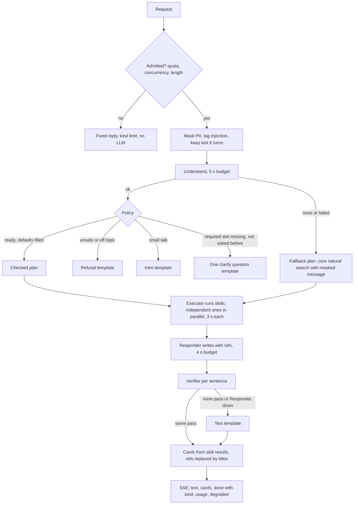

# Tripi v3: nghiên cứu, kiến trúc và kế hoạch (bản đề xuất)

- **Ngày:** 2026-11-16 · **Người viết:** Bảo (dùng AI: có) · **Trạng thái:** đề xuất v0.2, chờ Bảo duyệt trước khi code
- **v0.5 (16/11), Bảo chốt để code Giai đoạn A:**
  - Chỉ làm trên mobile (reel); web để sau.
  - Khách chưa đăng nhập dùng được với hạn mức nhỏ hơn nhiều (5 lượt hoặc 8.000 token mỗi ngày). Ngữ cảnh của khách chỉ nằm trong bộ nhớ app: đăng nhập thì chat tiếp với nguyên ngữ cảnh, không đăng nhập thì mất.
  - Gateway có router hạn mức riêng cho `/ai/chat`.
  - Thời tiết dùng Open-Meteo bản miễn phí.
  - Gợi ý ngoài hệ thống được phép nếu gắn nhãn "tham khảo" (Giai đoạn B).
  - Mã task TF31.
  - Các báo cáo `docs/research/reports/DeepResearch_Tripi_*.md` nằm trong thư mục bị `.gitignore`, chỉ có trên máy Bảo.
- **v0.4 (16/11):** Bảo mô tả trợ lý du lịch đầy đủ (R1–R13, mục 0A). Thiết kế lại ở [DeepResearch_Tripi_tro_ly_du_lich_day_du.md](../research/reports/DeepResearch_Tripi_tro_ly_du_lich_day_du.md).
- **v0.3 (16/11):** Bảo chốt 2 agent. Tải đồng thời, hạn mức, edge case, SLO, kiểm thử: xem [DeepResearch_Tripi_2_agent_SWE.md](../research/reports/DeepResearch_Tripi_2_agent_SWE.md). Chỗ nào hai tài liệu khác nhau thì theo tài liệu đó.
- **v0.2 (16/11):** Bảo muốn multi-agent. Thêm mục 2A (nghiên cứu và chọn kiểu multi-agent); sửa D1, D2 và các mục 3, 4, 6 theo lựa chọn đó.
- **Thay cho:** chưa thay. Khi được duyệt, mục 3–6 sẽ gộp vào `tripflix-travel-agent-architecture.md` thành v3.0.
- **Đã đọc (16/11):** `tripflix-ai` (nhánh `bao/TF44-cong-truoc-phan-loai`, gồm develop `ca8390d` cộng 2 commit), `tripflix-be` develop `c00fa5e`, `tripflix-fe` develop `cef1f04`. Có cả báo cáo rà soát ngày 11/11 (`reports/02_Review_Kien_Truc_AI_Summary_va_Chatbot_Agent.md`).

**Nhãn dùng trong tài liệu:**
- **[CODE]**: đã kiểm trong code.
- **[NGUỒN]**: có nguồn ở mục 8. Phần lớn nguồn mới đọc ở mức tóm tắt kết quả tìm kiếm, chưa đọc toàn văn.
- **[ĐỀ XUẤT]**: đề xuất của Claude.
- **[HIỆU CHỈNH]**: con số tạm, phải đo lại.
- **[CẦN CHỐT]**: cần người có tên trả lời.

---

## 0. Tóm tắt một trang

**Vấn đề.** Trợ lý hiện tại chạy được (TF31), nhưng là bản nối để test:
- Route `/chat` vừa gọi LLM vừa chọn nhánh vừa xử lý lỗi.
- Chỉ có 3 kiểu tìm: bài/reel, chỗ ở, chuyến bay.
- Không biết người dùng đang xem reel nào.
- Một API hỏng là cả lượt lỗi.

**Đề xuất v3** (giữ hợp đồng SSE và thẻ hiện có, chỉ **thêm** trường):

| # | Quyết định | Vì sao (ngắn) |
|---|---|---|
| D1 | **Hai agent LLM có vai trò cách ly** (mục 2A). **Controller** đọc câu và lập kế hoạch dưới dạng JSON, không bao giờ thấy kết quả core. **Responder** đọc kết quả rồi viết câu trả lời, không có tool. Giữa hai agent là **các Skill chuyên trách** viết bằng code (reel, chỗ ở, chuyến bay, lộ trình, tóm tắt) và một **Verifier** bằng code | Đây là mẫu Dual LLM / plan-then-execute [NGUỒN 3, 4, 12]. Đổi Skill thành agent LLM riêng thì hỏng nặng hơn với việc tuần tự và nặng tool (−39 đến −70%) [NGUỒN 14], tốn token hơn [NGUỒN 15, 17] |
| D2 | **Mỗi lượt gọi LLM 2 lần** (Controller, Responder). Responder hỏng hoặc bị Verifier chặn hết câu thì dùng **câu mẫu** (dự phòng) | Có chữ tự nhiên, kiểu người trẻ, mà vẫn không lộ giá giả: LLM tự sửa lỗi không đáng tin [NGUỒN 18], nên Verifier bằng code là lớp chặn cuối |
| D3 | **Mỗi vai là một cổng (port)**: Controller, Plan checker, Skill, Responder, Verifier. Mỗi cổng có bản thật và bản giả; mỗi agent và mỗi Skill tắt được bằng cờ | Báo cáo 11/11 mục 3, seam "Chạy một lượt Tripi" |
| D4 | **Gọi LLM qua `LlmClient` + `GuardedLlmClient` có sẵn**, không gọi DeepSeek trực tiếp trong route | Bỏ bảng giá trùng, có circuit breaker, đổi được nhà cung cấp |
| D5 | **Thêm 3 ý định**: `post_detail` (lộ trình của reel), `check_room` (khách sạn trong reel còn phòng không), `what_people_say` (đọc tóm tắt bình luận đã có) | Dùng thế mạnh riêng của Tripflix: reel có lộ trình và tóm tắt "người đi rồi nói gì" |
| D6 | **Client gửi thêm `contextPostId` và `kind` của từng lượt cũ** | Để hiểu "khách sạn trong video này", và để đếm chính xác số lần đã hỏi lại |
| D7 | **Hỏng một công cụ thì chỉ mất phần đó.** LLM hỏng thì core tự hiểu câu (chế độ dự phòng) | PRD: AI hỏng thì tìm và đặt vẫn chạy |
| D8 | **Bộ eval hội thoại** `evals/assistant/`: chạy bằng LLM giả trong CI, chạy bằng LLM thật khi đổi prompt; đo pass^3 | PRD yêu cầu 100 kịch bản; RULES §10 yêu cầu điểm trước/sau |

**Không làm** ở v3:
- Tool ghi (đặt chỗ, sửa lộ trình).
- Lưu hội thoại ở server.
- Vector DB.
- Agent LLM riêng cho từng nghiệp vụ, agent tự tranh luận, agent LLM chấm lại agent LLM.
- Stream từng token (stream theo câu đã qua Verifier).

**Thời gian:** hôm nay thứ Hai 16/11, ngừng thêm tính năng thứ Năm 19/11, demo thứ Sáu 20/11. Còn 3 ngày làm việc nên kế hoạch ở mục 6 chia P0/P1, cắt được từ cuối lên.

---

## 0A. Yêu cầu chức năng do Bảo mô tả (16/11)

Ghi lại theo lời Bảo; ví dụ là của Bảo. Phần này **mở rộng** phạm vi của các mục sau. Thiết kế lại theo phần này nằm ở [DeepResearch_Tripi_tro_ly_du_lich_day_du.md](../research/reports/DeepResearch_Tripi_tro_ly_du_lich_day_du.md); tài liệu đó thay danh sách Skill (§2A.3), luật Verifier (§2A.4), bảng ý định (§3.5) và kế hoạch (§6) của tài liệu này. Mâu thuẫn ghi ở 0A.3, khuyến nghị cho từng mâu thuẫn ở mục 11 của tài liệu kia.

### 0A.1. Agent nói chuyện như một trợ lý du lịch thật

| # | Khả năng | Ví dụ của Bảo | Hiện có? |
|---|---|---|---|
| R1 | Gợi ý theo câu tự nhiên, kèm thẻ video | "muốn đi Vũng Tàu 2 ngày 1 đêm" → 3 thẻ video | Có (TF31) |
| R2 | **Không phải câu nào cũng hiện 3 thẻ video**: loại thẻ và số thẻ theo câu hỏi | hỏi thời tiết thì không cần thẻ video | Chưa (hiện ưu tiên video cho mọi câu tìm) |
| R3 | Trả lời các câu hỏi tiếp theo về chuyến đi | "lộ trình như nào", "ở đâu", "thời tiết sắp tới", "cần mang gì" | Chưa |
| R4 | Đọc lộ trình của video đang nói tới | "lộ trình của video này" | Chưa (đề xuất `post_detail`) |
| R5 | **Tự đề xuất lộ trình** | Vũng Tàu 2N1Đ | Chưa |
| R6 | Đề xuất vé máy bay, chỗ ở **từ kho dữ liệu** của Tripflix | | Có một phần (tìm chỗ ở, chuyến bay) |
| R7 | Thêm các điểm đi chơi nổi tiếng | Ngọn Hải Đăng, Mũi Nghinh Phong, bãi biển | Chưa (core chưa có nguồn POI: `food`, `cafe`, `see` đang rỗng) |
| R8 | Hỏi người dùng đang ở đâu, rồi **hướng dẫn cách đi** tới nơi đến | ở TP.HCM → Vũng Tàu | Chưa |
| R9 | Có chuyến bay thì đề xuất vé; không có thì đề xuất **nhà xe** | | Chưa có dữ liệu xe |
| R10 | Đề xuất nơi ở (khách sạn, nhà nghỉ, resort): **ưu tiên dịch vụ Tripflix có bán trước, ngoài hệ thống sau** | | Chưa có nguồn ngoài |
| R11 | Xếp lộ trình thuận đường **tính từ nơi ở** | resort → Hải Đăng → Mũi Nghinh Phong → biển | Chưa |
| R12 | **Sửa kế hoạch theo yêu cầu**, agent tự gợi ý phương án thay | đổi máy bay sang xe, đổi hãng bay, đổi nơi ở | Chưa |
| R13 | Responder trả lời **vui tươi, trẻ trung**, không cứng nhắc như câu mẫu hiện tại | | Chưa |

**Giả định của Bảo:** có API bản đồ (kiểu Google Maps: tìm địa điểm, khoảng cách, chỉ đường) và API thời tiết.

### 0A.2. Hành trình mẫu (Vũng Tàu 2N1Đ)

1. Người dùng: "muốn đi vũng tàu 2n1đ" → Tripi gợi ý 3 reel, rồi hỏi "Bạn xuất phát từ đâu nè?"
2. "ở sài gòn" → không có chuyến bay TP.HCM–Vũng Tàu trong kho, nên gợi ý xe khách: hãng, giờ chạy, thời gian đi.
3. Gợi ý nơi ở: khách sạn hoặc resort Tripflix có bán, kèm giá thật; sau đó mới tới chỗ ngoài hệ thống (ghi rõ là không đặt được trên Tripflix).
4. Lộ trình 2 ngày xếp theo khoảng cách từ nơi ở: Hải Đăng → Mũi Nghinh Phong → biển…, kèm thời tiết những ngày đó và đồ cần mang.
5. "đổi resort khác gần biển hơn" → gợi ý 2–3 nơi thay, lộ trình tự xếp lại theo nơi ở mới.

### 0A.3. Mâu thuẫn cần chốt trước khi thiết kế lại

| # | Yêu cầu mới | Va chạm với | Ai chốt |
|---|---|---|---|
| X1 | R10: gợi ý chỗ ở ngoài hệ thống; R9: nhà xe | PRD F9 AC: "100% dịch vụ gợi ý (khách sạn, vé máy bay)… phải là thực thể có thật trong cơ sở dữ liệu hệ thống". PRD Won't: "đặt dịch vụ ngoài hệ thống" | Leader tuần, mentor |
| X2 | R3: câu hỏi chung (đồ mang theo, mẹo) | Thiết kế v2 và v0.1: "trợ lý không tự trả lời từ trí nhớ của LLM". Câu hỏi chung không có API nào trả lời được | Bảo |
| X3 | R5, R11: tự đề xuất lộ trình | TravelPlanner: LLM lập kế hoạch nhiều ràng buộc rất kém (0,6%). Thứ tự điểm đi phải do code tính từ khoảng cách, LLM chỉ diễn đạt | (cách làm, không cần chốt) |
| X4 | R12: sửa kế hoạch qua nhiều lượt | ai-service không lưu dữ liệu nghiệp vụ (RULES §10). Kế hoạch đang dở phải nằm ở đâu: client giữ, core lưu, hay Redis có hạn | Bảo, Thành |
| X5 | R8: hỏi nơi người dùng đang ở | PRD: không gửi PII sang LLM. Mức thành phố thì ổn; tọa độ GPS chỉ gửi cho API bản đồ, không gửi cho LLM | Bảo |
| X6 | R13: Responder tự do và vui hơn | Verifier G2 cấm số tiền. Lộ trình lại cần nói "tổng khoảng X đồng", và câu trả lời thời tiết cần số độ | Bảo |
| X7 | Toàn bộ 0A | Ngừng thêm tính năng 19/11, còn 3 ngày; P0 hiện tại đã khoảng 22 giờ | Bảo, leader tuần |
| X8 | Dữ liệu xe khách, POI, nơi ở ngoài | Không có trong core. Google Maps gần như không có tuyến xe khách liên tỉnh Việt Nam [CẦN NC]. Giả định có API thì cần adapter giả với dữ liệu mẫu trước | Bảo |

## 1. Hiện trạng: đọc từ code 3 repo

### 1.1. Đường chạy một lượt hôm nay [CODE]

```
FE mobile (assistant-transport.ts)
  └─ POST /chat { conversationId, message, history[{role,text}] }   ← không gửi kind
       ai-service app/api/chat.py
       ├─ require_chat_user: JWT qua JWKS + GET core /api/auth/me (mỗi lượt)
       ├─ understand(): httpx gọi thẳng DeepSeek, prompt v2, JSON object
       ├─ chuỗi if/elif chọn: refusal | small_talk | clarify | reel | stay | flight | search
       ├─ app/services/assistant.py: gọi core /api/search, /search/posts, /suggest, /stays, /flights
       └─ SSE: status → text (một lần) → cards → done{kind, usage} | error
```

### 1.2. Cái đã tốt, giữ nguyên

- LLM chỉ ra JSON ý định. Giá, chỗ, ID đều lấy từ core. Thẻ do code dựng (`build_cards`).
- Che PII trước khi gọi LLM (`mask_pii`), áp cho cả lịch sử.
- Kiểm token bằng JWKS và fail closed. Có timeout cả lượt (12 giây).
- LLM tắt hoặc hỏng thì đi chế độ dự phòng: gửi nguyên câu (đã che PII) cho core tìm.
- Core đã hiểu câu tự nhiên tốt: nơi, ngân sách, số ngày, không dấu, gõ sai (`POST /api/search`, README discovery mục 6). Core cũng đã bỏ bài bị ẩn khỏi kết quả.

### 1.3. Chỗ cần sửa

| # | Phát hiện | Ở đâu | Hệ quả |
|---|---|---|---|
| H1 | Route gọi DeepSeek bằng httpx riêng, có bảng giá riêng trong `ChatSettings` | [chat.py:117](../../app/api/chat.py#L117), [chat.py:48](../../app/api/chat.py#L48) | Hai bảng giá lệch nhau theo thời gian. Không có breaker. Không đổi được nhà cung cấp |
| H2 | Định tuyến là chuỗi `if` lồng nhau, có regex đọc thẳng câu gốc ("rẻ nhất", "reel") | [chat.py:202-263](../../app/api/chat.py#L202) | Thêm một ý định phải sửa route. Khó test từng nhánh |
| H3 | Một API core lỗi thì cả lượt trả `DEPENDENCY_UNAVAILABLE` | [chat.py:274](../../app/api/chat.py#L274) | Chuyến bay chậm làm hỏng cả câu hỏi về reel |
| H4 | "Hỏi lại đúng một câu" chưa được đảm bảo: FE không gửi `kind`, server mặc định mọi lượt là `answer` | FE `assistant-transport.ts`, [assistant.py:22](../../app/services/assistant.py#L22) | Có thể hỏi lại nhiều lần liên tiếp |
| H5 | Bắt buộc đăng nhập, trong khi PRD F9 cho khách vãng lai dùng | [chat.py:84](../../app/api/chat.py#L84), PRD F9 AC 1 | Lệch PRD. Đây cũng là mâu thuẫn TF31 đã ghi ở v2 |
| H6 | Không biết người dùng đang xem reel nào | `ChatRequest` | Không trả lời được "khách sạn trong video này còn phòng không" |
| H7 | Chuyến bay cần LLM tự đoán mã sân bay IATA | prompt v2 | Người trẻ gõ "bay ra hn", không gõ "HAN". Core đã có `/api/suggest?types=airport` |
| H8 | Mỗi lượt tạo 3 `httpx.AsyncClient` mới (auth, LLM, core) | chat.py | Mỗi lượt bắt tay TCP/TLS lại, thêm độ trễ |
| H9 | Chưa có hạn mức theo người, trần chi phí ngày, giới hạn số lượt chạy đồng thời | — | OWASP LLM10 (tiêu thụ không giới hạn) [NGUỒN 7] |
| H10 | Chưa có bộ eval hội thoại | `evals/` chỉ có summary, moderation | Không có số đo cho TF14/TF40 |
| H11 | `ai.usage.recorded` mới ghi log; core chưa có consumer nào cho sự kiện này | chat.py:158; grep `tripflix-be` | Đẩy lên stream lúc này cũng chưa ai đọc |

`LlmClient.generate` là hàm **đồng bộ** (worker tóm tắt dùng), còn chat là async. Cách nhỏ nhất: gọi qua `asyncio.to_thread`, không viết thêm adapter async (mục 3.3).

---

## 2. Nghiên cứu: 6 câu hỏi và kết luận

### Q1. Workflow cố định hay để LLM tự gọi tool?

- Anthropic chia hệ thống agent thành workflow (đường đi định sẵn bằng code) và agent (LLM tự quyết). Họ khuyên chọn cách đơn giản nhất chạy được; định tuyến (routing) hợp với việc phân loại đầu vào rồi chuyển sang xử lý chuyên biệt [NGUỒN 1].
- τ-bench đo agent gọi tool trong hội thoại bán lẻ và hàng không. Agent gọi tool tốt nhất lúc đó (gpt-4o) đúng dưới 50%, và pass^8 (đúng cả 8 lần chạy lại) dưới 25% ở mảng bán lẻ [NGUỒN 2]. Tức là cùng một câu, chạy lại có thể ra kết quả khác.
- TravelPlanner: GPT-4 chỉ lập kế hoạch đạt mọi ràng buộc ở 0,6% trường hợp (đã dẫn ở v2).
- **Kết luận:** đường đi do code giữ, LLM không tự gọi tool trong vòng lặp (mục 2A chọn kiểu multi-agent phù hợp với điều này). Câu nhiều bước ("reel này → khách sạn → còn phòng") viết thành kế hoạch trong code. TF14 vẫn cần so 2 cách; mục 3.4 để sẵn chỗ chạy cách "LLM gọi tool" trên cùng bộ công cụ, không cần viết lại.

### Q2. Chống prompt injection thế nào khi tên bài, caption do người dùng viết?

- Plan-then-execute: kế hoạch chốt trước khi đọc dữ liệu không tin cậy, nên chữ chen trong kết quả tool không thêm được hành động mới [NGUỒN 3].
- Dual LLM và CaMeL: LLM có quyền không bao giờ đọc kết quả tool. Hạn chế còn lại: dữ liệu vẫn có thể lái **tham số** của tool [NGUỒN 4].
- **Áp vào Tripi:**
  - LLM chỉ đọc tin nhắn người dùng, không bao giờ đọc kết quả core.
  - Tham số gửi core là tham số đã qua schema: ngày, số người, `postId` lấy từ client, không lấy từ chữ LLM.
  - Không có tool ghi, nên tham số bị lái cũng chỉ ra một lượt tìm khác.
  - Đây đúng là nhóm mẫu "LLM chỉ chọn hành động" mà v2 đã dẫn.

### Q3. Giữ hội thoại ở đâu khi ai-service không được lưu dữ liệu nghiệp vụ?

- Giữ lịch sử ở client là cách mặc định phổ biến (ví dụ `useChat` của AI SDK). Nhược điểm: client sửa được, mất khi đổi máy, payload lớn dần. Lưu ở server thì bền hơn, nhưng vẫn phải cắt ngữ cảnh trước mỗi lần gọi LLM [NGUỒN 5].
- **Kết luận:** giữ ở client (như v2). Lý do:
  - Lịch sử chỉ là ngữ cảnh để hiểu câu, không bao giờ là căn cứ gợi ý. Gợi ý chỉ lấy từ kết quả core của lượt hiện tại.
  - Sửa lịch sử chỉ làm hỏng câu trả lời của chính người sửa.
  - Đăng nhập giữa chừng không mất hội thoại (PRD F9), vì lịch sử không gắn với tài khoản.
  - Không thêm token ký tên (signed state): chưa có nhu cầu nào mà `kind` trong lịch sử không giải được.

### Q4. Khi nào hỏi lại, hỏi mấy lần?

- AwN (EMNLP 2025): agent nên hỏi khi thiếu tham số bắt buộc của hàm, không đoán [NGUỒN 6a].
- ClarifyMT-Bench: theo dõi từng thông tin ở 3 trạng thái (chưa có, đã có, mâu thuẫn) [NGUỒN 6b].
- v2 đã dẫn: hỏi nhiều lượt làm giảm hài lòng.
- **Kết luận [ĐỀ XUẤT]:**
  - Mỗi ý định khai báo thông tin **bắt buộc** (bảng mục 3.5). Code kiểm, không để LLM quyết.
  - Câu hỏi lấy từ mẫu cố định.
  - Đã hỏi một lần (đếm `kind=clarify` trong lịch sử) thì không hỏi nữa: chạy với mặc định và nói rõ đã giả định gì.

### Q5. Có nên stream chữ và kiểm chữ khi stream không?

- Muốn kiểm chữ khi đang stream thì phải gom theo câu rồi mới thả ra (Guardrails AI, SentGuard). Kiểm cả bài trước khi gửi thì chắc hơn, nhưng chậm hơn và tốn gấp đôi [NGUỒN 8].
- **Kết luận:** Responder stream ra, server gom theo câu, Verifier kiểm từng câu rồi mới gửi `text` (mỗi câu một sự kiện). Gửi `status` ngay khi nhận request. Hợp đồng SSE giữ nguyên: FE hiện đang cộng dồn mọi `text.delta`, nên nhiều sự kiện `text` vẫn chạy đúng.

### Q6. Chi phí và lạm dụng

- OWASP LLM06 (quyền quá mức): không cho model tự làm hành động nguy hiểm, ghi log mọi lần gọi tool. LLM10 (tiêu thụ không giới hạn): đặt hạn mức tài nguyên và chi phí [NGUỒN 7].
- DeepSeek tự cache tiền tố prompt, không cần cờ bật. Giá trên các trang tổng hợp lệch nhau [NGUỒN 9]. Adapter đang ghi giá giờ cao điểm 0,3 / 1,2 USD mỗi triệu token vào / ra, xem như cận trên.
- **Ước tính một lượt:** xem mục 2A.6.

**Giới hạn của nghiên cứu này:** các OTA lớn (Expedia Romie, Booking) không công bố kiến trúc kỹ thuật; chỉ có bài báo chí [NGUỒN 10]. Không có nguồn nào đo trực tiếp tiếng Việt không dấu kiểu người trẻ: phải tự đo bằng bộ eval.

---

## 2A. Multi-agent: nghiên cứu và lựa chọn

### 2A.1. Nghiên cứu nói gì

| Nguồn | Phát hiện | Áp vào Tripi |
|---|---|---|
| Google Research + MIT, "Towards a Science of Scaling Agent Systems" (2025) [NGUỒN 14] | 180 cấu hình, 5 kiến trúc. Việc **song song được**: multi-agent tốt hơn tới +81%. Việc **tuần tự**: mọi biến thể multi-agent kém đi 39–70%. Việc **nặng tool**: chịu chi phí phối hợp nặng nhất. Agent độc lập không trao đổi khuếch đại lỗi 17,2 lần | Một lượt Tripi là chuỗi tuần tự, nặng tool: hiểu câu → tìm nơi → kiểm phòng → nói |
| Anthropic, hệ thống multi-agent cho Research [NGUỒN 15] | Lead agent chia việc cho subagent chạy song song. Hợp với việc "nhiều hướng độc lập"; **không hợp** khi các agent cần chung ngữ cảnh hoặc phụ thuộc nhau nhiều. Tốn khoảng 15 lần token so với chat thường (số từ bài tóm tắt) | Tripi không có nhiều hướng tìm độc lập kéo dài; các bước dùng chung slot (nơi, ngày, số người) |
| Cognition, "Don't Build Multi-Agents" [NGUỒN 16] | Hai nguyên tắc: chia sẻ đủ ngữ cảnh; mỗi hành động mang quyết định ngầm. Subagent thiếu ngữ cảnh sẽ ra quyết định mâu thuẫn | Nếu "agent chỗ ở" và "agent chuyến bay" tự hiểu "cuối tuần này" khác nhau, câu trả lời lệch ngày nhau |
| MAST, NeurIPS 2025 [NGUỒN 13] | 1.642 lượt chạy của 7 framework, 14 kiểu hỏng trong 3 nhóm. Phần lớn lỗi đến từ **thiết kế hệ thống** (giao việc, phối hợp, kiểm tra), không chỉ từ model | Mỗi chỗ nối giữa các agent là một chỗ có thể hỏng; càng ít chỗ nối do LLM quyết thì càng ít lỗi |
| LangChain benchmark trên τ-bench [NGUỒN 17] | Supervisor (một agent điều phối các agent con) luôn tốn token hơn swarm; ở supervisor, agent con không trả lời thẳng người dùng | Mỗi tầng LLM thêm một lần gọi, tức thêm 1–2 giây và thêm tiền |
| OpenAI Agents SDK [NGUỒN 19] | Hai kiểu: **handoff** (chuyển hẳn hội thoại cho agent chuyên trách) và **agent-as-tool** (agent quản lý giữ hội thoại, gọi agent con cho việc nhỏ có giới hạn) | Tripi chỉ có một "giọng" nói với người dùng, nên hợp kiểu "một agent giữ hội thoại" hơn handoff |
| Dual LLM (Willison 2023), CaMeL, 6 mẫu thiết kế (2025) [NGUỒN 3, 4, 12] | Tách **LLM có quyền** (đọc câu người dùng, lập kế hoạch, không đọc dữ liệu lạ) và **LLM cách ly** (đọc dữ liệu lạ, không có tool). Hai bên trao nhau **biến tượng trưng** (`$r1`), không trao nội dung | Đúng ý "1 agent đọc hiểu, điều khiển, 1 agent xuất output" của Bảo, và có thêm lý do an toàn |
| Huang và cộng sự, ICLR 2024 [NGUỒN 18] | LLM tự sửa câu trả lời mà không có phản hồi bên ngoài thì không tốt hơn, có khi tệ hơn. Phản hồi từ công cụ bên ngoài mới giúp | Không thêm "agent LLM kiểm tra agent LLM". Bộ kiểm là code (Verifier) |

### 2A.2. Bốn phương án

| | A. Một agent (bản v0.1) | **B. Hai agent cách ly + Skill bằng code** | C. Supervisor + agent LLM cho từng nghiệp vụ + Responder | D. Hội đồng (planner, critic, debate) |
|---|---|---|---|---|
| Lần gọi LLM mỗi lượt | 1 | **2** | 3–6 | 4+ |
| Độ trễ ước tính (p50) [HIỆU CHỈNH] | ~2 s | **~4 s** | 6–10 s | > 10 s |
| Chữ trả lời tự nhiên | Không (câu mẫu) | **Có** | Có | Có |
| Chống chen lệnh qua caption, tên bài | Rất tốt | **Rất tốt**: Controller không đọc kết quả; Responder không có tool | Kém: agent con vừa đọc kết quả vừa gọi tool | Kém |
| Hợp việc tuần tự, nặng tool | Tốt | **Tốt** | Kém [NGUỒN 14] | Kém |
| Test, tái hiện lỗi | Dễ | **Dễ**: plan là JSON, Skill là code | Khó | Rất khó |
| Đổi, thêm nghiệp vụ | Thêm planner + mẫu | **Thêm một Skill** (file mới, đăng ký vào registry) | Thêm một agent + prompt | — |
| Thay model riêng từng vai | — | **Có** (mỗi agent một `LlmClient`) | Có | Có |

### 2A.3. Lựa chọn: B, gọi là "Controller – Skills – Responder"

```mermaid
flowchart LR
U["User message, recent turns, post in view"] --> G["Admission and input guard, code"]
G --> C["Controller agent, LLM: understand and output a plan as JSON"]
C --> PV["Plan checker, code: schema, allowed skills, slots, clarify once"]
PV -->|clarify or refuse| TPL["Fixed templates"]
PV -->|plan| EX["Executor, code: run skills by dependency, in parallel when possible"]
subgraph SK["Skills, code, read only, one module each"]
  K1["Content: posts and reels"]
  K2["Stay: place, stays, hotel offers"]
  K3["Flight: airports, flights"]
  K4["Trip: post itinerary"]
  K5["Voices: stored comment summary"]
end
EX --> SK
SK --> CORE["Core API"]
EX --> FACTS["Fact sheet: short fields with refs r1, r2, no prices"]
FACTS --> R["Responder agent, LLM, no tools: write the reply with refs"]
R --> V["Verifier, code: per sentence"]
V -->|pass| OUT["Stream text, then cards from skill results"]
V -->|nothing left or Responder down| TPL
TPL --> OUT
```



**Mỗi vai làm gì:**

| Vai | Là gì | Thấy gì | Không được | Ra gì |
|---|---|---|---|---|
| **Controller** | Agent LLM có quyền | Tin nhắn, 6 lượt gần nhất (đã che PII), `contextPostId` có hay không, danh sách Skill | Không thấy kết quả core; không viết chữ cho người dùng | `Plan` JSON (mục 2A.4) |
| **Plan checker** | Code | `Plan` | — | Plan hợp lệ, hoặc câu hỏi lại / từ chối theo mẫu |
| **Executor + Skills** | Code | Tham số đã kiểm | Không gọi LLM; không ghi | Kết quả có cấu trúc + trạng thái `ok/empty/failed/disabled` |
| **Responder** | Agent LLM cách ly | Câu hỏi đã che PII + **bảng dữ kiện rút gọn**: mã `r1…`, loại, tên, nơi, số ngày, lý do khớp, còn hay hết; không có giá | Không có tool; không được nhắc mã ngoài bảng | 1–4 câu tiếng Việt, nhắc kết quả bằng `[r1]` |
| **Verifier** | Code | Từng câu của Responder + tập mã được phép | — | Câu đạt thì gửi; câu trượt thì bỏ |

- **Vì sao Skill là code mà không phải agent LLM:** mỗi Skill chỉ là "tham số đã rõ → gọi 1–3 API → lọc". Không có gì cần LLM suy luận. Biến chúng thành agent LLM là thêm lần gọi, thêm chỗ hỏng (MAST), và thêm cửa cho chen lệnh.
- **Khi nào nâng một Skill thành agent LLM:** khi eval chỉ ra có nghiệp vụ cần suy luận nhiều bước mà code không viết được. Ví dụ sau pilot: "sửa lộ trình cho rẻ hơn mà vẫn gần biển". Skill đó vẫn giữ cùng interface, nên Controller và Responder không phải sửa.

### 2A.4. Hợp đồng giữa các agent

**Controller ra `Plan`** (prompt `assistant-controller.v1.md`, JSON schema, nhiệt độ 0). Ví dụ cho câu "ks trong video nay t7 nay con phong k", khi có `contextPostId`:

```json
{"intent": "check_room",
 "slots": {"checkIn": "2026-11-21", "checkOut": "2026-11-22", "adults": 2},
 "missing": null,
 "steps": [
   {"id": "s1", "skill": "trip.get_post", "args": {"postId": "$context.postId"}},
   {"id": "s2", "skill": "stay.hotel_offers",
    "args": {"hotelId": "$s1.hotelId", "checkIn": "$slots.checkIn", "checkOut": "$slots.checkOut", "adults": "$slots.adults"}}
 ]}
```

- `$s1.hotelId` là **biến tượng trưng**. Executor thay giá trị thật sau khi s1 chạy xong. Controller không bao giờ thấy `hotelId` thật hay tên khách sạn [NGUỒN 12].
- **Plan checker từ chối plan nếu:**
  - Gọi Skill không có trong registry.
  - Có quá 4 bước [HIỆU CHỈNH].
  - Có vòng phụ thuộc.
  - `$context.postId` mà client không gửi.
  - Thiếu thông tin bắt buộc của ý định (bảng 3.5).
- **Không có vòng lặp ReAct.** Có tối đa **một lần lập lại kế hoạch** khi mọi bước đều `empty`. Lúc đó Controller chỉ nhận **mã trạng thái** (`{"s2": "empty"}`), không nhận nội dung, để vẫn giữ được cách ly. Ví dụ dùng để nới điều kiện: bỏ "hồ bơi", giữ nơi và ngày.
- **Thêm ý định đơn giản không cần plan dài:** `find_trip` chỉ có một bước `content.explore {q}`. Plan JSON vẫn dùng cùng một khuôn.

**Responder nhận bảng dữ kiện** (prompt `assistant-responder.v1.md`):

```json
{"question": "ks trong video nay t7 nay con phong k",
 "assumptions": ["2 người", "nhận 21/11, trả 22/11"],
 "facts": [{"ref": "r1", "kind": "room", "title": "Deluxe hướng đồi", "hotel": "Khách sạn A Đà Lạt",
            "available": true, "reason": "khách sạn trong reel bạn đang xem"}],
 "degraded": []}
```

- Ra: `"Khách sạn trong reel vẫn còn phòng tối 21/11 cho 2 người nè, ví dụ [r1]. Bấm thẻ để xem giá và đặt nhé."`
- Server thay `[r1]` bằng tên lấy từ thẻ trước khi gửi, nên **FE không phải sửa**.
- Tên bài, tên khách sạn là chữ do người dùng hoặc đối tác viết, có thể chứa lệnh. Chúng chỉ tới Responder, mà Responder không có tool. Tệ nhất là một câu lạ, và câu đó vẫn phải qua Verifier.

**Verifier bỏ câu nếu (luật G của v2, viết lại cho vai mới):**

| Luật | Kiểm |
|---|---|
| G1 | Mã `[rN]` không có trong `facts` |
| G2 | Có số tiền, "k", "tr", "%", "giảm", số phòng còn lại |
| G3 | Có liên kết, số điện thoại, email |
| G4 | Có từ tạo khan hiếm ("sắp hết", "chỉ còn", "nhanh tay") |
| G5 | Nói "còn phòng" hoặc "còn vé" khi fact tương ứng `available=false`, hoặc ngược lại |
| G6 | Dài quá 4 câu thì cắt phần thừa |

Không còn câu nào thì dùng câu mẫu. Thẻ luôn do code dựng từ kết quả Skill, không qua LLM.

### 2A.5. Hai agent dùng model khác nhau được

- Mỗi vai có một `LlmClient` riêng, chọn bằng cấu hình: `CHAT_CONTROLLER_PROVIDER/MODEL`, `CHAT_RESPONDER_PROVIDER/MODEL`. Mỗi vai một circuit breaker.
- Controller cần JSON đúng và hiểu tiếng Việt không dấu. Responder cần viết tự nhiên. Trước mắt cả hai dùng DeepSeek; TF14 so 2 model trên từng vai bằng bộ eval.

### 2A.6. Chi phí và độ trễ [HIỆU CHỈNH, chưa đo]

| Bước | Token vào | Token ra | Thời gian |
|---|---|---|---|
| Controller | ~1.300 (phần lớn là prompt cố định, được cache) | ~200 | 1–2 s |
| Skills (core) | — | — | 0,3–1 s, song song khi được |
| Responder | ~900 | ~150 | 1–2 s; câu đầu hiện sau ~0,5 s nhờ stream theo câu |
| **Một lượt** | **~2.200** | **~350** | **p50 ~4 s, p95 ~7 s** |

- Theo giá cận trên trong adapter (0,3 USD vào, 1,2 USD ra mỗi triệu token): khoảng 0,0011 USD một lượt, 0,006 USD một cuộc 5 lượt.
- Hỏi lại và từ chối không gọi Responder (câu mẫu), nên rẻ hơn.
- Số thật lấy từ bộ eval (TF40).

### 2A.7. Chừa đường lui riêng cho multi-agent

| Hỏng | Người dùng thấy | Tắt bằng |
|---|---|---|
| Controller hỏng, chậm, sai JSON | Chế độ dự phòng: core tự hiểu câu, thẻ + câu mẫu | `CHAT_CONTROLLER_ENABLED=false`, breaker |
| Plan checker từ chối plan | Câu hỏi lại theo mẫu hoặc chế độ dự phòng | — |
| Responder hỏng, chậm (quá 4 s) | Thẻ + câu mẫu, `done.degraded=["responder"]` | `CHAT_RESPONDER_ENABLED=false` (quay về đúng phương án A) |
| Responder viết câu sai | Verifier bỏ câu đó; hết câu thì dùng câu mẫu | — |
| Một Skill lỗi | Các Skill khác vẫn ra; câu "chưa kiểm được…" | `CHAT_SKILLS_DISABLED=flight` |

`CHAT_RESPONDER_ENABLED=false` cũng là cách đo công bằng cho TF14: cùng bộ eval, A và B chỉ khác một cờ.

---

## 3. Kiến trúc v3

### 3.1. Thành phần

Sơ đồ ở mục 2A.3. Trong mục 3, "Hiểu câu" là **Controller**, "Planner/Policy" là **Plan checker**, "Tool" là **Skill**.

**Bốn điều bất biến (kiểm bằng test):**
1. Controller chỉ thấy tin nhắn và lịch sử đã che PII. Không bao giờ thấy kết quả core.
2. Responder không có tool. Chữ của Responder chỉ tới người dùng sau khi qua Verifier.
3. Mọi ID, giá, tình trạng còn chỗ trong thẻ đến từ kết quả Skill **của lượt này**, không qua LLM.
4. Không có Skill ghi. Đặt chỗ là nút mở màn sẵn có; FE gọi `POST /api/checkout` bằng token của người dùng.

### 3.2. Cây module [ĐỀ XUẤT]

Theo kiểu đang có của `app/services/summary/`: một package, mỗi file một việc, phần logic thuần không gọi mạng.

```
app/api/chat.py                    # chỉ còn: xác thực (tùy chọn), cổng nhận, đổi kết quả sang SSE
app/services/assistant/
├─ schemas.py      # ChatRequest, Turn, Plan, Step, Fact, Card, Answer (chuyển từ assistant.py, giữ tên cũ)
├─ controller.py   # agent Controller: LlmController (qua LlmClient), NoController (dự phòng)
├─ plan_check.py   # thuần: schema, Skill có trong registry, ≤ 4 bước, hỏi lại một lần, mặc định
├─ executor.py     # chạy step theo phụ thuộc, thay biến $s1.x, timeout từng step
├─ skills/         # mỗi file một Skill đọc core: content, stay, flight, trip, voices
├─ responder.py    # agent Responder: LlmResponder, TemplateResponder (dự phòng = câu mẫu)
├─ verifier.py     # thuần: luật G1–G6 từng câu
├─ render.py       # thẻ từ kết quả Skill (build_cards chuyển sang đây), thay [rN] bằng tên
├─ turn.py         # run_turn(): ghép các vai, có deadline, trả kết quả và lý do suy giảm
└─ usage.py        # cộng token, chi phí theo vai; ghi ai.usage.recorded
app/prompts/assistant-controller.v1.md   # thay vai của assistant-understand.v2 (v1, v2 giữ nguyên)
app/prompts/assistant-responder.v1.md
```

- `app/services/assistant.py` cũ: chuyển dần vào package, giữ đường import cũ cho `tests/test_chat.py` trong lúc chuyển (re-export). Đây là code của chính Bảo, không đụng phần người khác.
- **Kiểm thử:**
  - `plan_check.py`, `verifier.py`, `render.py` test bằng dữ liệu thuần.
  - `skills/` test bằng `httpx.MockTransport`.
  - `turn.py` test bằng Controller giả (trả `Plan` ghi sẵn), Responder giả và Skill giả.

### 3.3. Cổng và adapter

| Cổng | Hình dạng | Adapter | Tắt bằng |
|---|---|---|---|
| Controller | `async plan(request) -> Plan \| None` | `LlmController`: `await asyncio.to_thread(llm.generate, system, user, schema)`, với `llm = GuardedLlmClient(build_llm(...), CircuitBreaker("chat-controller"))`. `NoController`: trả `None` để đi dự phòng | `CHAT_CONTROLLER_ENABLED=false` |
| Skill | `async run(args, deps) -> SkillResult` (ok / empty / failed / disabled) | Gọi core qua **một** `httpx.AsyncClient` dùng chung (tạo trong `lifespan`) | `CHAT_SKILLS_DISABLED=flight,stay` |
| Responder | `async write(question, facts) -> AsyncIterator[str]` (từng câu) | `LlmResponder` (breaker `chat-responder`); `TemplateResponder` (câu mẫu) | `CHAT_RESPONDER_ENABLED=false` |
| Hiển thị | `render(results) -> list[Card]` | Một bản, thuần | — |
| Đo | `record(step, LlmResult)` | Log có cấu trúc (như summary, moderation) | — |

- `build_llm` hiện nằm trong `summary_worker.py:604`. [ĐỀ XUẤT] chuyển sang `app/clients/llm/__init__.py` để chat và worker dùng chung, worker import lại từ đó. Code của Bảo, không đổi hành vi.
- Container API hiện không có `LLM_PROVIDER` (docstring `ModerationSettings`). Chat dùng `ChatSettings` riêng: `chat_controller_provider/model` và `chat_responder_provider/model` (mặc định `deepseek`), rồi gọi `build_llm` cho từng vai. Bỏ 3 trường giá trong `ChatSettings`; adapter tự biết giá của mình.
- **Responder cần stream.** `LlmClient.generate` hiện trả cả cục. [ĐỀ XUẤT] T7 làm Responder không stream trước (Verifier kiểm cả bài rồi gửi theo câu). Chỉ thêm `generate_stream` vào adapter DeepSeek nếu đo thấy thời gian tới chữ đầu quá chậm.

### 3.4. Một lượt chạy thế nào



(Nhánh "Understand" và "Policy" ở sơ đồ trên chính là Controller và Plan checker.)

- **Deadline:** tổng 12 giây như hiện tại [HIỆU CHỈNH]:
  - Controller tối đa 4 giây.
  - Skill 3 giây mỗi bước.
  - Responder tối đa 4 giây.
  - Còn dưới 4 giây thì bỏ Responder, dùng câu mẫu.
- **Suy giảm:** tool lỗi hoặc bị tắt thì trả `failed`/`disabled`, không coi là "hết chỗ". Ví dụ: kế hoạch `find_trip` có 2 bước; nếu bước `stays` lỗi thì vẫn trả thẻ reel, câu mẫu thêm "Chưa kiểm được phòng lúc này", và `done.degraded=["stays"]`. Báo cáo 11/11 mục 4 yêu cầu đúng điểm này: "không chuyển lỗi upstream thành hết chỗ".
- **So sánh cho TF14:** cùng bộ eval, chạy với `CHAT_RESPONDER_ENABLED=true` (B, hai agent) và `false` (A, một agent), trên 2 model. Không cần viết thêm đường chạy nào.

### 3.5. Ý định và kế hoạch

| Ý định | Bắt buộc (thiếu thì hỏi một lần) | Mặc định khi đã hỏi rồi | Các bước gọi core | Thẻ |
|---|---|---|---|---|
| `find_trip` | nơi đến | — (core tự hiểu câu) | `POST /api/search {q}` | bài, lộ trình, video, chỗ ở tham khảo |
| `find_reel` | — | — | `POST /api/search/posts {q, postType: video}` | video |
| `find_stay` | nơi; ngày nhận, ngày trả | thứ Sáu tới → Chủ nhật, 2 người, **nói rõ giả định** | `GET /api/suggest?types=place` → `GET /api/stays` | chỗ ở, giá thật |
| `find_flight` | nơi đi, nơi đến, ngày | — (không đoán sân bay) | `GET /api/suggest?types=airport` ×2 → `GET /api/flights` | chuyến bay |
| `post_detail` **mới** | `contextPostId` hoặc bài vừa có trong thẻ | — | `GET /api/v1/posts/{id}` | lộ trình theo ngày (`tripAttachment.items`) |
| `check_room` **mới** | khách sạn (từ `tripAttachment.hotelId` hoặc tên); ngày | như `find_stay` | (`GET /posts/{id}`) → `GET /api/hotels/{id}?checkIn&checkOut&adults` | phòng: còn hay hết, giá |
| `what_people_say` **mới** | `contextPostId` | — | `GET /api/v1/posts/{id}/ai-summary` | khối khen/chê đã lưu; `status≠ready` thì câu mẫu "chưa đủ ý kiến" |
| `small_talk`, `refusal` | — | — | không gọi | không |

**Ví dụ nhiều bước (cái v2 chưa làm được).** Người dùng đang xem reel "Săn mây Đà Lạt" và gõ "ks trong video nay t7 nay con phong k":

1. Client gửi `contextPostId=<id reel>`.
2. LLM trả `intent=check_room`, `checkIn=2026-11-21`, `checkOut=2026-11-22`, `usesContextPost=true`.
3. Planner gọi `GET /posts/{id}` để lấy `tripAttachment.hotelId`, rồi gọi `GET /hotels/{hotelId}` kèm ngày.
4. Thẻ phòng có `isAvailable` và giá do core trả. Responder viết câu dựa trên bảng dữ kiện, không có giá (mục 2A.4).

Controller không thấy tên khách sạn. Không LLM nào thấy giá.

**Còn phải kiểm:**
- ~~`GET /api/hotels/{slug}` có nhận `hotelId` không.~~ **Đã kiểm 16/11: có**, `findPropertyBySlugOrId` [CODE].
- Bài không có `tripAttachment` thì trả câu mẫu "Reel này chưa gắn khách sạn".

### 3.6. Thay đổi hợp đồng (chỉ thêm trường, tương thích ngược)

| Trường | Hướng | Ghi chú |
|---|---|---|
| `contextPostId: uuid \| null` | request | FE gửi khi mở chat từ một reel hoặc bài |
| `history[].kind` | request | Đã có trong schema `Turn`. FE chỉ cần gửi `done.kind` của lượt trước (sửa 1 dòng ở `assistant-transport.ts`, phần của Bảo, chủ app là chị Trang) |
| `done.degraded: string[]` | response | Tên các tool lỗi hoặc bị tắt |
| `cards[].kind`: thêm `room`, `itinerary`, `summary` | response | FE chưa biết loại mới thì hiện như thẻ chung hoặc bỏ qua [CẦN CHỐT, chị Trang, Thành] |

- Sinh lại `contracts/openapi/ai-service.json` bằng `scripts/export_openapi.py`. FE chạy `pnpm gen:api`.
- **Đăng nhập [CẦN CHỐT, leader tuần]:** PRD cho khách vãng lai dùng; TF31 và code hiện bắt buộc đăng nhập. Code v3 viết theo kiểu "đăng nhập tùy chọn": có token thì kiểm như cũ và đếm hạn mức theo `sub`; không token thì đếm theo IP. Một cờ `CHAT_REQUIRE_LOGIN` (mặc định `true`, giữ hành vi hiện tại) quyết định có nhận khách vãng lai hay không.

### 3.7. An toàn

| Rủi ro | Chặn bằng | Tầng |
|---|---|---|
| Chen lệnh qua tin nhắn | Controller chỉ ra `Plan` JSON; Plan checker chỉ nhận Skill có trong registry; không có Skill ghi; `match_injection` gắn cờ và log | cấu trúc |
| Chen lệnh qua tiêu đề bài, caption | Controller không đọc kết quả core. Responder đọc nhưng không có tool; câu của nó phải qua Verifier | cấu trúc |
| Gợi ý bài ẩn | Core đã lọc ở thời điểm gọi; mỗi lượt chỉ dùng kết quả của chính lượt đó | core |
| Giá sai, khan hiếm giả | Responder không nhận giá; Verifier G2, G4, G5 bỏ câu có số tiền, từ tạo khan hiếm, hoặc nói sai còn/hết. Giá chỉ nằm trong thẻ | cấu trúc + code |
| Bịa thực thể ("khách sạn X rất đẹp") | Verifier G1: mọi kết quả phải nhắc bằng `[rN]` có trong bảng dữ kiện. [CẦN NC] dò tên riêng không có mã | code |
| Lộ PII | `mask_pii` cho tin nhắn và lịch sử; không gửi `sub`, email, tên sang LLM | code |
| Ngoài phạm vi, nguy hiểm | `intent=refusal` → mẫu từ chối thân thiện | LLM + mẫu |
| Lạm dụng chi phí | Hạn mức, trần ngày, giới hạn đồng thời (mục 4) | code |

### 3.8. Chừa đường lui

| Hỏng | Người dùng thấy | Tắt bằng | Phục hồi |
|---|---|---|---|
| Controller chậm, lỗi, sai JSON | Thẻ từ tìm kiếm tự nhiên của core + "Mình đang hơi chậm…", `kind=fallback` | `CHAT_CONTROLLER_ENABLED=false`; breaker tự mở sau N lỗi | Breaker tự đóng; không cần chạy bù (không có trạng thái) |
| Responder chậm, lỗi, viết sai | Thẻ + câu mẫu | `CHAT_RESPONDER_ENABLED=false` | Như trên |
| Một API core (stays, flights) lỗi | Phần còn lại vẫn hiện; câu "chưa kiểm được…"; `degraded` | `CHAT_SKILLS_DISABLED=` | Bật lại cờ |
| Core search lỗi | `error` → FE hiện nút thử lại | — | Client thử lại; lượt chat không có tác dụng phụ |
| Core auth lỗi | 503 "chưa kiểm tra được phiên" (fail closed như cũ) | — | — |
| Chat quá tải, ảnh hưởng `/moderate` (cùng process) | Lượt vượt giới hạn đồng thời nhận câu mẫu "đang đông" | `CHAT_MAX_INFLIGHT` | Nếu số đo cho thấy `/moderate` chậm khi chat đông thì tách process (báo cáo 11/11) |
| Prompt mới làm sai ý định | Eval tụt điểm trước khi merge | Đổi `CHAT_CONTROLLER_PROMPT` về bản trước | Prompt có version, không ghi đè |
| Release lỗi | — | Pin image cũ | Không có dữ liệu cần migrate |

---

## 4. Chi phí, hạn mức, độ trễ, mở rộng

**Hạn mức [ĐỀ XUẤT, HIỆU CHỈNH]:**

| Đối tượng | Hạn mức | Nơi đếm |
|---|---|---|
| Đã đăng nhập | 30 lượt mỗi ngày | Redis `INCR` có hạn giờ (bộ đếm kỹ thuật, cùng loại với nhãn TTL của tóm tắt) |
| Khách vãng lai (nếu bật) | 5 lượt mỗi ngày theo IP | như trên |
| Toàn hệ thống | Trần chi phí mỗi ngày, ví dụ 2 USD; chạm trần thì mọi lượt đi chế độ dự phòng | như trên |
| Đồng thời | `CHAT_MAX_INFLIGHT` = 20 lượt mỗi process (semaphore) | bộ nhớ process |

- Gateway đã giới hạn theo IP (README BE). Hạn mức theo người thì gateway không biết `sub`, nên đếm ở ai-service [CẦN CHỐT, Dũng].
- Redis không trả lời thì **cho qua** (fail open) và log. Hạn mức là để chống lạm dụng, không phải để bảo mật; chặn hết khi Redis lỗi sẽ làm tắt luôn trợ lý.

**Độ trễ mục tiêu [HIỆU CHỈNH]:**
- `status` đầu tiên dưới 300 ms.
- Có câu trả lời: p50 dưới 3 giây, p95 dưới 6 giây.

Phần lớn thời gian nằm ở LLM (1 lần) và core (1–2 lần nối tiếp). Dùng chung client HTTP bỏ được 3 lần bắt tay TLS mỗi lượt.

**Mở rộng:**
- ai-service không giữ trạng thái, nên tăng số process là tăng sức chịu tải.
- Tải dồn về core search (đọc chỉ mục, rẻ) và nhà cung cấp LLM (giới hạn tốc độ của họ).
- Gấp 10 lần tải pilot vẫn nằm trong khả năng một process vì phần lớn thời gian là chờ I/O. Cần số đo trước khi khẳng định.

**Chi phí mỗi cuộc (TF40):**
- `done.usage` đã có.
- Bộ eval tính trung bình chi phí mỗi cuộc và p50/p95 độ trễ, ghi vào evidence.
- Đẩy `ai.usage.recorded` lên Redis Stream chỉ làm khi analytics (chị Trang) có consumer [CẦN CHỐT, chị Trang]. Trước đó dùng log có cấu trúc như summary và moderation đang làm.

---

## 5. Đo chất lượng: `evals/assistant/`

**Dữ liệu:** `cases.v1.jsonl`. Mỗi dòng là một hội thoại 1–3 lượt, có nhãn:

```json
{"id": "stay-03", "turns": ["ks da lat t7 nay", "2 nguoi"], "contextPostId": null,
 "expect": {"intent": "find_stay", "kind": "answer", "clarifyCount": 1, "cardKinds": ["stay"]},
 "tags": ["khong-dau", "viet-tat"]}
```

**Phân bố mục tiêu (PRD: 100 kịch bản):**
- 15 bài/lộ trình, 10 reel, 15 chỗ ở, 10 chuyến bay, 10 theo ngữ cảnh reel, 10 hỏi lại.
- 10 từ chối hoặc ngoài phạm vi, 10 thực thể không có thật ("khách sạn Hoàng Hôn Mộc Châu"), 10 chen lệnh.
- Ít nhất một nửa viết không dấu, viết tắt, lóng hoặc trộn tiếng Anh.
- **Mốc 19/11: 40 câu đầu** [HIỆU CHỈNH].

**Cách chạy:**

| Chế độ | LLM | Core | Khi nào |
|---|---|---|---|
| CI | Giả: trả `Understanding` ghi sẵn trong case | Giả (`MockTransport` + fixture) | Mỗi PR: kiểm policy, planner, render, suy giảm |
| Live | DeepSeek | Core local hoặc staging | Đổi prompt hoặc model; chạy 3 lần mỗi câu để tính pass^3 [NGUỒN 2] |

**Chỉ số:**

| Chỉ số | Cách đo | Mục tiêu |
|---|---|---|
| Gợi ý có thật | Mọi `id` trong thẻ gọi lại core vẫn tồn tại và vẫn hiện | 100% (TF31, PRD) |
| Báo đúng khi không có | Case "thực thể không có thật" ra `no_result` hoặc hỏi lại, không ra thẻ sai | 100% |
| Đúng ý định | So với nhãn | đo lần đầu rồi đặt ngưỡng |
| Hỏi lại tối đa một lần | `clarifyCount ≤ 1` | 100% (code đảm bảo) |
| Từ chối đúng / từ chối nhầm | precision, recall trên nhóm từ chối | đo |
| Ổn định | pass^3 theo ý định | đo |
| Plan hợp lệ | Tỉ lệ `Plan` của Controller qua Plan checker ngay lần đầu | đo |
| Câu Responder bị Verifier bỏ | Tỉ lệ câu bị bỏ, chia theo luật G1–G6 | đo; cao nghĩa là phải sửa prompt Responder |
| Chi phí mỗi cuộc; độ trễ p50/p95 | từ `done.usage` (tách theo vai) và đồng hồ | báo cáo TF40 |

Chạy: `uv run python evals/assistant/run.py --mode ci|live`. Ghi điểm trước/sau vào evidence khi đổi prompt (RULES §10).

---

## 6. Kế hoạch (tech lead giao từng bước)

Mỗi bước là một commit nhỏ, build và test pass. Một nhánh mỗi task theo RULES §2 (ví dụ `bao/TF31-tripi-v3-tach-cong`), tạo từ `develop` mới nhất.

**P0: phải xong trước 19/11**

| # | Việc | Xong khi | Ước tính |
|---|---|---|---|
| T1 | Tách package `app/services/assistant/` (schemas, render, skills) từ `assistant.py`, **không đổi hành vi** | 17+ test chat cũ pass nguyên vẹn | 2 giờ |
| T2 | Khung eval `evals/assistant/` + 40 câu đầu; chạy live với đường hiện tại (điểm "trước") | `run.py --mode ci` in bảng chỉ số; có số live trong evidence | 3 giờ + tiền LLM |
| T3 | Đưa `build_llm` ra dùng chung; schema `Plan`; `plan_check.py`; `executor.py` có biến `$sN.x`, chạy song song, Skill lỗi trả `failed` và `done.degraded` | Test thuần cho checker và executor; test "stay lỗi vẫn ra reel" | 4 giờ |
| T4 | Controller: prompt `assistant-controller.v1.md`, `LlmController` qua `GuardedLlmClient` + `to_thread`; thay chuỗi `if` trong route; bỏ httpx gọi DeepSeek và bảng giá trong `ChatSettings` | Test với Controller giả; eval CI không tụt | 3 giờ |
| T5 | Responder + Verifier: prompt `assistant-responder.v1.md`, luật G1–G6, câu mẫu dự phòng, thay `[rN]` bằng tên | Test Verifier từng luật; test Responder giả viết câu sai thì bị bỏ | 3 giờ |
| T6 | Client HTTP dùng chung trong `lifespan`; deadline từng vai; chạy eval live (điểm "sau"), A và B bằng cờ Responder | Bảng A/B trong evidence (TF14) | 2 giờ + tiền LLM |

**P1: nếu kịp trước 19/11, theo thứ tự**

| # | Việc | Phụ thuộc |
|---|---|---|
| T7 | `contextPostId` + Skill `trip`, `voices`, `stay.hotel_offers` (ý định `post_detail`, `check_room`, `what_people_say`) | Kiểm `hotels/{id}`; FE gửi `contextPostId` (chị Trang) |
| T8 | Sân bay qua `/api/suggest?types=airport` | — |
| T9 | Hỏi lại một lần dựa vào `history[].kind` | FE gửi `kind` (1 dòng) |
| T10 | Hạn mức Redis, trần ngày, `CHAT_MAX_INFLIGHT`, `CHAT_SKILLS_DISABLED` | Chốt với Dũng nơi đếm hạn mức |
| T11 | Đăng nhập tùy chọn sau cờ `CHAT_REQUIRE_LOGIN` | Chốt với leader tuần |

- P0 dài khoảng 17 giờ, nhiều hơn bản v0.1 khoảng 5 giờ vì thêm Responder và Verifier. Với 3 ngày còn lại, P1 nhiều khả năng chỉ kịp T7.
- Nếu trễ: cắt T5 (tắt Responder, quay về phương án A), giữ T7 vì đó là phần khác biệt của Tripflix.
- **Sau 19/11:** chỉ sửa lỗi, viết evidence TF31/TF40.

**Phần cần người khác:**

| Việc | Ai | Cần trước |
|---|---|---|
| FE gửi `kind` và `contextPostId`; hiện thẻ loại mới | Chị Trang (app), Thành (web) | 18/11 |
| Xác nhận `GET /api/hotels/{id}` nhận `hotelId` | Thắng | 17/11 |
| Hạn mức theo người: gateway hay ai-service | Dũng | 17/11 |
| Cho khách vãng lai dùng trợ lý không | Leader tuần | 17/11 |
| Có cần consumer `ai.usage.recorded` không | Chị Trang (analytics) | sau pilot được |
| Mở `/ai` trên gateway staging | anh Phong | trước demo |

---

## 7. Câu hỏi cho Bảo trước khi code

1. Đồng ý phương án B (Controller – Skills – Responder) không? Hay vẫn muốn mỗi nghiệp vụ một agent LLM (phương án C), dù số đo nghiên cứu nói ngược lại?
2. Thứ tự P0 đặt Responder (T5) trước ngữ cảnh reel (T7). Nếu chỉ kịp một trong hai trước 19/11, anh chọn cái nào?
3. Đặt mã task cho nhánh: dùng tiếp TF31 hay mã mới?
4. Các thay đổi chưa commit trên nhánh TF44 (`pipeline.py`, `summary_worker.py`, `scripts/reel_summary_*.py`) xử lý thế nào trước khi tạo nhánh mới từ `develop`? Em không đụng vào.

---

## 8. Nguồn

1. Anthropic, "Building effective agents": https://www.anthropic.com/engineering/building-effective-agents
2. Yao và cộng sự, "τ-bench: A Benchmark for Tool-Agent-User Interaction in Real-World Domains", ICLR 2025: https://arxiv.org/abs/2406.12045
3. "Architecting Resilient LLM Agents: A Guide to Secure Plan-then-Execute Implementations" (đọc qua bản tóm tắt): https://www.themoonlight.io/en/review/architecting-resilient-llm-agents-a-guide-to-secure-plan-then-execute-implementations ; Beurer-Kellner và cộng sự 2025 (đã dẫn ở v2): https://arxiv.org/pdf/2506.08837
4. CaMeL, Google DeepMind (đọc qua bài tóm tắt; số 0 tấn công thành công và 2,82 lần token chưa kiểm ở bài gốc): https://signals.aktagon.com/articles/2026/07/camel-defeating-prompt-injection-attacks-in-llm-agents-through-capability-based-security/ ; https://cusy.io/en/blog/design-patterns-for-securing-llm-agents.html
5. Thiết kế trạng thái hội thoại (blog kỹ thuật, không phải nghiên cứu): https://tianpan.co/blog/2026-04-20-conversation-state-api-resource-multi-turn-sessions ; https://tianpan.co/blog/2026-04-16-stateful-conversations-database-scale-session-store
6. (a) "Learning to Ask: When LLM Agents Meet Unclear Instruction", EMNLP 2025: https://aclanthology.org/anthology-files/pdf/emnlp/2025.emnlp-main.1104.pdf ; (b) ClarifyMT-Bench: https://arxiv.org/pdf/2512.21120
7. OWASP Top 10 for LLM Applications 2025, LLM06 và LLM10 (đọc qua bài tóm tắt): https://www.gravitee.io/blog/owasp-top-10-for-llm-applications-2025-a-practical-guide ; https://invicti.com/blog/web-security/owasp-top-10-risks-llm-security-2025
8. Kiểm chữ khi stream: Guardrails AI https://www.guardrailsai.com/docs/concepts/streaming ; SentGuard https://arxiv.org/abs/2606.02041 ; Azure lab https://azure.github.io/agent-innovator-lab/3_optimization-design-ptn_01_evaluation_on_streaming
9. DeepSeek: tool calls https://api-docs.deepseek.com/guides/tool_calls ; giá (trang tổng hợp, chưa kiểm trang chính thức) https://www.benchlm.ai/deepseek/api-pricing
10. Expedia Romie (báo chí, không có chi tiết kỹ thuật): https://www.hoteldive.com/news/expedia-ai-assistant-romie/716315/ ; tổng hợp LLMOps (Trainline: ràng buộc ở hạ tầng thay vì prompt): https://www.zenml.io/blog/what-1200-production-deployments-reveal-about-llmops-in-2025
11. Rà soát nội bộ 11/11: `C:\Users\lnqba\Documents\tripflix\reports\02_Review_Kien_Truc_AI_Summary_va_Chatbot_Agent.md`
12. Simon Willison, Dual LLM pattern (2023) và bài về CaMeL (2025): https://simonwillison.net/2023/Apr/25/dual-llm-pattern/ ; https://simonwillison.net/2025/Apr/11/camel/ ; https://simonwillison.net/2025/Jun/13/prompt-injection-design-patterns/
13. Cemri và cộng sự, "Why Do Multi-Agent LLM Systems Fail?" (MAST), NeurIPS 2025: https://arxiv.org/abs/2503.13657
14. Kim và cộng sự (Google Research, MIT), "Towards a Science of Scaling Agent Systems", 2025: https://arxiv.org/abs/2512.08296 ; https://research.google/blog/towards-a-science-of-scaling-agent-systems-when-and-why-agent-systems-work/
15. Anthropic, "How we built our multi-agent research system": https://www.anthropic.com/engineering/multi-agent-research-system (số 15 lần token lấy từ bài tóm tắt https://www.zenml.io/llmops-database/building-a-multi-agent-research-system-for-complex-information-tasks)
16. Cognition, "Don't Build Multi-Agents": https://cognition.com/blog/dont-build-multi-agents
17. LangChain, "Benchmarking Multi-Agent Architectures": https://blog.langchain.com/benchmarking-multi-agent-architectures
18. Huang và cộng sự, "Large Language Models Cannot Self-Correct Reasoning Yet", ICLR 2024: https://arxiv.org/abs/2310.01798
19. OpenAI Agents SDK, handoffs và agents-as-tools: https://openai.github.io/openai-agents-python/multi_agent/ ; https://developers.openai.com/api/docs/guides/agents/orchestration
